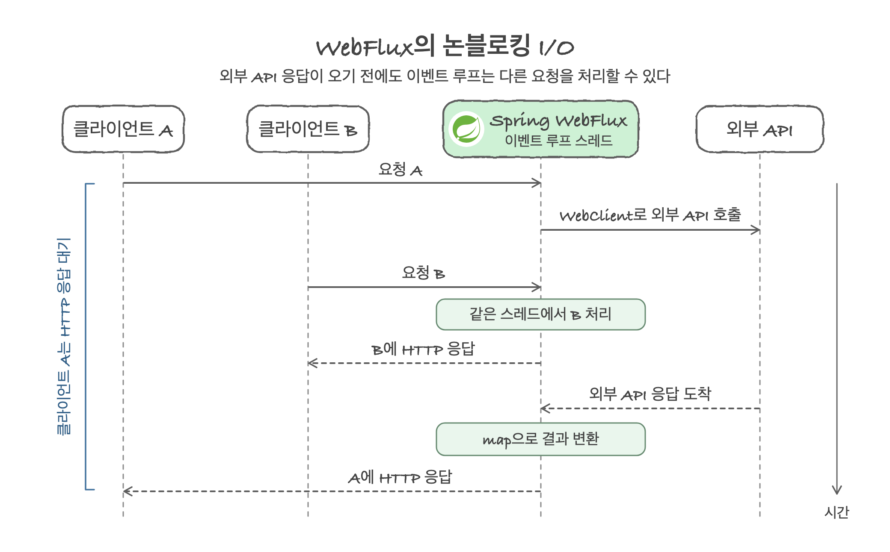
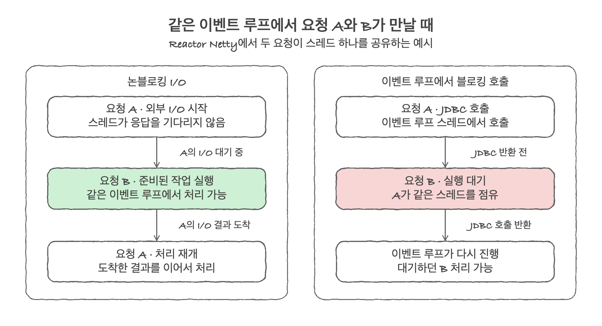
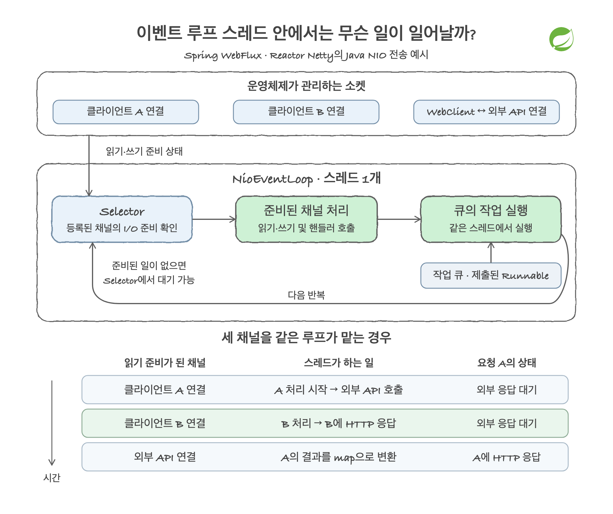

# Reactive Programming and WebFlux Fundamentals

## 1. 데이터가 도착할 때 처리하기

리액티브 프로그래밍에서는 값, 완료, 오류가 신호로 전달되고, 연산자로 그 흐름을 조합한다. 예를 들어 HTTP 응답이나 DB 조회 결과가 도착했을 때 변환을 이어 갈 수 있다. 리액티브 타입은 작업의 결과와 조합 방법을 표현한다. 실행 스레드와 블로킹 여부는 실제 데이터 소스, 연산자, 스케줄러 구성에 따라 결정된다. [Reactor · Flux and Mono](https://projectreactor.io/docs/core/release/reference/coreFeatures/simple-ways-to-create-a-flux-or-mono-and-subscribe-to-it.html)

예시에서 클라이언트 A가 HTTP 응답을 기다리는 동안 같은 이벤트 루프 스레드는 준비된 요청 B를 처리할 수 있다. 외부 API 응답이 도착하면 리액티브 흐름에 선언해 둔 `map`이 결과를 변환하고 WebFlux가 A에 응답한다. [Spring Framework 6.2 · WebFlux Overview](https://docs.spring.io/spring-framework/reference/6.2/web/webflux/new-framework.html)

## 2. Reactive Streams의 계약

| 구성 요소 | 역할 |
| --- | --- |
| `Publisher` | 구독을 받고 요청된 수량 범위에서 값을 전달한다. |
| `Subscriber` | `onSubscribe`, `onNext`, `onError`, `onComplete`로 상태를 받는다. |
| `Subscription` | 구독자가 `request(n)`으로 수요를 추가하고 `cancel()`로 중단하는 통로다. |
| `Processor` | 상류에는 구독자, 하류에는 발행자로 동작할 수 있다. |

`request(n)`은 한 번에 전달 가능한 수량을 누적한다. 값이 없는 스트림도 완료 또는 오류 신호를 보낼 수 있다. 완료와 오류는 각각 스트림을 끝내는 신호다. [Reactive Streams JVM 명세](https://github.com/reactive-streams/reactive-streams-jvm/tree/v1.0.4)

## 3. 배압으로 메모리 사용 제어하기

배압(backpressure)은 처리할 수 있는 양을 상류로 전달해 생산과 소비 속도를 맞추는 방법이다. 소스가 그 요청을 반영할 수 있어야 대기열이 계속 커지는 것을 막을 수 있다. 밀어내는 방식의 입력에서는 제한된 버퍼, 일부 이벤트 폐기, 최신 값 유지, 실패 중에서 데이터의 의미에 맞는 정책을 선택한다. 연산자의 사전 요청, 동시 작업 수, 요청별 버퍼도 함께 제한해야 전체 메모리 사용량을 관리할 수 있다. [Reactive Streams · Goals and Design](https://github.com/reactive-streams/reactive-streams-jvm/tree/v1.0.4) · [Reactor · Backpressure and Demand](https://projectreactor.io/docs/core/release/reference/coreFeatures/simple-ways-to-create-a-flux-or-mono-and-subscribe-to-it.html)

## 4. Spring MVC와 Spring WebFlux의 실행 모델

MVC는 서블릿 기반이며 블로킹 호출을 쓰는 애플리케이션에 맞는 스레드 모델을 사용한다. 비동기 응답도 지원한다. WebFlux는 논블로킹 I/O를 전제로 하며 Reactor Netty 구성에서는 적은 수의 이벤트 루프 스레드가 여러 연결의 작업을 처리한다. WebFlux 핸들러에서 JDBC를 호출하거나 `block()`을 실행하면 같은 이벤트 루프를 공유하는 요청에도 지연이 생길 수 있다. 블로킹 연동이 필요한 구간은 별도의 제한된 실행기로 옮기고 대기열과 동시 실행 한도를 함께 관리한다. [Spring Framework 6.2 · WebFlux Overview](https://docs.spring.io/spring-framework/reference/6.2/web/webflux/new-framework.html) · [Reactor · Wrapping a Blocking Call](https://projectreactor.io/docs/core/release/reference/faq.html)

Netty가 Java NIO 전송을 사용할 때 `NioEventLoop`의 한 스레드는 `Selector`로 등록된 여러 채널의 I/O 준비 상태를 확인하고, 준비된 채널의 핸들러와 작업 큐에 제출된 코드를 실행하는 과정을 반복한다. 준비된 I/O나 실행할 작업이 없으면 `Selector`에서 대기할 수 있고, 채널이 준비되거나 새 작업이 스레드를 깨우면 처리를 이어 간다. [Netty 4.1 · NioEventLoop](https://netty.io/4.1/xref/io/netty/channel/nio/NioEventLoop.html#504) · [Java NIO · Selector](https://docs.oracle.com/en/java/javase/21/docs/api/java.base/java/nio/channels/Selector.html)

Spring Boot 3.5는 MVC와 WebFlux 스타터가 모두 있으면 기본적으로 MVC를 선택한다. 어떤 웹 스택을 시작했는지 확인한 뒤 컨트롤러, DB 드라이버, 외부 호출 클라이언트의 동작을 한 요청 흐름에서 살펴본다. [Spring Boot 3.5 · Reactive Web Applications](https://docs.spring.io/spring-boot/3.5/reference/web/reactive.html)
