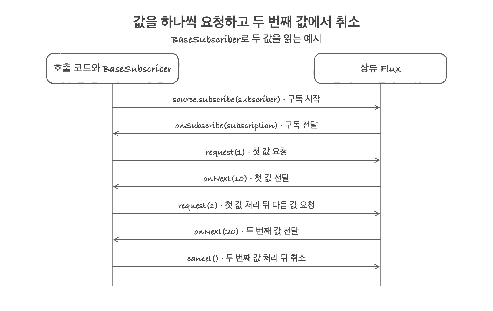

# Reactor Mono, Flux, and Subscription

## 1. 결과의 개수에 맞는 타입 고르기

`Mono<T>`는 최대 한 값, `Flux<T>`는 0개 이상의 값을 표현한다. 상품 상세 조회에는 `Mono<Item>`, 상품 목록이나 실시간 이벤트에는 `Flux<Item>`를 사용할 수 있다. `Mono.empty()`는 값 없이 성공적으로 완료되는 신호다. 실패는 `Mono.error(...)`나 `Flux.error(...)`로 표현한다. [Reactor · Flux and Mono](https://projectreactor.io/docs/core/release/reference/coreFeatures/simple-ways-to-create-a-flux-or-mono-and-subscribe-to-it.html)

객체가 이미 있으면 `Mono.just(value)`, 구독마다 결과를 다시 구해야 하면 `Mono.defer(...)` 또는 계산식에 맞는 팩터리를 사용한다. `Mono.just(loadItem())`의 인자는 조립 시점에 평가된다. 스트림을 조립하는 것과 구독으로 실행하는 것을 구분하면 반복 실행이나 캐시의 범위를 판단할 수 있다. [Reactor · Hot and Cold](https://projectreactor.io/docs/core/release/reference/advancedFeatures/reactor-hotCold.html)

## 2. 구독, 수요, 취소 연결하기

대부분의 람다 기반 `subscribe(...)`는 제한 없는 수요로 시작한다. 직접 수요를 조절하려면 `BaseSubscriber`에서 필요한 수량을 요청할 수 있다. 다음 예제는 하나씩 요청하고 두 값을 받으면 취소한다. 값의 가공과 종료를 스트림에 선언할 수 있다면 `take(2)`도 사용할 수 있다. [Reactor · BaseSubscriber and Demand](https://projectreactor.io/docs/core/release/reference/coreFeatures/simple-ways-to-create-a-flux-or-mono-and-subscribe-to-it.html)

```java
import java.util.function.Consumer;

import org.reactivestreams.Subscription;
import reactor.core.publisher.BaseSubscriber;
import reactor.core.publisher.Flux;

public class DemandExample {

    public static void readTwo(Flux<Integer> source, Consumer<Integer> handle) {
        source.subscribe(new BaseSubscriber<Integer>() {
            private int received;

            @Override
            protected void hookOnSubscribe(Subscription subscription) {
                request(1);
            }

            @Override
            protected void hookOnNext(Integer value) {
                handle.accept(value);
                if (++received == 2) {
                    cancel();
                } else {
                    request(1);
                }
            }
        });
    }
}
```



람다로 구독한 경우 반환된 `Disposable`의 `dispose()`로 취소할 수 있다. 취소는 상류에 중단 의사를 전달한다. 비동기 경계에서는 이미 전달 중인 신호와 경합할 수 있으므로 취소와 자원 정리 동작을 테스트한다. `limitRate`는 상류로 보내는 요청을 묶음으로 조정한다. `buffer`, `flatMap` 같은 연산자는 자신이 받는 수요를 상류에 전달할 때 수량을 바꿀 수 있다. [Reactor · Cancelling a Subscribe and Reshaping Requests](https://projectreactor.io/docs/core/release/reference/coreFeatures/simple-ways-to-create-a-flux-or-mono-and-subscribe-to-it.html)

WebFlux 컨트롤러에서는 조합한 `Publisher`를 반환한다. 프레임워크가 응답을 쓸 때 그 스트림을 구독하므로 요청 처리의 취소도 같은 실행 흐름에서 전파될 수 있다. [Spring Framework 6.2 · WebFlux Return Values](https://docs.spring.io/spring-framework/reference/6.2/web/webflux/controller/ann-methods/return-types.html)
