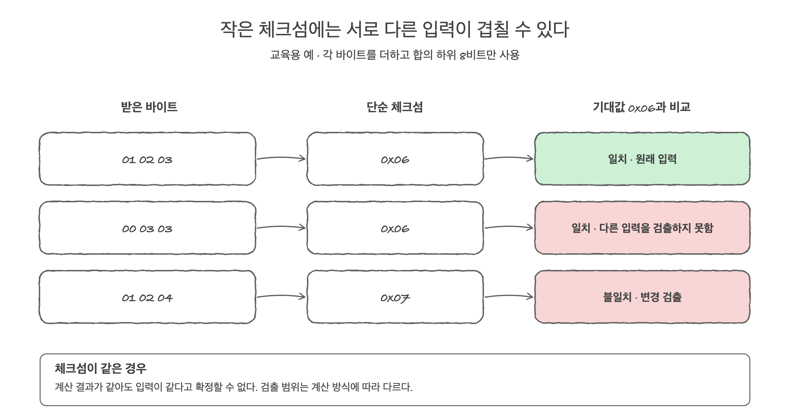
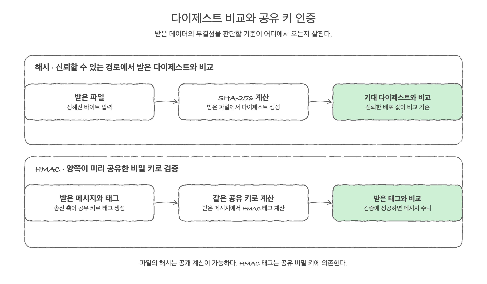

# 체크섬과 암호학적 해시

## 1. 체크섬으로 데이터 오류를 찾기

이름 궁합처럼 긴 입력을 몇 자리 숫자로 줄이면 서로 다른 입력에서도 같은 결과가 나올 수 있다. **체크섬(checksum)**은 데이터를 정해진 규칙으로 계산한 검사용 값이다. 송신 측이 만든 값과 수신 측이 다시 계산한 값을 비교해 전송·저장 과정에서 생긴 일부 오류를 검출한다. 어떤 오류를 발견할 수 있는지는 체크섬 알고리즘에 따라 달라진다. [RFC 1071 §1 · Internet Checksum의 계산과 검증](https://www.rfc-editor.org/rfc/rfc1071.html#section-1)

아래는 바이트의 합에서 하위 8비트만 사용하는 단순 예제다. 첫 번째와 두 번째 입력은 같은 값을 내므로 검사에서 구별되지 않는다. 세 번째는 값이 달라 오류를 발견할 수 있다. 인터넷 체크섬은 16비트 워드의 1의 보수 합을 사용한다. [RFC 1071 §1 · Internet Checksum의 계산과 검증](https://www.rfc-editor.org/rfc/rfc1071.html#section-1)

```text
입력 바이트          합 mod 256
01 02 03           0x06
00 03 03           0x06
01 02 04           0x07
```



간단한 체크섬 예제로 검출되는 변경과 검출되지 않는 변경을 비교했다. [RFC 1071 §1 · Internet Checksum의 계산과 검증](https://www.rfc-editor.org/rfc/rfc1071.html#section-1)

## 2. 해시, 다이제스트와 인증의 차이

**암호학적 해시**는 같은 바이트 입력에서 같은 길이의 다이제스트를 계산한다. 예를 들어 SHA-256의 출력은 256비트이며 16진수로 쓰면 64자리다. 입력이 문자라면 문자 인코딩과 줄바꿈까지 동일해야 같은 바이트가 된다. 다음은 줄바꿈 없이 UTF-8 바이트 `61 62 63`으로 적은 `abc`의 SHA-256이다. [NIST FIPS 180-4 §5–6 · SHA-256과 메시지 다이제스트](https://csrc.nist.gov/pubs/fips/180-4/upd1/final)



해시 비교의 신뢰 기준과 HMAC 검증에서 공유 키가 하는 역할을 나타냈다. [NIST FIPS 180-4 §5–6 · SHA-256과 메시지 다이제스트](https://csrc.nist.gov/pubs/fips/180-4/upd1/final) · [RFC 2104 §1–2 · HMAC의 목적과 구성](https://www.rfc-editor.org/rfc/rfc2104.html#section-1)

```text
ba7816bf8f01cfea414140de5dae2223b00361a396177a9cb410ff61f20015ad
```

- **역상 저항성**은 주어진 다이제스트를 만드는 입력을 찾기 어렵다는 성질이다. **제2역상 저항성**은 이미 알고 있는 입력과 같은 다이제스트를 내는 다른 입력을 찾기 어렵다는 성질이다. **충돌 저항성**은 어떤 두 입력이든 같은 다이제스트를 내는 쌍을 찾기 어렵다는 성질이다. 출력 길이가 유한하므로 충돌 자체는 존재한다. [NIST SP 800-57 Part 1 Rev. 5 · 암호학적 해시와 보안 강도](https://csrc.nist.gov/pubs/sp/800/57/pt1/r5/final) · [NIST Glossary · Cryptographic hash function](https://csrc.nist.gov/glossary/term/cryptographic_hash_function)
- 다운로드 파일을 검사할 때는 신뢰할 수 있는 배포 경로에서 받은 다이제스트를 기대값으로 사용한다. 비밀 키 없이 계산한 해시는 누구나 다시 만들 수 있다. 비밀 키를 이미 공유한 두 시스템이 메시지 무결성과 출처를 확인하려면 **HMAC**처럼 공유 키를 사용하는 MAC을 적용할 수 있다. 공개키로 검증하는 방식은 [전자서명](02_understanding_symmetric_encryption_public_keys_and_signatures.md)에서 다룬다. [NIST FIPS 180-4 · Secure Hash Standard](https://csrc.nist.gov/pubs/fips/180-4/upd1/final) · [RFC 2104 §1–2 · HMAC의 목적과 구성](https://www.rfc-editor.org/rfc/rfc2104.html#section-1)
