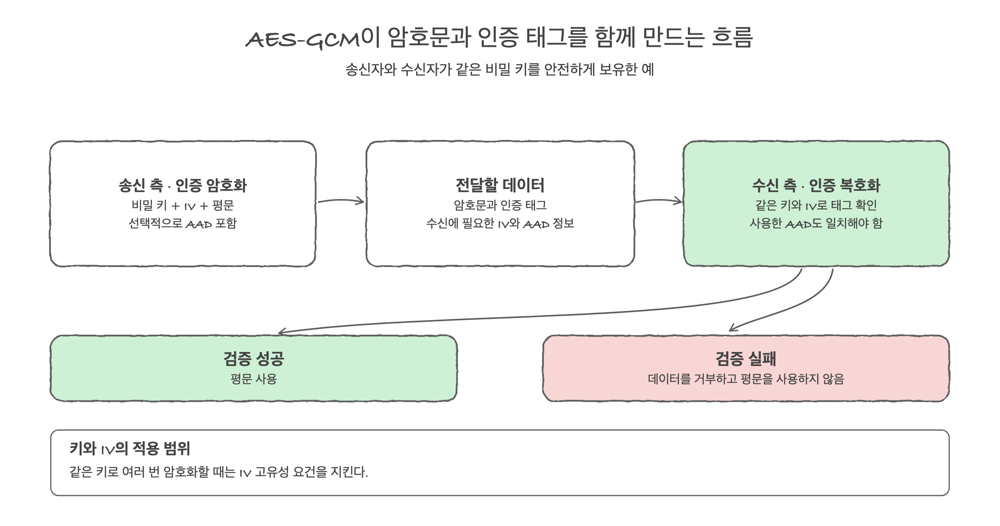
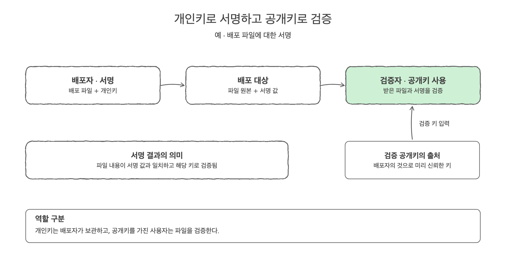

# 대칭키, 공개키 암호와 전자서명

## 1. 대칭키로 데이터를 암호화하고 검증하기

**대칭키 암호화**는 암호화와 복호화에 같은 비밀 키를 사용한다. AES는 블록 암호이고, AES-GCM은 AES와 함께 사용하는 인증 암호화 방식(AEAD)이다. AES-GCM은 평문을 암호문으로 바꾸고 인증 태그를 만든다. 수신자는 복호화 과정에서 태그를 검증하며, 인증에 실패하면 평문을 사용하지 않는다. [NIST FIPS 197 · AES](https://csrc.nist.gov/pubs/fips/197/final) · [NIST SP 800-38D §5.2, §7 · GCM 인증 암호화와 복호화](https://csrc.nist.gov/pubs/sp/800/38/d/final)

AES-GCM에서 암호화와 인증 태그 검증이 연결되는 흐름이다. [NIST FIPS 197 · AES](https://csrc.nist.gov/pubs/fips/197/final) · [NIST SP 800-38D §5.2, §7 · GCM 인증 암호화와 복호화](https://csrc.nist.gov/pubs/sp/800/38/d/final)

AES-GCM의 입력에는 비밀 키 외에 논스(IV)가 포함된다. 같은 키로 암호화할 때는 IV 고유성 요건을 지켜야 한다. 암호화할 필요는 없지만 무결성을 확인해야 하는 헤더를 연관 데이터(AAD)로 포함할 수도 있다. 서로 다른 시스템이 비밀 키를 안전하게 보유하거나 파생하는 방법은 암호화 방식과 함께 설계한다. [NIST SP 800-38D §5.2, §8 · GCM의 AAD와 IV 고유성 요건](https://csrc.nist.gov/pubs/sp/800/38/d/final)

## 2. 공개키와 개인키의 용도를 구분하기

**공개키 암호**는 공개할 수 있는 키와 소유자만 보관하는 개인키를 사용한다. 공개키를 이용하는 방식이라도 목적에 따라 알고리즘과 키 용도가 달라진다. 예를 들어 공개키 암호화 방식인 RSA-OAEP는 수신자의 공개키로 암호화하고 수신자가 자신의 개인키로 복호화한다. ECDHE는 양쪽이 교환한 공개 값과 자신만의 임시 비밀 값으로 공통 비밀을 계산하는 키 합의 방식이다. [RFC 8017 §7.1 · RSAES-OAEP](https://www.rfc-editor.org/rfc/rfc8017.html#section-7.1) · [RFC 9846 §4.2.8, §7.4 · TLS의 키 공유와 (EC)DHE](https://datatracker.ietf.org/doc/html/rfc9846#section-4.2.8)

공개키를 사용하기 전에 그 키가 교신하려는 상대의 것인지 확인해야 한다. 인증과 연결되지 않은 키 합의는 두 장치가 비밀을 계산할 수 있게 해 주지만, 상대의 신원은 따로 확인해야 한다. TLS에서는 인증서, 전자서명, 신뢰 경로 검증을 사용해 이 역할을 나눈다. [RFC 9846 §2, §4.4 · 키 교환과 인증](https://datatracker.ietf.org/doc/html/rfc9846#section-4.4) · [RFC 5280 §6 · 인증 경로 검증](https://www.rfc-editor.org/rfc/rfc5280.html#section-6)

## 3. 전자서명으로 내용과 서명 키 확인하기

**전자서명(digital signature)**은 서명자가 개인키로 메시지에 대한 서명 값을 만든 뒤 검증자가 대응하는 공개키로 서명과 메시지를 검증하는 방식이다. 검증에 성공하면 해당 공개키에 대응하는 개인키로 만든 서명과 메시지가 일치함을 확인할 수 있다. 메시지 자체를 숨기려면 암호화를 별도로 사용한다. 서명자를 특정하려면 검증 공개키를 그 주체에 연결하는 신뢰 근거도 필요하다. [NIST FIPS 186-5 §3–4 · Digital Signature Standard](https://csrc.nist.gov/pubs/fips/186-5/final) · [RFC 5280 §6 · 인증 경로 검증](https://www.rfc-editor.org/rfc/rfc5280.html#section-6)

서명 생성, 배포, 공개키 검증의 경계를 그렸다. [NIST FIPS 186-5 §3–4 · Digital Signature Standard](https://csrc.nist.gov/pubs/fips/186-5/final) · [RFC 5280 §6 · 인증 경로 검증](https://www.rfc-editor.org/rfc/rfc5280.html#section-6)

예를 들어 배포자가 배포 파일에 서명하면, 사용자는 배포자의 것으로 신뢰한 공개키로 받은 파일과 서명을 함께 검증한다. 파일이 변경되거나 서명과 공개키가 일치하지 않으면 검증에 실패한다. 양쪽이 같은 비밀 키를 가진 HMAC과 달리, 공개키만 가진 검증자는 그 키로 새 서명을 만들 수 없다. [NIST FIPS 186-5 §3–4 · 서명 생성과 검증](https://csrc.nist.gov/pubs/fips/186-5/final) · [RFC 2104 §1 · 공유 키 기반 메시지 인증](https://www.rfc-editor.org/rfc/rfc2104.html#section-1)
