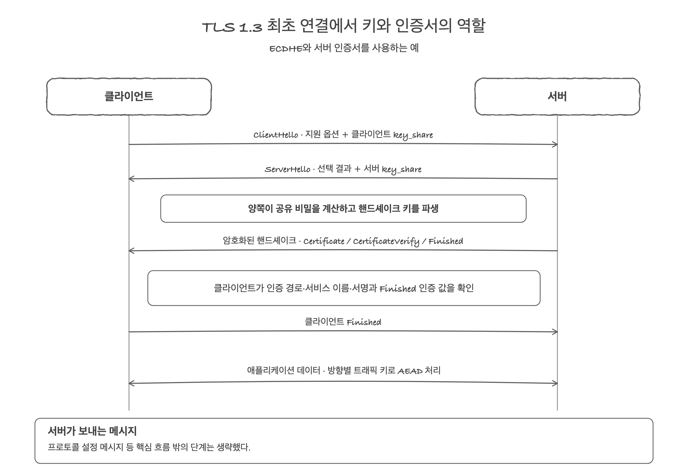
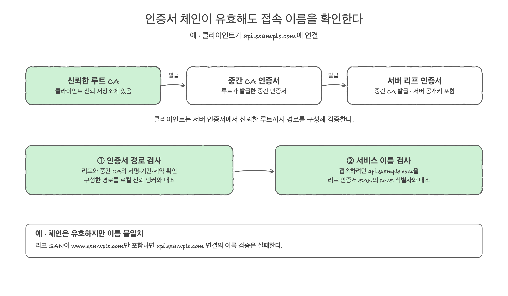

# 웹 PKI와 TLS로 서버를 인증하고 통신 보호하기

## 1. 인터넷에서 서비스 이름과 공개키 연결하기

HTTPS는 HTTP 통신을 TLS로 보호한다. 새 HTTPS 연결을 만들 때 클라이언트는 연결할 이름(예: `api.example.com`)을 기준으로 서버가 제시한 인증서를 확인한다. 서버 인증서는 서비스 식별자와 공개키를 담고, 발급자의 서명으로 이 정보를 묶는다. TLS 핸드셰이크는 서버가 인증서에 대응하는 개인키를 가진 주체인지도 검증한다. [RFC 9110 §4.2.2 · HTTPS URI](https://www.rfc-editor.org/rfc/rfc9110.html#section-4.2.2) · [RFC 9525 §6 · 서비스 식별자 검증](https://www.rfc-editor.org/rfc/rfc9525.html#section-6) · [RFC 9846 §4.4.3 · CertificateVerify](https://datatracker.ietf.org/doc/html/rfc9846#section-4.4.3)

SSL은 TLS의 전신이다. SSL 3.0은 사용이 금지됐고, 일반적인 웹 서비스의 현대 구성은 TLS를 사용한다. 이 문서는 TLS 1.3을 정리하며, IETF는 2026년 7월 발행한 RFC 9846으로 기존 TLS 1.3 명세 RFC 8446을 대체했다. [RFC 7568 §3 · SSL 3.0 사용 금지](https://www.rfc-editor.org/rfc/rfc7568.html#section-3) · [IETF · RFC 9846 상태와 대체 관계](https://datatracker.ietf.org/doc/rfc9846/)

## 2. TLS 1.3에서 키 합의, 서명과 대칭키를 함께 쓰기

아래는 **서버 인증서를 사용하는 TLS 1.3 최초 연결**의 예다. 클라이언트와 서버는 `ClientHello`와 `ServerHello`에서 지원 옵션과 임시 공개 값(`key_share`)을 교환한다. ECDHE를 선택했다면 양쪽은 공유 비밀을 계산하고, TLS 키 스케줄이 이 비밀과 핸드셰이크 정보를 사용해 각 방향의 키를 파생한다. [RFC 9846 §2 · Protocol Overview](https://datatracker.ietf.org/doc/html/rfc9846#section-2) · [RFC 9846 §7.1 · Key Schedule](https://datatracker.ietf.org/doc/html/rfc9846#section-7.1)

서버는 `ServerHello` 다음의 암호화된 핸드셰이크에서 `Certificate`, `CertificateVerify`, `Finished`를 보낸다. 클라이언트는 인증 경로와 서비스 이름을 확인하고 `CertificateVerify`의 서명과 `Finished`의 인증 값을 검증한다. 클라이언트도 `Finished`를 보내며, 이후 애플리케이션 데이터는 AES-GCM 같은 대칭키 AEAD로 보호된다. 여기서 서버 인증서의 키는 서명에 쓰이고, ECDHE의 임시 키는 공유 비밀을 만드는 데 쓰인다. [RFC 9846 §4.4 · 인증 메시지](https://datatracker.ietf.org/doc/html/rfc9846#section-4.4) · [RFC 9846 §5.2 · TLS Record Payload Protection](https://datatracker.ietf.org/doc/html/rfc9846#section-5.2)

서버 인증서를 쓰는 최초 TLS 1.3 연결에서 키 합의, 서버 인증, 레코드 보호의 순서를 표시했다. [RFC 9846 §2 · Protocol Overview](https://datatracker.ietf.org/doc/html/rfc9846#section-2) · [RFC 9846 §7.1 · Key Schedule](https://datatracker.ietf.org/doc/html/rfc9846#section-7.1) · [RFC 9846 §4.4 · 인증 메시지](https://datatracker.ietf.org/doc/html/rfc9846#section-4.4) · [RFC 9846 §5.2 · TLS Record Payload Protection](https://datatracker.ietf.org/doc/html/rfc9846#section-5.2)

## 3. 공개키를 받은 뒤에도 신뢰를 확인해야 하는 이유

공개키는 공개할 수 있지만, 공개키를 받았다는 사실만으로 소유자의 이름이 증명되지는 않는다. TLS 클라이언트는 연결하려고 했던 이름을 기준으로 인증서의 식별자를 검증하고, 신뢰하는 인증 기관까지 연결되는 경로를 검사한다. 서명 검증은 제시된 키가 실제 핸드셰이크에 사용됐음을 확인한다. 세 가지 검증을 거치면 인증 경로, 서비스 이름, 키 사용이 서로 맞아야 연결을 신뢰할 수 있다. [RFC 5280 §6 · 인증 경로 검증](https://www.rfc-editor.org/rfc/rfc5280.html#section-6) · [RFC 9525 §6 · 서비스 식별자 검증](https://www.rfc-editor.org/rfc/rfc9525.html#section-6) · [RFC 9846 §4.4.3 · CertificateVerify](https://datatracker.ietf.org/doc/html/rfc9846#section-4.4.3)

## 4. 인증서 체인과 서비스 이름 검증하기

**PKI(Public Key Infrastructure)**에는 인증서를 발급하는 CA와 각 인증서의 유효성을 판단하는 정책이 있다. 예를 들어 서버의 리프 인증서를 중간 CA가 서명하고, 클라이언트는 로컬 신뢰 저장소의 루트에 이르는 인증 경로를 검증한다. 경로 검증에는 각 인증서의 서명, 유효 기간, CA 조건과 제약 사항 확인이 포함된다. 서버는 일반적으로 리프와 필요한 중간 인증서를 보내고, 루트에 대한 신뢰는 클라이언트에 미리 설정되어 있다. [RFC 5280 §4.2, §6 · 인증서 확장과 경로 검증](https://www.rfc-editor.org/rfc/rfc5280.html#section-6) · [RFC 9846 §4.4.2 · 인증서 목록](https://datatracker.ietf.org/doc/html/rfc9846#section-4.4.2)

인증 경로 검증 뒤 서비스 이름도 맞아야 한다. `api.example.com`에 연결하는 예에서 클라이언트는 인증서의 `subjectAltName`에 대상 이름과 일치하는 DNS 식별자가 있는지 확인한다. RFC 9525의 서비스 식별 검증에서는 `commonName`을 대체 이름으로 사용하지 않는다. 유효한 체인이라도 다른 이름의 인증서라면 이 검증에서 실패한다. [RFC 9525 §4, §6 · SAN 식별자와 이름 비교](https://www.rfc-editor.org/rfc/rfc9525.html#section-6)

인증서의 발급 경로와 접속 이름의 검증을 각각 그렸다. [RFC 5280 §4.2, §6 · 인증서 확장과 경로 검증](https://www.rfc-editor.org/rfc/rfc5280.html#section-6) · [RFC 9846 §4.4.2 · 인증서 목록](https://datatracker.ietf.org/doc/html/rfc9846#section-4.4.2) · [RFC 9525 §4, §6 · SAN 식별자와 이름 비교](https://www.rfc-editor.org/rfc/rfc9525.html#section-6)

## 5. 웹 서버 인증서 발급과 운영 점검

공개 HTTPS 서비스에 사용하는 공인 CA 인증서는 웹 서버의 이름과 공개키를 연결한다. 서비스 운영자는 공개적으로 신뢰되는 웹 PKI를 사용하거나, 접속자가 조직에서 관리하는 환경이면 그 환경이 신뢰하는 내부 PKI를 사용할 수 있다. 공개 인증서 발급에서는 ACME로 도메인 제어권 검증과 인증서 발급·갱신을 자동화할 수 있다. [CA/Browser Forum · TLS Baseline Requirements의 공개 신뢰 범위와 도메인 검증](https://cabforum.org/working-groups/server/baseline-requirements/requirements/) · [RFC 8555 §7–8 · ACME 인증과 Challenge](https://www.rfc-editor.org/rfc/rfc8555.html#section-7)

갱신이나 배포 후에는 클라이언트가 접속할 실제 이름에서 현재 제공되는 인증서를 확인한다. 이어서 SAN, 만료일, 필요한 중간 인증서가 전달되는지 살핀다. 예를 들어 로드 밸런서에서 TLS를 종료한다면 외부 연결에 쓰이는 인증서는 로드 밸런서에 배치된 인증서다. 백엔드 구간에서도 별도로 TLS를 사용한다면 그 구간의 대상 이름과 신뢰 설정도 확인한다. 웹 서버 인증서는 서버의 이름 검증을 위한 것이고, 클라이언트 인증서나 문서에 서명하는 인증서는 각각의 용도와 신뢰 체계에서 다룬다. [RFC 5280 §4.2.1.12 · Extended Key Usage](https://www.rfc-editor.org/rfc/rfc5280.html#section-4.2.1.12) · [RFC 9525 §6 · 서비스 식별자 검증](https://www.rfc-editor.org/rfc/rfc9525.html#section-6) · [RFC 9846 §4.4.2 · 서버 및 클라이언트 인증서](https://datatracker.ietf.org/doc/html/rfc9846#section-4.4.2)
