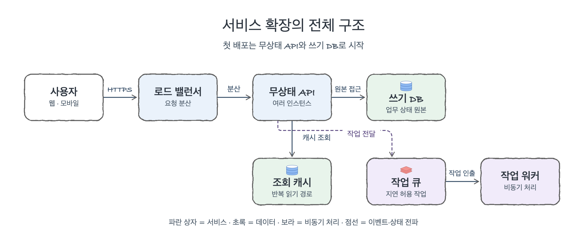

# Designing Services for a Million Users

가입자 100만 명은 확장 규모를 설명하는 가정이다. 용량은 활성 사용자, 요청 피크, 데이터 크기와 기능별 비용으로 정한다. 먼저 대표 여정의 성공률과 지연 목표를 정의한다. [Google SRE · Implementing SLOs](https://sre.google/workbook/implementing-slos/) · [Google SRE · Handling Overload](https://sre.google/sre-book/handling-overload/)

그림의 근거 · [Google SRE · Handling Overload](https://sre.google/sre-book/handling-overload/) · [Microsoft Cache-Aside](https://learn.microsoft.com/en-us/azure/architecture/patterns/cache-aside) · [Microsoft Queue-Based Load Leveling](https://learn.microsoft.com/en-us/azure/architecture/patterns/queue-based-load-leveling) · [Microsoft Microservice Boundaries](https://learn.microsoft.com/en-us/azure/architecture/microservices/model/microservice-boundaries)

## 1. 초기 서비스의 경계를 단순하게 잡는다

예제의 첫 배포는 로드 밸런서 뒤의 무상태 API와 단일 쓰기 DB로 시작한다. 로그인 세션은 공유 저장소 또는 검증 가능한 토큰에 두고, 서버의 로컬 디스크를 세션 원본으로 쓰는 경우 재배포와 장애 때의 동작을 별도로 설계한다. [Google SRE · Handling Overload](https://sre.google/sre-book/handling-overload/) · [Microsoft Microservice Boundaries](https://learn.microsoft.com/en-us/azure/architecture/microservices/model/microservice-boundaries)

## 2. 병목에 따라 확장 지점을 고른다

| 관측 징후 | 먼저 비교할 선택 | 근거 |
| --- | --- | --- |
| API가 포화되고 DB 여유가 있음 | 무상태 인스턴스 확장 및 부하 분산을 시험한다. | [Google SRE · Handling Overload](https://sre.google/sre-book/handling-overload/) · [Google SRE · Monitoring Distributed Systems](https://sre.google/sre-book/monitoring-distributed-systems/) |
| 반복 조회와 DB 읽기가 많음 | 인덱스·쿼리 개선과 캐시를 비교한다. 읽기 복제본은 최신성이 허용되는 경로에 붙인다. | [Microsoft Cache-Aside](https://learn.microsoft.com/en-us/azure/architecture/patterns/cache-aside) · [Google SRE · Implementing SLOs](https://sre.google/workbook/implementing-slos/) |
| 쓰기가 집중되거나 피크가 짧음 | 원인 쿼리와 핫 키부터 조사한다. 즉시 결과가 필요 없는 작업에는 큐를 검토한다. | [Google SRE · Handling Overload](https://sre.google/sre-book/handling-overload/) · [Microsoft Queue-Based Load Leveling](https://learn.microsoft.com/en-us/azure/architecture/patterns/queue-based-load-leveling) |

## 3. 장애와 확장을 동시에 검증한다

한 API 인스턴스가 빠진 상태에서 목표 트래픽을 보내고, p95 지연·오류율·DB 대기·큐 최장 체류 시간을 비교한다. 지연이 개선되는 지점과 새로 포화되는 지점을 다음 설계의 기준으로 기록한다. [Google SRE · Monitoring Distributed Systems](https://sre.google/sre-book/monitoring-distributed-systems/) · [Google SRE · Implementing SLOs](https://sre.google/workbook/implementing-slos/) · [Google SRE · Handling Overload](https://sre.google/sre-book/handling-overload/)

## 4. 주제별 읽기

| 범위 | 시작할 문서 | 근거 |
| --- | --- | --- |
| 01~04 기초 | [대략적 용량 계산](02_estimating_system_capacity_with_rough_calculations.md)과 [시스템 디자인 프레임워크](03_applying_a_system_design_framework.md) | [Google SRE · Handling Overload](https://sre.google/sre-book/handling-overload/) · [Google SRE · Implementing SLOs](https://sre.google/workbook/implementing-slos/) |
| 05~11 핵심 구성요소 | [분산 속도 조절기](05_designing_a_distributed_rate_limiter.md), [키–값 저장소](08_designing_a_distributed_key_value_store.md), [CDN과 GSLB](11_designing_content_delivery_and_global_load_balancing.md) | [RFC 6585](https://www.rfc-editor.org/rfc/rfc6585.html#section-4) · [Amazon · Dynamo](https://www.amazon.science/publications/dynamo-amazons-highly-available-key-value-store) · [AWS Route 53 DNS Failover](https://docs.aws.amazon.com/Route53/latest/DeveloperGuide/dns-failover.html) |
| 12~20 서비스 사례 I | [URL 단축기](12_designing_a_url_shortener.md), [뉴스 피드](15_designing_a_news_feed.md), [동영상 플랫폼](18_designing_a_video_on_demand_platform.md) | [RFC 9110 HTTP Semantics](https://www.rfc-editor.org/rfc/rfc9110.html) · [AWS Transactional Outbox](https://docs.aws.amazon.com/prescriptive-guidance/latest/cloud-design-patterns/transactional-outbox.html) · [AWS Video on Demand](https://docs.aws.amazon.com/solutions/latest/video-on-demand-on-aws/architecture-overview.html) |
| 21~27 서비스 사례 II | [광고 클릭 집계](21_aggregating_ad_clicks_at_scale.md), [좌석 예매](22_designing_a_ticket_reservation_service.md), [종단간 암호화 메신저](27_designing_an_end_to_end_encrypted_messaging_service.md) | [Flink 2.2 Windows](https://nightlies.apache.org/flink/flink-docs-release-2.2/docs/dev/datastream/operators/windows/) · [PostgreSQL 18 SELECT](https://www.postgresql.org/docs/18/sql-select.html#SQL-FOR-UPDATE-SHARE) · [Signal Sesame](https://signal.org/docs/specifications/sesame/) |

## 5. 주제별 설계 사례를 더 살펴본다

- **위치 검색·공유와 지도** — [28 반경 검색](28_designing_a_proximity_search_service.md), [29 주변 친구](29_designing_a_nearby_friends_service.md), [30 지도·경로](30_designing_a_map_and_routing_service.md)
- **데이터 수집·처리와 보관** — [31 메시지 로그](31_designing_a_distributed_message_log.md), [32 지표·경보](32_designing_a_metrics_and_alerting_system.md), [21 광고 클릭 집계](21_aggregating_ad_clicks_at_scale.md), [35 객체 저장소](35_designing_an_object_storage_service.md)
- **운영과 제품 사례** — [33 호텔 예약](33_designing_a_hotel_reservation_service.md), [34 분산 이메일](34_designing_a_distributed_email_service.md), [36 게임 랭킹](36_designing_a_realtime_game_leaderboard.md), [37 거래소 매칭](37_designing_an_exchange_matching_engine.md)
- **결제와 지갑** — [결제 시스템 설계](../payment-system/01_designing_a_payment_system.md), [Wallet Service](../payment-system/06_building_a_wallet_service.md), [복식 원장](../payment-system/07_building_a_double_entry_ledger.md)
