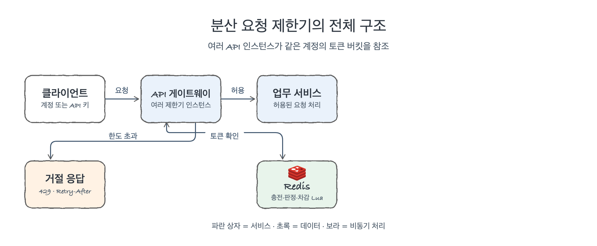

# Designing a Distributed Rate Limiter

Rate Limiter는 계정, API 키 또는 경로별로 요청 허용량을 관리한다. 과금 기능과 공개 검색처럼 처리 비용과 요구가 다르면 각각의 제한 정책을 둔다. [Google SRE · Handling Overload](https://sre.google/sre-book/handling-overload/) · [RFC 6585](https://www.rfc-editor.org/rfc/rfc6585.html#section-4)

그림의 근거 · [RFC 6585](https://www.rfc-editor.org/rfc/rfc6585.html#section-4) · [Redis Lua Scripting](https://redis.io/docs/latest/develop/programmability/eval-intro/) · [Google SRE · Handling Overload](https://sre.google/sre-book/handling-overload/) · [AWS Backoff and Jitter](https://aws.amazon.com/builders-library/timeouts-retries-and-backoff-with-jitter/)

## 1. 버스트와 평균 허용량을 각각 정한다

토큰 버킷 예에서는 용량 20, 초당 충전량 10을 둔다. 버킷이 가득 차면 순간적으로 20건을 허용할 수 있고, 소진 뒤에는 충전 속도가 지속 허용량을 정한다. 허용 여부를 판정할 때 경과 시간으로 토큰을 채우고 비용만큼 차감한다. [AWS Backoff and Jitter](https://aws.amazon.com/builders-library/timeouts-retries-and-backoff-with-jitter/) · [Google SRE · Handling Overload](https://sre.google/sre-book/handling-overload/)

## 2. 여러 API 서버가 같은 제한 상태를 본다

Redis를 공유한다면 충전·허용 여부 판정·차감을 한 Lua 실행으로 묶는다. Redis Cluster에서 여러 키를 함께 사용하는 경우 같은 슬롯 조건을 만족시킨다. 지역별 버킷을 쓰면 글로벌 한도와 지역 합계의 차이를 허용 오차로 관리한다. [Redis Lua Scripting](https://redis.io/docs/latest/develop/programmability/eval-intro/) · [Redis Multi-Key Operations](https://redis.io/docs/latest/develop/using-commands/multi-key-operations/) · [Amazon · Dynamo](https://www.amazon.science/publications/dynamo-amazons-highly-available-key-value-store)

## 3. 거절과 제한기 장애의 정책을 정한다

한도를 넘은 요청에는 429를 반환하고 대기 시간을 계산할 수 있으면 Retry-After를 쓴다. 제한기 저장소가 불능일 경우 저위험 조회의 임시 허용과 비용이 큰 요청의 제한을 서비스 정책으로 구분한다. [RFC 6585](https://www.rfc-editor.org/rfc/rfc6585.html#section-4) · [Google SRE · Handling Overload](https://sre.google/sre-book/handling-overload/)

정상·버스트 트래픽과 저장소 장애를 별도로 시험한다. 허용 수, 차단 수, 정상 트래픽의 오탐과 제한기가 추가한 지연을 확인한다. [Google SRE · Handling Overload](https://sre.google/sre-book/handling-overload/) · [Google SRE · Monitoring Distributed Systems](https://sre.google/sre-book/monitoring-distributed-systems/)
