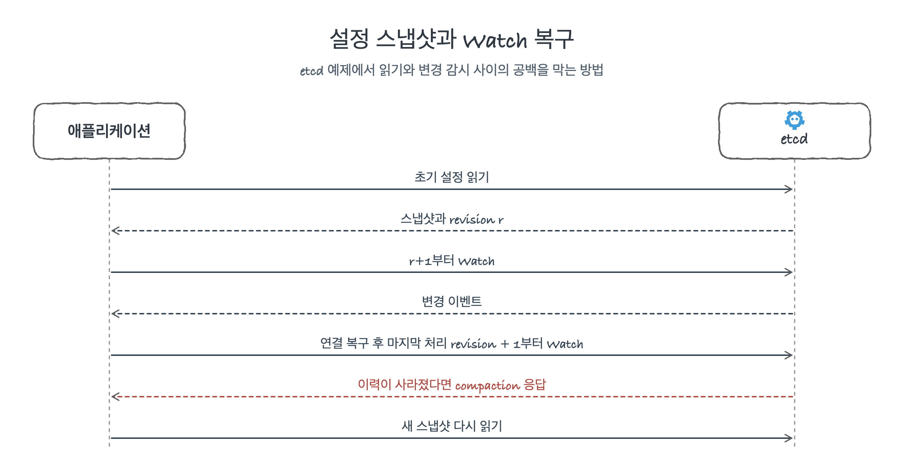

# Rolling Out Dynamic Configuration

동적 설정은 배포 없이 값이 바뀌는 경로다. 설정 오류 역시 곧바로 서비스 영향으로 이어지므로 검증, 배포 범위, 되돌리기 단위를 설정과 함께 정의한다. [etcd 3.6 API](https://etcd.io/docs/v3.6/learning/api/) · [AWS AppConfig Rollback](https://docs.aws.amazon.com/appconfig/latest/userguide/monitoring-deployments.html)

## 1. 업무 설정을 하나의 버전으로 배포한다

스키마 검증을 통과한 설정 묶음에 버전을 부여한다. 애플리케이션은 값을 하나씩 갈아 끼우는 대신 필요한 값을 모두 검증한 뒤 스냅샷을 교체한다. 잘못된 새 버전은 거부하고 마지막 정상 버전과 거부 이유를 남긴다. [etcd 3.6 API](https://etcd.io/docs/v3.6/learning/api/) · [AWS AppConfig Rollback](https://docs.aws.amazon.com/appconfig/latest/userguide/monitoring-deployments.html)

## 2. 초기 읽기와 변경 감시를 연결한다

etcd에서 초기 상태와 응답 revision r을 읽고 r+1부터 Watch를 시작하는 예를 쓸 수 있다. 끊겼을 때 마지막 처리 revision 이후부터 이어 읽고, 해당 이력이 compaction으로 사라졌으면 스냅샷을 다시 읽는다. [etcd 3.6 API](https://etcd.io/docs/v3.6/learning/api/)

그림의 근거 · [etcd 3.6 API](https://etcd.io/docs/v3.6/learning/api/)

## 3. 카나리, 롤백과 설정 버전 관측

일부 인스턴스에만 먼저 적용해 오류·지연을 비교한다. 설정 버전을 로그나 상태 지표로 남겨 구버전 인스턴스를 찾고, 실패하면 확인된 이전 설정 값으로 새 버전을 발행한다. 롤백 요청이 모든 인스턴스에 반영될 때까지 관측한다. [AWS AppConfig Rollback](https://docs.aws.amazon.com/appconfig/latest/userguide/monitoring-deployments.html) · [Google SRE · Monitoring Distributed Systems](https://sre.google/sre-book/monitoring-distributed-systems/)
