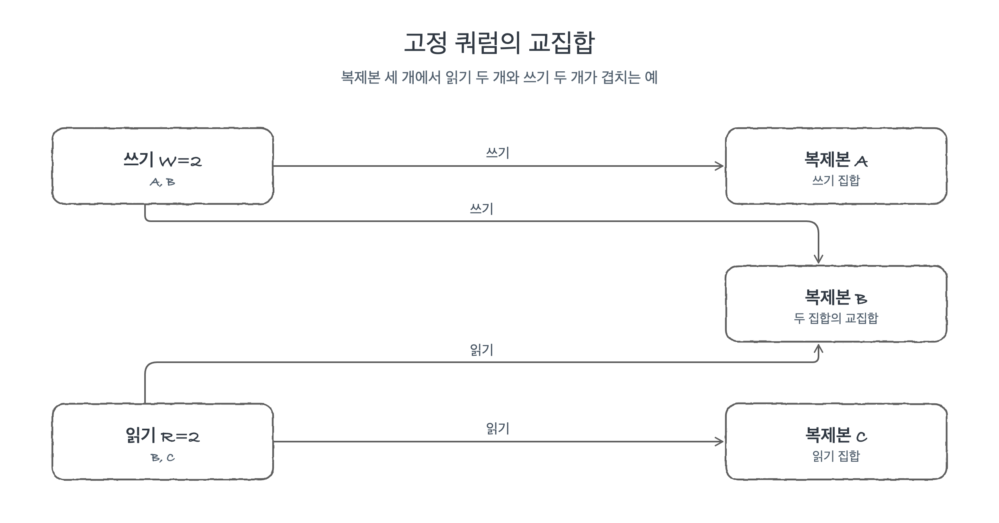

# Designing a Distributed Key-Value Store

키–값 저장소에서는 키 단위 읽기·쓰기 계약과 장애 중 허용할 읽기 값을 먼저 정한다. 예제는 해시 파티션과 복제본을 이용하며, 구체적인 충돌 해결은 값의 업무 의미에 맞춰 선택한다. [Amazon · Dynamo](https://www.amazon.science/publications/dynamo-amazons-highly-available-key-value-store)

## 1. 라우팅과 복제를 구성한다

키 해시로 파티션을 찾고 여러 장애 영역에 복제본을 둔다. 해시 범위를 나누면 많은 키의 요청을 분산할 수 있지만 한 키의 집중은 별도로 다뤄야 한다. 저장소 장애 때는 어느 복제본이 읽기·쓰기를 처리할지 정한다. [Amazon · Dynamo](https://www.amazon.science/publications/dynamo-amazons-highly-available-key-value-store) · [Google SRE · Handling Overload](https://sre.google/sre-book/handling-overload/)

## 2. 쿼럼과 충돌 해결을 분리한다

같은 고정 복제 집합 N=3에서 R=2, W=2는 두 집합의 교집합을 만든다. 장애 중 대체 노드에 저장하는 sloppy quorum이나 동시에 발생한 쓰기까지 포함하면 추가 조건이 필요하다. 업무에서 충돌을 병합할지, 버전을 비교할지, 한 작성자에게 순서를 맡길지 정한다. [Amazon · Dynamo](https://www.amazon.science/publications/dynamo-amazons-highly-available-key-value-store)

그림의 근거 · [Amazon · Dynamo](https://www.amazon.science/publications/dynamo-amazons-highly-available-key-value-store)

## 3. 복제본의 수렴과 삭제를 검증한다

복구한 노드는 버전과 값의 차이를 대조한다. 삭제를 전파할 때는 삭제 표시를 남기고, 이전 값이 다시 살아나지 않도록 복제·대조 완료 조건을 확인한 뒤 제거한다. 노드 손실·네트워크 분리·재합류 순서에서 최신성과 오류율을 측정한다. [Amazon · Dynamo](https://www.amazon.science/publications/dynamo-amazons-highly-available-key-value-store) · [Google SRE · Monitoring Distributed Systems](https://sre.google/sre-book/monitoring-distributed-systems/)
