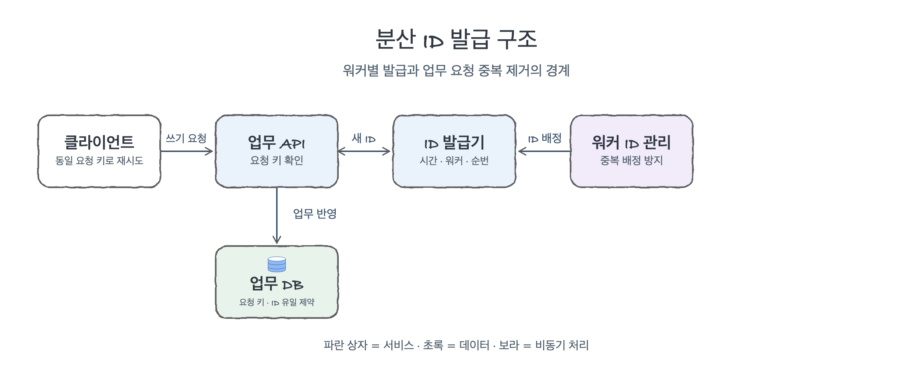

# Generating Unique IDs in Distributed Systems

분산 ID를 고를 때 충돌 방지, 정렬 가능성, 저장 크기와 장애 시 발급 정책을 각각 정한다. DB 안의 유일 제약도 함께 둔다. [RFC 9562 UUIDv7](https://www.rfc-editor.org/rfc/rfc9562.html#section-5.7) · [PostgreSQL 18 Constraints](https://www.postgresql.org/docs/18/ddl-constraints.html)

그림의 근거 · [RFC 9562 UUIDv7](https://www.rfc-editor.org/rfc/rfc9562.html#section-5.7) · [AWS Idempotent APIs](https://aws.amazon.com/builders-library/making-retries-safe-with-idempotent-APIs/) · [PostgreSQL 18 Constraints](https://www.postgresql.org/docs/18/ddl-constraints.html)

## 1. 중앙 발급과 로컬 발급을 비교한다

DB나 발급 서버 하나를 사용하면 관리 기준이 단순하지만 발급 경로에 의존한다. UUIDv7은 밀리초 UTC 타임스탬프와 무작위성 등을 사용해 노드별로 발급할 수 있다. 시간 배열이 곧 서비스 전체의 정확한 발생 순서를 뜻하지 않으므로 업무 순서는 별도로 저장할 수 있다. [RFC 9562 UUIDv7](https://www.rfc-editor.org/rfc/rfc9562.html#section-5.7) · [PostgreSQL 18 Constraints](https://www.postgresql.org/docs/18/ddl-constraints.html)

## 2. 시간·워커·순번 방식의 장애 경계를 정한다

시간, 고유 워커 ID, 같은 시간 단위의 순번을 합치는 경우 워커 ID 중복 발급을 방지한다. 시계가 뒤로 가거나 순번이 소진되면 새 시간까지 기다릴지 발급을 실패시킬지 선택한다. 재시작한 노드가 이전에 사용한 구간을 다시 쓰지 않게 한다. [RFC 9562 UUIDv7](https://www.rfc-editor.org/rfc/rfc9562.html#section-5.7) · [AWS Idempotent APIs](https://aws.amazon.com/builders-library/making-retries-safe-with-idempotent-APIs/)

## 3. 다시 들어온 업무 요청을 구분한다

새 ID를 만들 수 있다는 것과 이전 요청의 중복을 막는 것은 별도다. 네트워크 재시도에서 동일 업무를 찾을 식별자를 저장하고, 시계 역행·노드 증설·동시 발급 시 충돌과 발급 지연을 시험한다. [AWS Idempotent APIs](https://aws.amazon.com/builders-library/making-retries-safe-with-idempotent-APIs/) · [RFC 9562 UUIDv7](https://www.rfc-editor.org/rfc/rfc9562.html#section-5.7) · [PostgreSQL 18 Constraints](https://www.postgresql.org/docs/18/ddl-constraints.html)
