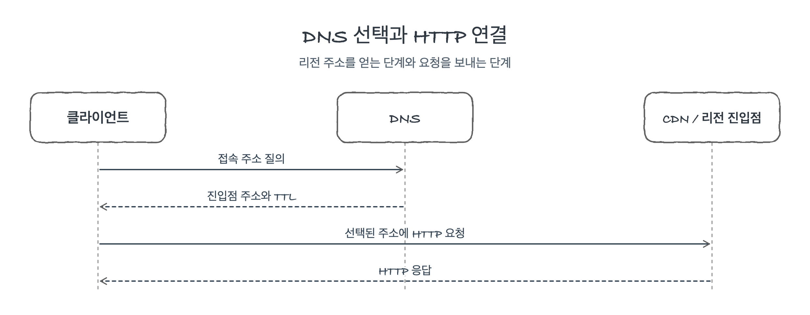

# Designing Content Delivery and Global Load Balancing

CDN은 사용자와 가까운 엣지에서 콘텐츠 응답을 제공한다. DNS 기반 GSLB는 클라이언트가 연결할 경로나 리전의 후보를 선택한다. 같은 서비스에서도 캐시 가능 콘텐츠와 쓰기 API의 경로를 다르게 둘 수 있다. [RFC 9111 HTTP Caching](https://www.rfc-editor.org/rfc/rfc9111.html) · [AWS Route 53 Latency Routing](https://docs.aws.amazon.com/Route53/latest/DeveloperGuide/routing-policy-latency.html) · [AWS Route 53 DNS Failover](https://docs.aws.amazon.com/Route53/latest/DeveloperGuide/dns-failover.html)

## 1. DNS와 HTTP 경로를 나눠 그린다

DNS 응답으로 리전 진입점이나 CDN 주소를 얻고 실제 HTTP 요청은 그 결과를 사용해 연결한다. DNS TTL이 남은 리졸버와 기존 연결에는 장애 조치가 즉시 반영되지 않을 수 있다. DNS 라우팅과 함께 각 리전의 실제 요청 성공률을 확인한다. [AWS Route 53 DNS Failover](https://docs.aws.amazon.com/Route53/latest/DeveloperGuide/dns-failover.html) · [AWS Route 53 Latency Routing](https://docs.aws.amazon.com/Route53/latest/DeveloperGuide/routing-policy-latency.html) · [AWS Route 53 Record Values](https://docs.aws.amazon.com/Route53/latest/DeveloperGuide/resource-record-sets-values-basic.html)

그림의 근거 · [AWS Route 53 DNS Failover](https://docs.aws.amazon.com/Route53/latest/DeveloperGuide/dns-failover.html) · [AWS Route 53 Latency Routing](https://docs.aws.amazon.com/Route53/latest/DeveloperGuide/routing-policy-latency.html) · [AWS Route 53 Record Values](https://docs.aws.amazon.com/Route53/latest/DeveloperGuide/resource-record-sets-values-basic.html)

## 2. 캐시 키, TTL, 개인화 경계를 정한다

공개 콘텐츠는 버전이 들어간 URL로 캐시하고, 언어나 압축에 따라 응답이 바뀌면 해당 요청 헤더를 고려한다. 권한과 개인 정보가 포함된 응답은 공유 캐시에 저장되는 조건부터 검토하고 예제에서는 no-store로 관리한다. [RFC 9111 HTTP Caching](https://www.rfc-editor.org/rfc/rfc9111.html)

## 3. 콜드 캐시와 지역 장애를 검증한다

리전 장애 조치나 대량 무효화 때 여러 엣지가 동시에 원본을 조회할 수 있다. 원본 용량, 에러율, 적중률, TTL 만료 시각과 다른 리전의 읽기·쓰기 권한을 같은 장애 시나리오에서 확인한다. [AWS Route 53 DNS Failover](https://docs.aws.amazon.com/Route53/latest/DeveloperGuide/dns-failover.html) · [Microsoft Cache-Aside](https://learn.microsoft.com/en-us/azure/architecture/patterns/cache-aside) · [Google SRE · Monitoring Distributed Systems](https://sre.google/sre-book/monitoring-distributed-systems/)
