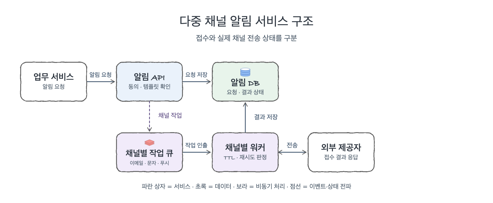

# Designing a Notification Service

알림 요청 접수, 제공자 수락, 단말 전달을 서로 다른 상태로 다룬다. 이메일·문자·푸시는 독립적인 처리량과 보존 조건을 가질 수 있다. [FCM Delivery](https://firebase.google.com/docs/cloud-messaging/understand-delivery) · [FCM Message Lifespan](https://firebase.google.com/docs/cloud-messaging/customize-messages/setting-message-lifespan) · [Microsoft Queue-Based Load Leveling](https://learn.microsoft.com/en-us/azure/architecture/patterns/queue-based-load-leveling)

그림의 근거 · [FCM Delivery](https://firebase.google.com/docs/cloud-messaging/understand-delivery) · [AWS Transactional Outbox](https://docs.aws.amazon.com/prescriptive-guidance/latest/cloud-design-patterns/transactional-outbox.html) · [FCM Message Lifespan](https://firebase.google.com/docs/cloud-messaging/customize-messages/setting-message-lifespan) · [AWS Idempotent APIs](https://aws.amazon.com/builders-library/making-retries-safe-with-idempotent-APIs/)

## 1. 채널별로 작업을 생성한다

사용자 설정과 수신 동의를 확인한 뒤 알림 ID, 템플릿 버전, 채널, 만료 시각을 저장한다. 큐 작업은 업무 ID·수신자·채널 기준으로 중복을 확인하며, 템플릿 데이터와 수신 주소의 보관을 제한한다. [AWS Transactional Outbox](https://docs.aws.amazon.com/prescriptive-guidance/latest/cloud-design-patterns/transactional-outbox.html) · [AWS Idempotent APIs](https://aws.amazon.com/builders-library/making-retries-safe-with-idempotent-APIs/)

## 2. 재시도와 만료 정책을 분리한다

채널별 워커가 제공자 응답을 해석해 일시 오류는 지연 재시도하고, 영구적으로 사용할 수 없는 대상은 상태를 갱신한다. 예를 들어 FCM 푸시는 TTL을 정하고, 제공자의 메시지 ID는 접수의 의미로 기록한다. [FCM Message Lifespan](https://firebase.google.com/docs/cloud-messaging/customize-messages/setting-message-lifespan) · [FCM Delivery](https://firebase.google.com/docs/cloud-messaging/understand-delivery) · [AWS Backoff and Jitter](https://aws.amazon.com/builders-library/timeouts-retries-and-backoff-with-jitter/)

## 3. 큐 적체와 중복 전송을 검증한다

만료된 채널 작업은 호출 전에 확인한다. 결과를 잃었다면 제공자 지원 여부에 따라 같은 멱등 키나 조회를 우선한다. 채널별 대기 시간·확정 실패·만료율·중복 의심 건을 정상 재전달과 나눠 측정한다. [FCM Message Lifespan](https://firebase.google.com/docs/cloud-messaging/customize-messages/setting-message-lifespan) · [AWS Idempotent APIs](https://aws.amazon.com/builders-library/making-retries-safe-with-idempotent-APIs/) · [Google SRE · Monitoring Distributed Systems](https://sre.google/sre-book/monitoring-distributed-systems/)
