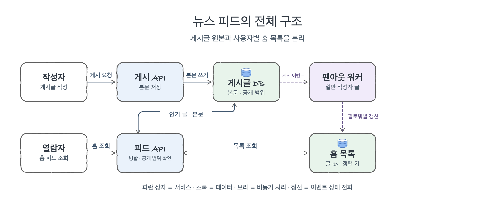

# Designing a News Feed

뉴스 피드는 게시글의 본문과 사용자별 홈 목록을 분리해 설계할 수 있다. 어떤 글이 보이는지와 정렬 기준, 게시 후 반영까지 허용되는 지연을 정한다. [AWS Transactional Outbox](https://docs.aws.amazon.com/prescriptive-guidance/latest/cloud-design-patterns/transactional-outbox.html) · [Microsoft Cache-Aside](https://learn.microsoft.com/en-us/azure/architecture/patterns/cache-aside) · [Google SRE · Implementing SLOs](https://sre.google/workbook/implementing-slos/)

그림의 근거 · [AWS Transactional Outbox](https://docs.aws.amazon.com/prescriptive-guidance/latest/cloud-design-patterns/transactional-outbox.html) · [Microsoft Cache-Aside](https://learn.microsoft.com/en-us/azure/architecture/patterns/cache-aside) · [Microsoft Queue-Based Load Leveling](https://learn.microsoft.com/en-us/azure/architecture/patterns/queue-based-load-leveling) · [PostgreSQL 18 Constraints](https://www.postgresql.org/docs/18/ddl-constraints.html)

## 1. 게시글 원본과 홈 목록을 분리한다

게시글은 작성자 ID와 생성 시각으로 저장한다. 홈 목록은 게시글 ID와 정렬 기준을 보관하는 파생 구조로 두고 목록을 열 때 본문을 묶어 읽는다. 삭제·차단·공개 범위 변경이 있을 수 있으므로 응답 시점의 공개 범위를 확인한다. [Microsoft Cache-Aside](https://learn.microsoft.com/en-us/azure/architecture/patterns/cache-aside) · [PostgreSQL 18 Constraints](https://www.postgresql.org/docs/18/ddl-constraints.html)

## 2. 팬아웃 비용을 비교한다

| 전략 | 비용과 조건 | 근거 |
| --- | --- | --- |
| Fan-out on write | 기록할 때 팔로워 목록에 넣어 읽기 경로를 줄인다. 팔로워가 많은 계정의 경우 쓰기 수와 갱신 지연이 늘 수 있다. | [Microsoft Queue-Based Load Leveling](https://learn.microsoft.com/en-us/azure/architecture/patterns/queue-based-load-leveling) · [AWS Transactional Outbox](https://docs.aws.amazon.com/prescriptive-guidance/latest/cloud-design-patterns/transactional-outbox.html) |
| Fan-out on read | 조회할 때 작성자별 최신 목록을 병합한다. 인기 작성자의 글을 읽을 때 병합하는 혼합 방식도 가능하다. | [Microsoft Cache-Aside](https://learn.microsoft.com/en-us/azure/architecture/patterns/cache-aside) · [Google SRE · Handling Overload](https://sre.google/sre-book/handling-overload/) |

## 3. 목록을 다시 만들고 이어 읽는다

커서는 마지막 정렬 키와 고유 게시글 ID를 같이 보관한다. 팬아웃 이벤트가 재전달돼도 같은 글이 목록에 한 번만 남도록 하고, 지연이나 큐 중단 후 원본에서 목록을 재구성한다. [AWS Transactional Outbox](https://docs.aws.amazon.com/prescriptive-guidance/latest/cloud-design-patterns/transactional-outbox.html) · [PostgreSQL 18 Constraints](https://www.postgresql.org/docs/18/ddl-constraints.html) · [Google SRE · Monitoring Distributed Systems](https://sre.google/sre-book/monitoring-distributed-systems/)
