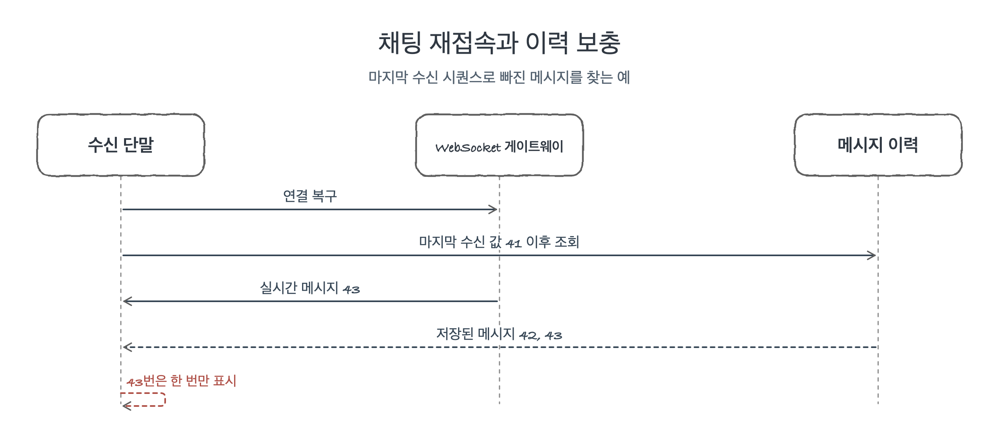

# Designing a Real-Time Chat System

채팅 연결은 실시간 운반 경로이고 메시지 저장은 재접속의 기준점이다. 송신 수락, 수신 서버 전달, 단말 읽음의 의미를 따로 정의한다. [RFC 6455 WebSocket](https://www.rfc-editor.org/rfc/rfc6455.html) · [Kafka 4.3 Introduction](https://kafka.apache.org/43/getting-started/introduction/) · [AWS Idempotent APIs](https://aws.amazon.com/builders-library/making-retries-safe-with-idempotent-APIs/)

## 1. 송신 요청을 멱등하게 저장한다

클라이언트는 client_message_id를 만들고 서버는 방·송신자 범위에서 이를 고유하게 관리한다. 방 시퀀스와 본문을 함께 저장한 뒤 송신 수락을 반환한다. 방 안의 엄격한 순서가 필요하면 방별 쓰기 권한이나 순번 발급을 직렬화한다. [PostgreSQL 18 Constraints](https://www.postgresql.org/docs/18/ddl-constraints.html) · [PostgreSQL 18 SELECT](https://www.postgresql.org/docs/18/sql-select.html#SQL-FOR-UPDATE-SHARE) · [AWS Idempotent APIs](https://aws.amazon.com/builders-library/making-retries-safe-with-idempotent-APIs/)

## 2. 연결을 통해 전달하고 빠진 구간을 보충한다

WebSocket 게이트웨이는 현재 연결로 전달한다. 재접속하면 단말이 마지막 수신 시퀀스 이후를 조회하고, 실시간 알림과 이력 조회가 겹쳐도 같은 메시지를 한 번만 표시한다. 입력 중 표시에는 수명이 짧은 별도 정책을 적용할 수 있다. [RFC 6455 WebSocket](https://www.rfc-editor.org/rfc/rfc6455.html) · [Kafka 4.3 Introduction](https://kafka.apache.org/43/getting-started/introduction/) · [Microsoft Cache-Aside](https://learn.microsoft.com/en-us/azure/architecture/patterns/cache-aside)

그림의 근거 · [RFC 6455 WebSocket](https://www.rfc-editor.org/rfc/rfc6455.html) · [Kafka 4.3 Introduction](https://kafka.apache.org/43/getting-started/introduction/) · [Microsoft Cache-Aside](https://learn.microsoft.com/en-us/azure/architecture/patterns/cache-aside)

## 3. 느린 연결과 단말 수를 검증한다

연결마다 송신 대기열 한도를 둔다. 한도를 넘으면 재연결 및 이력 보충을 유도하고, 대형 방의 전파 지연·연결 수·읽음 갱신 트래픽을 따로 측정한다. [Google SRE · Handling Overload](https://sre.google/sre-book/handling-overload/) · [Google SRE · Monitoring Distributed Systems](https://sre.google/sre-book/monitoring-distributed-systems/) · [RFC 6455 WebSocket](https://www.rfc-editor.org/rfc/rfc6455.html)
