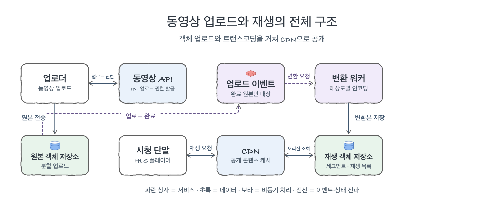

# Designing a Video-on-Demand Platform

동영상은 업로드와 재생의 워크로드가 다르다. 원본, 변환된 세그먼트와 재생 목록을 객체 저장소에 두고, 준비된 콘텐츠를 CDN으로 제공하는 안을 다룬다. [AWS Video on Demand](https://docs.aws.amazon.com/solutions/latest/video-on-demand-on-aws/architecture-overview.html) · [Apple HTTP Live Streaming](https://developer.apple.com/streaming/) · [RFC 9111 HTTP Caching](https://www.rfc-editor.org/rfc/rfc9111.html)

그림의 근거 · [AWS Video on Demand](https://docs.aws.amazon.com/solutions/latest/video-on-demand-on-aws/architecture-overview.html) · [Amazon S3 Multipart Upload](https://docs.aws.amazon.com/AmazonS3/latest/userguide/mpuoverview.html) · [Amazon S3 Presigned URLs](https://docs.aws.amazon.com/AmazonS3/latest/userguide/using-presigned-url.html) · [Apple HTTP Live Streaming](https://developer.apple.com/streaming/)

## 1. 업로드 경로를 대용량 전송에 맞춘다

API가 동영상 ID를 만든 뒤 일정 권한과 시간 범위의 사전 서명 요청으로 저장소에 업로드하도록 한다. 큰 파일은 multipart로 나눠 실패한 부분만 다시 전송한다. 전체 업로드가 완료된 원본만 변환 후보로 본다. [Amazon S3 Presigned URLs](https://docs.aws.amazon.com/AmazonS3/latest/userguide/using-presigned-url.html) · [Amazon S3 Multipart Upload](https://docs.aws.amazon.com/AmazonS3/latest/userguide/mpuoverview.html) · [AWS Video on Demand](https://docs.aws.amazon.com/solutions/latest/video-on-demand-on-aws/architecture-overview.html)

## 2. 변환을 비동기로 처리하고 재생을 공개한다

변환 작업이 여러 해상도의 세그먼트와 재생 목록을 쓴다. 필요한 객체가 준비된 뒤 동영상 버전을 읽기 가능으로 전환한다. HLS 재생은 단말의 네트워크 상황에 맞춰 재생 목록의 스트림 중 하나를 고를 수 있다. [AWS Video on Demand](https://docs.aws.amazon.com/solutions/latest/video-on-demand-on-aws/architecture-overview.html) · [Apple HTTP Live Streaming](https://developer.apple.com/streaming/) · [AWS Transactional Outbox](https://docs.aws.amazon.com/prescriptive-guidance/latest/cloud-design-patterns/transactional-outbox.html)

## 3. 업로드 피크와 재생 장애를 구분한다

변환 대기 시간은 업로드 완료부터 재생 가능까지, 재생 지연은 시작 시간과 재버퍼링으로 측정한다. 변환 실패 재시도, 공개 전 매니페스트 요청, 정상 세그먼트의 캐시 적중률을 각각 확인한다. [AWS Video on Demand](https://docs.aws.amazon.com/solutions/latest/video-on-demand-on-aws/architecture-overview.html) · [Google SRE · Monitoring Distributed Systems](https://sre.google/sre-book/monitoring-distributed-systems/) · [RFC 9111 HTTP Caching](https://www.rfc-editor.org/rfc/rfc9111.html)
