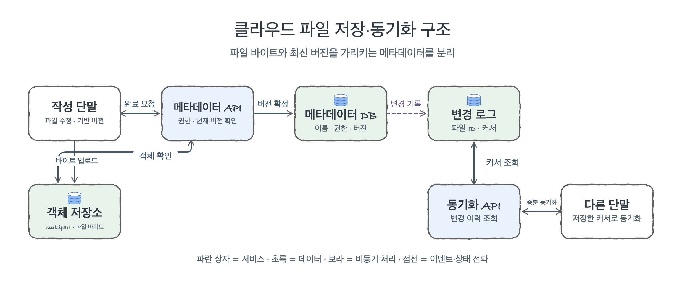

# Designing Cloud File Storage and Sync

파일 저장소는 큰 콘텐츠와 이름·폴더·권한·버전 같은 메타데이터를 분리한다. 여러 기기가 같은 파일을 수정할 수 있으므로 성공적으로 저장한 버전을 가리키는 기준이 필요하다. [Amazon S3 Multipart Upload](https://docs.aws.amazon.com/AmazonS3/latest/userguide/mpuoverview.html) · [Amazon S3 Conditional Writes](https://docs.aws.amazon.com/AmazonS3/latest/userguide/conditional-writes.html) · [PostgreSQL 18 Constraints](https://www.postgresql.org/docs/18/ddl-constraints.html)

그림의 근거 · [Amazon S3 Multipart Upload](https://docs.aws.amazon.com/AmazonS3/latest/userguide/mpuoverview.html) · [Amazon S3 Conditional Writes](https://docs.aws.amazon.com/AmazonS3/latest/userguide/conditional-writes.html) · [Amazon S3 Presigned URLs](https://docs.aws.amazon.com/AmazonS3/latest/userguide/using-presigned-url.html) · [etcd 3.6 API](https://etcd.io/docs/v3.6/learning/api/)

## 1. 파일 전송과 메타데이터 확정을 나눈다

업로드 ID와 논리 파일 ID를 만들고 부분 업로드를 시작한다. 완료 후 객체와 크기·무결성을 확인한 다음 메타데이터가 새 버전을 가리키도록 확정한다. 다운로드 권한은 메타데이터에서 확인한 뒤 제한된 접근을 부여한다. [Amazon S3 Multipart Upload](https://docs.aws.amazon.com/AmazonS3/latest/userguide/mpuoverview.html) · [Amazon S3 Presigned URLs](https://docs.aws.amazon.com/AmazonS3/latest/userguide/using-presigned-url.html) · [Amazon S3 Conditional Writes](https://docs.aws.amazon.com/AmazonS3/latest/userguide/conditional-writes.html)

## 2. 동시 수정과 오프라인 복귀를 처리한다

수정 시 기반 버전이 현재 버전과 일치하는지 비교한다. 다른 기기가 먼저 저장했다면 충돌본을 만들거나 사용자가 병합 대상을 고르게 한다. 변경 로그의 커서로 증분 동기화하고, 커서가 만료되면 스냅샷을 다시 읽는다. [Amazon S3 Conditional Writes](https://docs.aws.amazon.com/AmazonS3/latest/userguide/conditional-writes.html) · [etcd 3.6 API](https://etcd.io/docs/v3.6/learning/api/) · [PostgreSQL 18 UPDATE](https://www.postgresql.org/docs/18/sql-update.html)

## 3. 고아 객체와 지연된 변경을 검증한다

파일 업로드 이후 DB 확정 전에 실패한 객체와 미완료 multipart를 정리하는 정책을 둔다. 복사·삭제·공유 취소가 겹치는 경우의 버전 일관성과 동기화 지연, 미완료 업로드 크기를 관찰한다. [Amazon S3 Multipart Upload](https://docs.aws.amazon.com/AmazonS3/latest/userguide/mpuoverview.html) · [Amazon S3 Conditional Writes](https://docs.aws.amazon.com/AmazonS3/latest/userguide/conditional-writes.html) · [Google SRE · Monitoring Distributed Systems](https://sre.google/sre-book/monitoring-distributed-systems/)
