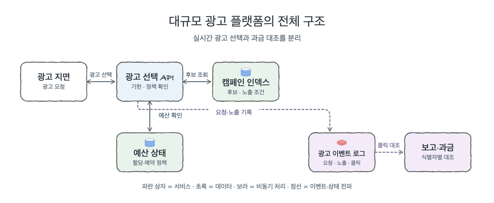

# Designing a Large-Scale Digital Ad Platform

광고 선택 요청의 지연 목표와 광고주 보고·과금의 정확도를 따로 정한다. 광고 노출, 클릭, 과금 근거의 식별자가 어떻게 이어지는지 먼저 정의한다. [IAB Tech Lab OpenRTB 2.6](https://github.com/InteractiveAdvertisingBureau/openrtb2.x/blob/main/2.6.md) · [Google SRE · Implementing SLOs](https://sre.google/workbook/implementing-slos/) · [Flink 2.2 Timely Stream Processing](https://nightlies.apache.org/flink/flink-docs-release-2.2/docs/concepts/time/)

그림의 근거 · [IAB Tech Lab OpenRTB 2.6](https://github.com/InteractiveAdvertisingBureau/openrtb2.x/blob/main/2.6.md) · [Amazon · Dynamo](https://www.amazon.science/publications/dynamo-amazons-highly-available-key-value-store) · [Google SRE · Implementing SLOs](https://sre.google/workbook/implementing-slos/) · [Microsoft Cache-Aside](https://learn.microsoft.com/en-us/azure/architecture/patterns/cache-aside)

## 1. 광고 후보를 제한된 시간 안에 고른다

광고 지면 및 정책 조건을 만족하는 캠페인 후보를 캐시나 인덱스에서 찾고, 예산과 노출 빈도를 확인해 광고를 선택한다. 기한 안에 후보를 확정할 수 없으면 광고 없음이나 사전 정의한 기본 응답을 반환한다. [IAB Tech Lab OpenRTB 2.6](https://github.com/InteractiveAdvertisingBureau/openrtb2.x/blob/main/2.6.md) · [Microsoft Cache-Aside](https://learn.microsoft.com/en-us/azure/architecture/patterns/cache-aside) · [Google SRE · Handling Overload](https://sre.google/sre-book/handling-overload/)

## 2. 실시간 예산과 최종 보고를 구분한다

예산 변경은 캠페인별로 반영하고, 여러 지역에서 쓰는 빠른 카운터의 조회 시차를 고려한다. 강한 상한이 필요하면 중앙 예약 또는 지역별 예산 할당을 검토한다. 실제 과금용 레코드는 별도 스트림에서 식별자별로 대조한다. [Amazon · Dynamo](https://www.amazon.science/publications/dynamo-amazons-highly-available-key-value-store) · [AWS Idempotent APIs](https://aws.amazon.com/builders-library/making-retries-safe-with-idempotent-APIs/) · [Flink 2.2 Stateful Stream Processing](https://nightlies.apache.org/flink/flink-docs-release-2.2/docs/concepts/stateful-stream-processing/)

## 3. 의도하지 않은 중복 집계를 찾는다

요청·노출·클릭을 각각의 이벤트로 기록하고 연결할 식별자를 둔다. 중복 이벤트, 늦은 클릭과 예산 경합을 주입해 응답 지연과 보고 정정량을 따로 본다. [IAB Tech Lab OpenRTB 2.6](https://github.com/InteractiveAdvertisingBureau/openrtb2.x/blob/main/2.6.md) · [Flink 2.2 Windows](https://nightlies.apache.org/flink/flink-docs-release-2.2/docs/dev/datastream/operators/windows/) · [Google SRE · Monitoring Distributed Systems](https://sre.google/sre-book/monitoring-distributed-systems/)
