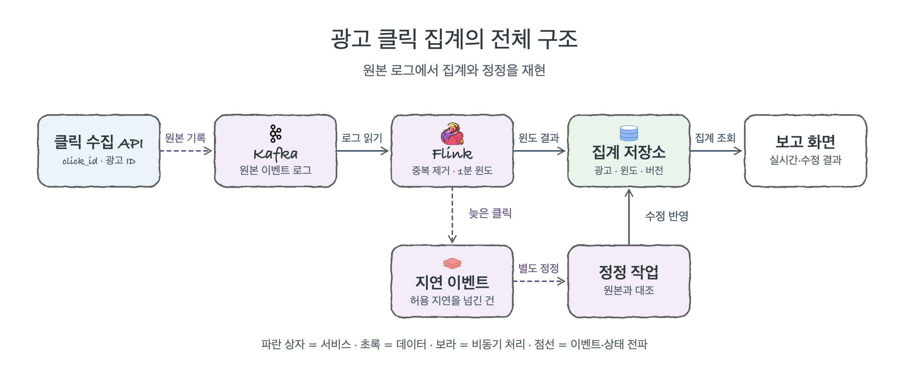
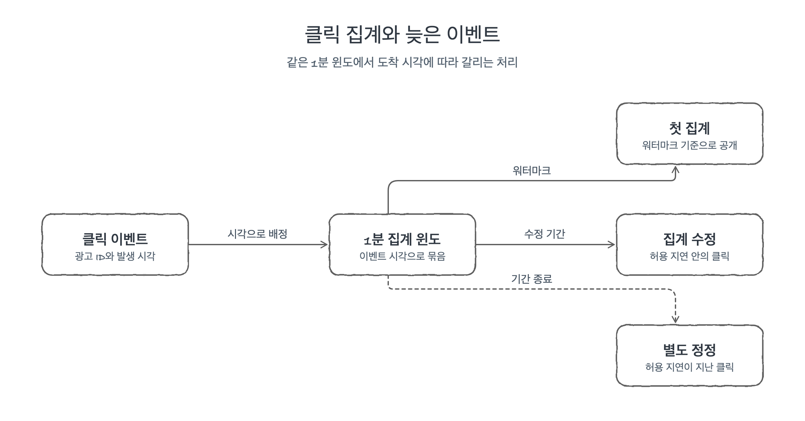

# Aggregating Ad Clicks at Scale

광고 클릭 집계는 클릭 시각과 수집 시각을 나눠 다룬다. 중복 수집과 늦게 도착한 클릭에 대해 실시간 화면과 과금용 정산이 각각 어떻게 변경되는지 정한다. [IAB Tech Lab OpenRTB 2.6](https://github.com/InteractiveAdvertisingBureau/openrtb2.x/blob/main/2.6.md) · [Flink 2.2 Timely Stream Processing](https://nightlies.apache.org/flink/flink-docs-release-2.2/docs/concepts/time/) · [Flink 2.2 Windows](https://nightlies.apache.org/flink/flink-docs-release-2.2/docs/dev/datastream/operators/windows/)

그림의 근거 · [Flink 2.2 Windows](https://nightlies.apache.org/flink/flink-docs-release-2.2/docs/dev/datastream/operators/windows/) · [Flink 2.2 Stateful Stream Processing](https://nightlies.apache.org/flink/flink-docs-release-2.2/docs/concepts/stateful-stream-processing/) · [IAB Tech Lab OpenRTB 2.6](https://github.com/InteractiveAdvertisingBureau/openrtb2.x/blob/main/2.6.md) · [Kafka 4.3 Introduction](https://kafka.apache.org/43/getting-started/introduction/)

## 1. 입력 로그와 재처리 기준을 정한다

원본 로그에 click_id, ad_id, 발생·수집 시각을 남긴다. 동일 click_id를 중복 제거할 보존 기한을 정하고, 재처리가 그보다 늦게 일어나도 과금에 중복 반영되지 않도록 원본 키나 배치 대조 절차를 둔다. [AWS Transactional Outbox](https://docs.aws.amazon.com/prescriptive-guidance/latest/cloud-design-patterns/transactional-outbox.html) · [Flink 2.2 Stateful Stream Processing](https://nightlies.apache.org/flink/flink-docs-release-2.2/docs/concepts/stateful-stream-processing/) · [PostgreSQL 18 Constraints](https://www.postgresql.org/docs/18/ddl-constraints.html)

## 2. 이벤트 시간 기준으로 집계한다

광고별 1분 tumbling window에서 클릭을 센다. 워터마크와 허용 지연으로 결과를 먼저 내보낼 시점과 수정 가능한 기간을 정한다. 기간을 넘긴 건은 늦은 데이터 경로로 보내 별도 정정 정책을 적용한다. [Flink 2.2 Timely Stream Processing](https://nightlies.apache.org/flink/flink-docs-release-2.2/docs/concepts/time/) · [Flink 2.2 Windows](https://nightlies.apache.org/flink/flink-docs-release-2.2/docs/dev/datastream/operators/windows/)

그림의 근거 · [Flink 2.2 Timely Stream Processing](https://nightlies.apache.org/flink/flink-docs-release-2.2/docs/concepts/time/) · [Flink 2.2 Windows](https://nightlies.apache.org/flink/flink-docs-release-2.2/docs/dev/datastream/operators/windows/)

## 3. 집계 결과를 멱등하게 반영한다

결과는 광고 ID·윈도 시작 시각으로 식별하고, 버전을 비교해 오래된 작업이 새 집계를 덮지 않게 한다. Kafka 재생, 순서가 바뀐 입력, 동일 이벤트 재전달을 주입하고 원본으로 집계 수치를 다시 계산해 비교한다. [Flink 2.2 Stateful Stream Processing](https://nightlies.apache.org/flink/flink-docs-release-2.2/docs/concepts/stateful-stream-processing/) · [AWS Transactional Outbox](https://docs.aws.amazon.com/prescriptive-guidance/latest/cloud-design-patterns/transactional-outbox.html) · [PostgreSQL 18 UPDATE](https://www.postgresql.org/docs/18/sql-update.html)
