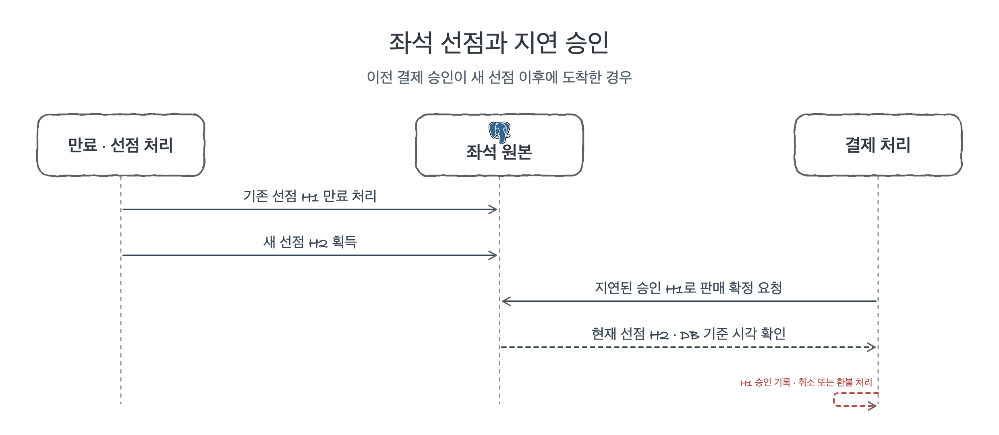

# Designing a Ticket Reservation Service

티켓팅은 동시에 같은 좌석을 요청하는 상황부터 설계한다. 목록과 좌석 배치도는 조회 경로로 제공하되 실제 보유·확정 판정은 해당 좌석을 쓰는 원본에서 내린다. [PostgreSQL 18 SELECT](https://www.postgresql.org/docs/18/sql-select.html#SQL-FOR-UPDATE-SHARE) · [Microsoft Cache-Aside](https://learn.microsoft.com/en-us/azure/architecture/patterns/cache-aside)

## 1. 좌석 선점의 상태와 원본을 정한다

이벤트 ID와 좌석 ID를 묶어 고유하게 관리한다. 좌석은 AVAILABLE → HELD → SOLD로 진행하며, HELD에는 hold_id와 만료 시각을 지정한다. 원본 행 잠금이나 상태·만료 조건을 만족할 때만 쓰는 방법으로 같은 좌석의 중복 확정을 막는다. [PostgreSQL 18 Constraints](https://www.postgresql.org/docs/18/ddl-constraints.html) · [PostgreSQL 18 SELECT](https://www.postgresql.org/docs/18/sql-select.html#SQL-FOR-UPDATE-SHARE) · [PostgreSQL 18 UPDATE](https://www.postgresql.org/docs/18/sql-update.html)

## 2. 결제와 만료의 경합을 처리한다

승인 수신과 만료 처리 모두 현재 hold_id와 DB 기준 시각을 확인한다. 동일한 선점이 여전히 유효할 때만 SOLD로 전이한다. 다른 선점이 이미 좌석을 얻었다면 지연된 승인의 사실을 보존하고 취소·환불 여부를 처리한다. [PostgreSQL 18 SELECT](https://www.postgresql.org/docs/18/sql-select.html#SQL-FOR-UPDATE-SHARE) · [AWS Idempotent APIs](https://aws.amazon.com/builders-library/making-retries-safe-with-idempotent-APIs/) · [AWS Saga Orchestration](https://docs.aws.amazon.com/prescriptive-guidance/latest/cloud-design-patterns/saga-orchestration.html)

그림의 근거 · [PostgreSQL 18 SELECT](https://www.postgresql.org/docs/18/sql-select.html#SQL-FOR-UPDATE-SHARE) · [AWS Idempotent APIs](https://aws.amazon.com/builders-library/making-retries-safe-with-idempotent-APIs/) · [AWS Saga Orchestration](https://docs.aws.amazon.com/prescriptive-guidance/latest/cloud-design-patterns/saga-orchestration.html)

## 3. 접속 대기열과 원본 처리량을 맞춘다

피크에는 대기열이나 요청 제한으로 좌석 DB에 들어오는 동시 요청 수를 제어한다. 마지막 한 좌석으로 선점·만료·승인 경쟁을 재현해 확정 좌석 수, 미확인 승인과 대기 시간의 분포를 확인한다. [Google SRE · Handling Overload](https://sre.google/sre-book/handling-overload/) · [Microsoft Queue-Based Load Leveling](https://learn.microsoft.com/en-us/azure/architecture/patterns/queue-based-load-leveling) · [Google SRE · Monitoring Distributed Systems](https://sre.google/sre-book/monitoring-distributed-systems/)
