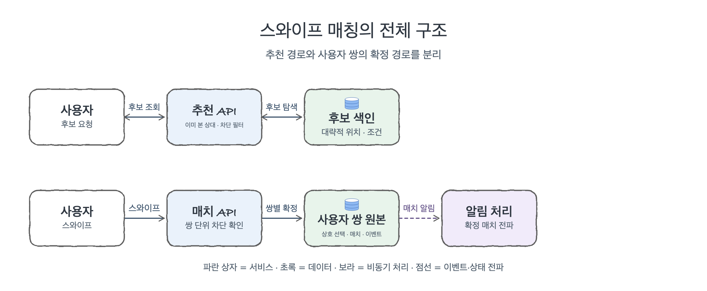

# Designing a Swipe-Based Dating Service

후보 추천과 매치 확정은 서로 다른 경로다. 추천이 잠시 오래된 결과를 보내도, 두 사람의 상호 선택과 차단 상태는 매치 확정 경계에서 다시 확인한다. [Redis GEOSEARCH](https://redis.io/docs/latest/commands/geosearch/) · [PostgreSQL 18 SELECT](https://www.postgresql.org/docs/18/sql-select.html#SQL-FOR-UPDATE-SHARE) · [Microsoft Microservice Boundaries](https://learn.microsoft.com/en-us/azure/architecture/microservices/model/microservice-boundaries)

그림의 근거 · [Redis GEOSEARCH](https://redis.io/docs/latest/commands/geosearch/) · [PostgreSQL 18 Constraints](https://www.postgresql.org/docs/18/ddl-constraints.html) · [PostgreSQL 18 SELECT](https://www.postgresql.org/docs/18/sql-select.html#SQL-FOR-UPDATE-SHARE) · [Microsoft Cache-Aside](https://learn.microsoft.com/en-us/azure/architecture/patterns/cache-aside)

## 1. 후보 조회와 표시 범위를 정한다

대략적 위치와 조건으로 후보를 찾고, 이미 본 대상이나 차단 관계를 제외한다. 위치 색인은 후보 추출에만 쓰고, 상세 위치 정보나 원본 좌표는 후보 응답에 직접 노출할 필요가 없는 경우 반환하지 않는다. [Redis GEOSEARCH](https://redis.io/docs/latest/commands/geosearch/) · [Microsoft Cache-Aside](https://learn.microsoft.com/en-us/azure/architecture/patterns/cache-aside)

## 2. 양방향 선택은 같은 사용자 쌍에서 직렬화한다

두 사용자 ID를 정렬한 pair_key를 유일하게 만들고, 해당 행의 잠금을 얻은 뒤 현재 선택과 차단 여부를 확인한다. 각 swipe에는 고유 업무 키를 사용한다. 두 방향의 LIKE가 모두 유효한 경우에만 쌍마다 하나의 match를 저장하고 알림 이벤트를 함께 기록한다. 차단 변경도 같은 쌍의 잠금 규칙으로 직렬화한다. [PostgreSQL 18 Constraints](https://www.postgresql.org/docs/18/ddl-constraints.html) · [PostgreSQL 18 INSERT](https://www.postgresql.org/docs/18/sql-insert.html) · [PostgreSQL 18 SELECT](https://www.postgresql.org/docs/18/sql-select.html#SQL-FOR-UPDATE-SHARE) · [AWS Transactional Outbox](https://docs.aws.amazon.com/prescriptive-guidance/latest/cloud-design-patterns/transactional-outbox.html)

## 3. 동시 LIKE와 차단을 시험한다

두 사람이 동시에 누르면 각자 상대의 아직 커밋되지 않은 선택을 놓칠 수 있다. 두 경로가 같은 쌍의 저장·잠금 규칙을 따른 상태에서 결과 행과 알림이 한 건으로 수렴하고, 차단 이후에는 현재 정책이 적용되는지 확인한다. [PostgreSQL 18 SELECT](https://www.postgresql.org/docs/18/sql-select.html#SQL-FOR-UPDATE-SHARE) · [PostgreSQL 18 Constraints](https://www.postgresql.org/docs/18/ddl-constraints.html) · [AWS Transactional Outbox](https://docs.aws.amazon.com/prescriptive-guidance/latest/cloud-design-patterns/transactional-outbox.html)
