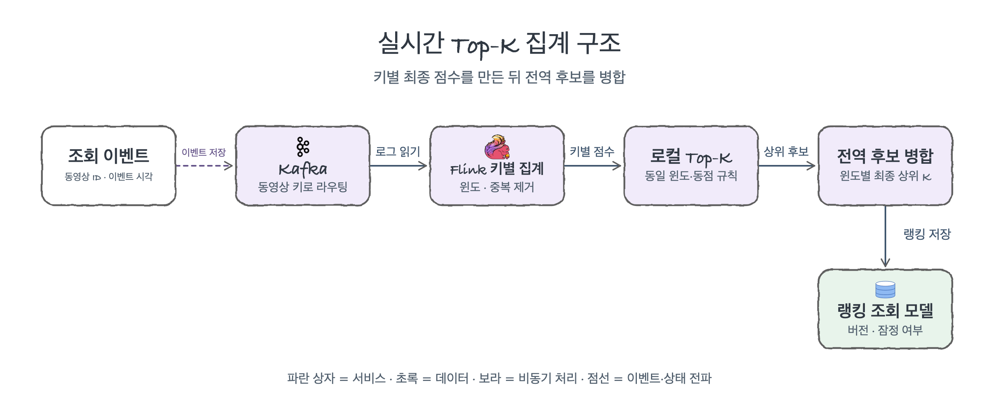
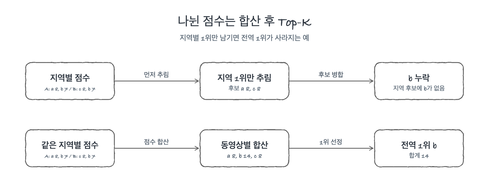

# Finding Top-K on an Event Stream

인기 동영상은 전체 누적 조회수, 최근 5분 또는 특정 국가별 조회수처럼 기준이 다를 수 있다. 이 예의 순위는 같은 이벤트 시간 윈도의 조회수와 고유 동영상 ID를 기준으로 한다. [Flink 2.2 Timely Stream Processing](https://nightlies.apache.org/flink/flink-docs-release-2.2/docs/concepts/time/) · [Flink 2.2 Windows](https://nightlies.apache.org/flink/flink-docs-release-2.2/docs/dev/datastream/operators/windows/) · [Redis ZRANGE](https://redis.io/docs/latest/commands/zrange/)

그림의 근거 · [Flink 2.2 Timely Stream Processing](https://nightlies.apache.org/flink/flink-docs-release-2.2/docs/concepts/time/) · [Kafka 4.3 Introduction](https://kafka.apache.org/43/getting-started/introduction/) · [Flink 2.2 Stateful Stream Processing](https://nightlies.apache.org/flink/flink-docs-release-2.2/docs/concepts/stateful-stream-processing/) · [Flink 2.2 Windows](https://nightlies.apache.org/flink/flink-docs-release-2.2/docs/dev/datastream/operators/windows/)

## 1. 동영상별 카운트를 먼저 모은다

동영상 ID로 파티션을 정하고 같은 윈도의 이벤트를 해당 키에서 집계한다. 윈도 경계, 워터마크, 중복 제거와 동점 순서를 명시한다. 결과는 윈도 시작과 집계 버전으로 식별해 정렬 집합 또는 조회 모델에 반영할 수 있다. [Kafka 4.3 Introduction](https://kafka.apache.org/43/getting-started/introduction/) · [Flink 2.2 Windows](https://nightlies.apache.org/flink/flink-docs-release-2.2/docs/dev/datastream/operators/windows/) · [Flink 2.2 Stateful Stream Processing](https://nightlies.apache.org/flink/flink-docs-release-2.2/docs/concepts/stateful-stream-processing/) · [Redis ZRANGE](https://redis.io/docs/latest/commands/zrange/)

## 2. 로컬 Top-K를 병합할 수 있는 조건

윈도와 동점 순서가 같고 각 동영상의 최종 점수가 하나의 논리 파티션에만 있다면, 각 파티션의 상위 K개 후보를 합쳐 전체 상위 K개를 고를 수 있다. 전역 상위 항목이 자기 파티션의 상위 K에 없다면 같은 파티션에 이미 그보다 앞선 항목이 K개 있는 셈이다. [Kafka 4.3 Introduction](https://kafka.apache.org/43/getting-started/introduction/) · [Flink 2.2 Stateful Stream Processing](https://nightlies.apache.org/flink/flink-docs-release-2.2/docs/concepts/stateful-stream-processing/) · [Redis ZRANGE](https://redis.io/docs/latest/commands/zrange/)

하나의 동영상 카운트를 여러 보조 키로 나눴다면 점수를 동영상별로 먼저 합친다. K=1인 예에서 지역 A는 a=8, b=7이고 지역 B는 c=8, b=7이다. 지역별 1위 a와 c만 병합하면 합계 14인 b를 놓친다. [Flink 2.2 Stateful Stream Processing](https://nightlies.apache.org/flink/flink-docs-release-2.2/docs/concepts/stateful-stream-processing/) · [Kafka 4.3 Introduction](https://kafka.apache.org/43/getting-started/introduction/)

그림의 근거 · [Flink 2.2 Stateful Stream Processing](https://nightlies.apache.org/flink/flink-docs-release-2.2/docs/concepts/stateful-stream-processing/) · [Kafka 4.3 Introduction](https://kafka.apache.org/43/getting-started/introduction/)

## 3. 잠정 결과와 늦은 보정을 검증한다

인기 키 폭증과 늦은 이벤트를 섞어 파티션별 지연과 전역 랭킹을 검사한다. 실시간 순위가 잠정인지 확정인지 표시하고, 새 보정이 반영된 뒤 이전 버전이 다시 도착해도 최신 순위가 유지되는지 시험한다. [Flink 2.2 Timely Stream Processing](https://nightlies.apache.org/flink/flink-docs-release-2.2/docs/concepts/time/) · [Flink 2.2 Windows](https://nightlies.apache.org/flink/flink-docs-release-2.2/docs/dev/datastream/operators/windows/) · [Google SRE · Monitoring Distributed Systems](https://sre.google/sre-book/monitoring-distributed-systems/)
