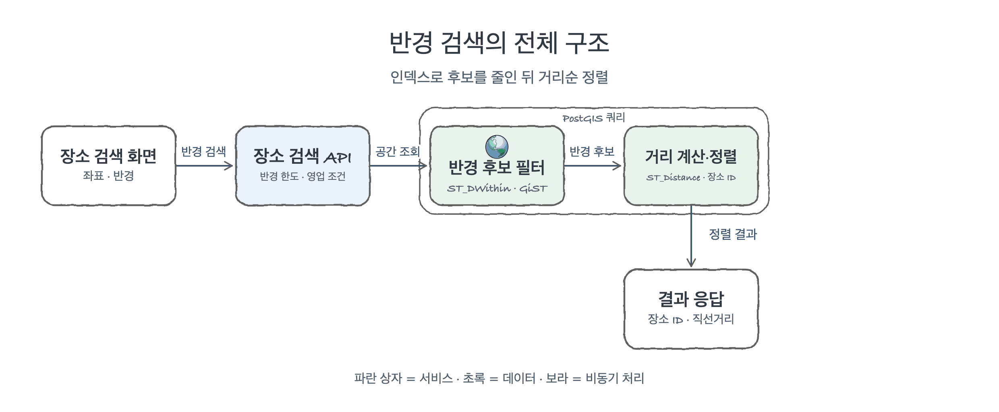

# Designing a Proximity Search Service

사용자가 지정한 반경 안에서 영업 중인 장소를 거리순으로 반환하는 API를 설계한다. 예제의 응답은 장소 ID와 직선거리이며, 이동 시간은 [경로 탐색](30_designing_a_map_and_routing_service.md)에서 계산한다. [PostGIS 3.6 · ST_Distance](https://postgis.net/docs/manual-3.6/ST_Distance.html) · [OSRM 5.24 · Table Service](https://project-osrm.org/docs/v5.24.0/api/#table-service)

그림의 근거 · [PostGIS 3.6 · ST_DWithin](https://postgis.net/docs/manual-3.6/ST_DWithin.html) · [PostGIS 3.6 · ST_Distance](https://postgis.net/docs/manual-3.6/ST_Distance.html) · [OSRM 5.24 · Table Service](https://project-osrm.org/docs/v5.24.0/api/#table-service) · [Google SRE · Monitoring Distributed Systems](https://sre.google/sre-book/monitoring-distributed-systems/)

## 1. 후보 검색과 정확한 거리 계산을 나눈다

PostGIS 3.6 예제에서는 장소를 `geography(Point, 4326)`로 저장하고 위치 열에 GiST 인덱스를 둔다. `ST_DWithin`으로 반경을 미터 단위로 제한한 뒤, 남은 결과를 `ST_Distance`와 `place_id` 순으로 정렬한다. `ST_DWithin`은 사용 가능한 공간 인덱스로 후보를 좁힐 수 있다. [PostGIS 3.6 · ST_DWithin](https://postgis.net/docs/manual-3.6/ST_DWithin.html) · [PostGIS 3.6 · ST_Distance](https://postgis.net/docs/manual-3.6/ST_Distance.html)

## 2. 밀집 지역과 반경 경계를 검증한다

밀집 지역에서는 반경을 넓힐수록 정렬 전에 조사할 후보도 많아진다. 예제로 최대 반경 5 km와 최대 결과 30개를 두고, 같은 결과 개수에서도 도심·외곽의 후보 수와 p95 지연을 따로 잰다. 반경 바로 안팎과 거리가 같은 장소를 넣어 포함 여부와 정렬의 안정성도 확인한다. [PostGIS 3.6 · ST_DWithin](https://postgis.net/docs/manual-3.6/ST_DWithin.html) · [Google SRE · Monitoring Distributed Systems](https://sre.google/sre-book/monitoring-distributed-systems/)
