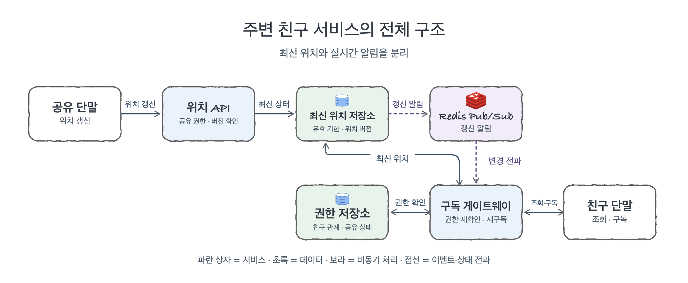

# Designing a Nearby Friends Service

친구 위치 공유 기능은 조회자와 공유자가 모두 허용한 범위에서 최근 위치를 표시한다. 이 설계 예제는 현재 위치의 근사 거리만 제공하고 이동 이력은 저장하지 않는다. API 서버는 조회·구독 요청마다 친구 관계와 위치 공유 권한을 확인한다. [W3C Geolocation · Privacy Considerations](https://www.w3.org/TR/geolocation/#privacy-for-recipients)

그림의 근거 · [W3C Geolocation · Privacy Considerations](https://www.w3.org/TR/geolocation/#privacy-for-recipients) · [Redis · Pub/Sub](https://redis.io/docs/latest/develop/pubsub/)

## 1. 최신 위치 상태와 알림을 나눈다

위치 레코드에는 사용자 ID, 좌표, 서버 기준 유효 기한, 갱신 버전을 둔다. 예를 들어 90초 안에 갱신되지 않으면 조회에서 제외하고, 지연 도착한 갱신은 버전을 비교해 폐기한다. 서버의 최신 상태를 먼저 반영한 뒤 위치가 바뀌었다는 알림만 발행한다. [W3C Geolocation · Privacy Considerations](https://www.w3.org/TR/geolocation/#privacy-for-recipients) · [Redis · Pub/Sub](https://redis.io/docs/latest/develop/pubsub/)

## 2. 연결이 끊긴 뒤 상태를 다시 맞춘다

Redis Pub/Sub는 구독자가 연결이 끊겼을 때 놓친 메시지를 재생하지 않는다. 재접속할 때는 먼저 다시 구독해 알림을 모으고, 현재 권한과 최신 위치를 조회한 뒤 더 새 버전의 알림만 반영한다. [Redis · Pub/Sub Delivery Semantics](https://redis.io/docs/latest/develop/pubsub/)

위치 공유 철회와 갱신이 경합하는 경우를 테스트한다. 구독 종료가 지연되더라도 송신 직전의 권한 검사에서 철회된 위치를 제외하고, 이미 만료된 위치를 캐시나 재접속 경로에서 되살리지 않는지 확인한다. [W3C Geolocation · Privacy Considerations](https://www.w3.org/TR/geolocation/#privacy-for-recipients)
