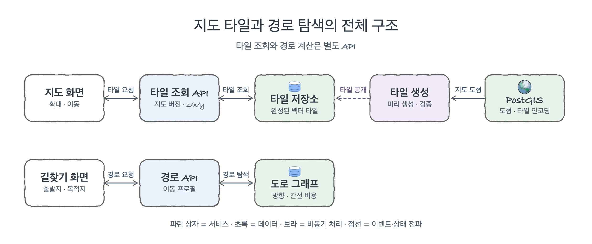

# Designing a Map and Routing Service

지도 탐색의 벡터 타일 조회와 출발지·목적지 사이의 경로 계산을 별도 API로 둔다. 타일은 확대 수준과 좌표를 키로 여러 사용자가 공유할 수 있고, 경로는 입력 좌표와 이동 수단에 따라 달라진다. [PostGIS 3.6 · ST_AsMVTGeom](https://postgis.net/docs/manual-3.6/ST_AsMVTGeom.html) · [OSRM 5.24 · Route Service](https://project-osrm.org/docs/v5.24.0/api/#route-service)

그림의 근거 · [PostGIS 3.6 · ST_AsMVTGeom](https://postgis.net/docs/manual-3.6/ST_AsMVTGeom.html) · [PostGIS 3.6 · ST_AsMVT](https://postgis.net/docs/manual-3.6/ST_AsMVT.html) · [OSRM 5.24 · Route Service](https://project-osrm.org/docs/v5.24.0/api/#route-service)

## 1. 타일의 버전과 원본 좌표계를 정한다

타일 키에 지도 데이터 버전과 `z/x/y`를 넣는다. PostGIS의 `ST_AsMVTGeom`으로 타일 좌표계에 맞춰 도형을 변환·절단하고 `ST_AsMVT`로 인코딩한다. 인기 타일은 미리 생성하고, 새 버전은 원본과 주요 타일을 검증한 뒤 공개한다. [PostGIS 3.6 · ST_AsMVTGeom](https://postgis.net/docs/manual-3.6/ST_AsMVTGeom.html) · [PostGIS 3.6 · ST_AsMVT](https://postgis.net/docs/manual-3.6/ST_AsMVT.html)

## 2. 도로 그래프와 경로 실패를 모델링한다

경로 서비스는 도로 그래프에서 이동 프로필에 맞는 경로를 찾는다. 이 예제의 자동차 경로는 예상 소요 시간으로 간선 비용을 정하고, 통행 금지 구간은 사용할 수 없는 간선으로 취급한다. 지도에 타일이 표시되어도 연결 가능한 경로가 없으면 경로 API는 별도로 실패를 응답한다. [OSRM 5.24 · Route Service](https://project-osrm.org/docs/v5.24.0/api/#route-service)

GPS 오차 때문에 도로를 잘못 선택하는 경우와 도로 폐쇄 직후의 경로를 시험한다. 타일·경로 데이터의 버전을 각각 기록해서 타일 오류, 경로 없음, 오래된 교통 정보의 영향을 구별한다. [OSRM 5.24 · Match Service](https://project-osrm.org/docs/v5.24.0/api/#match-service) · [Google SRE · Monitoring Distributed Systems](https://sre.google/sre-book/monitoring-distributed-systems/)
