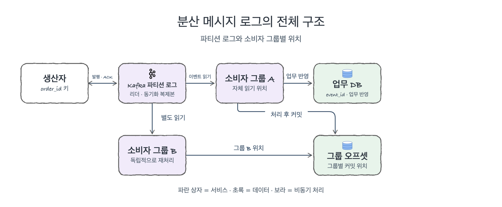

# Designing a Distributed Message Log

여러 소비자 그룹이 같은 이벤트를 독립적으로 읽고 재처리할 수 있는 로그형 메시지 큐를 설계한다. Kafka 4.2를 예로 사용하며, 소비자가 확인한 위치와 브로커의 데이터 보관 정책을 별도로 정한다. [Apache Kafka 4.2 · Design](https://kafka.apache.org/42/design/design/)

그림의 근거 · [Apache Kafka 4.2 · Design](https://kafka.apache.org/42/design/design/) · [AWS · Transactional Outbox](https://docs.aws.amazon.com/prescriptive-guidance/latest/cloud-design-patterns/transactional-outbox.html)

## 1. 순서와 발행 성공의 범위를 정한다

주문별 순서가 필요하면 `order_id`를 파티션 키로 고정한다. 오프셋은 파티션 안의 위치이므로 파티션이 다른 두 이벤트의 전역 순서를 나타내지 않는다. 해시 기반 파티셔너로 파티션 수를 바꾸면 같은 주문 키의 경로가 달라질 수 있어 기존 로그와 새 쓰기를 어디서 끊을지 정한다. [Apache Kafka 4.2 · Design](https://kafka.apache.org/42/design/design/)

`acks=all`은 현재 동기화된 복제본의 확인을 기다린다. 예를 들어 복제 인수 3과 `min.insync.replicas=2`를 쓰면 동기화된 복제본이 2개 미만일 때 이 설정의 쓰기를 거절한다. 복제본을 잃은 상태에서도 계속 쓸지와, 성공 응답 뒤 견뎌야 하는 장애를 함께 정한다. [Apache Kafka 4.2 · Design](https://kafka.apache.org/42/design/design/)

## 2. 소비자의 재처리와 적체를 검증한다

소비자는 주문 반영을 커밋한 뒤 오프셋을 커밋한다. 두 커밋 사이에 종료되면 같은 이벤트가 다시 들어올 수 있으므로 `event_id` 중복 검사와 업무 반영을 한 로컬 트랜잭션으로 처리한다. 파티션을 병렬 처리한다면 앞선 이벤트를 빠뜨린 채 뒤 오프셋을 확정하지 않는다. [Apache Kafka 4.2 · Design](https://kafka.apache.org/42/design/design/) · [AWS · Transactional Outbox](https://docs.aws.amazon.com/prescriptive-guidance/latest/cloud-design-patterns/transactional-outbox.html)

리더를 종료하고 소비자 처리 속도를 제한한 뒤 파티션별 lag, 가장 오래 기다린 이벤트의 나이, 복구 후 처리량을 본다. 그룹을 다시 시작해 누락 없이 재처리하는지 확인하고, 재처리 가능한 범위와 보존 기간을 비교한다. [Apache Kafka 4.2 · Design](https://kafka.apache.org/42/design/design/) · [Google SRE · Monitoring Distributed Systems](https://sre.google/sre-book/monitoring-distributed-systems/)
