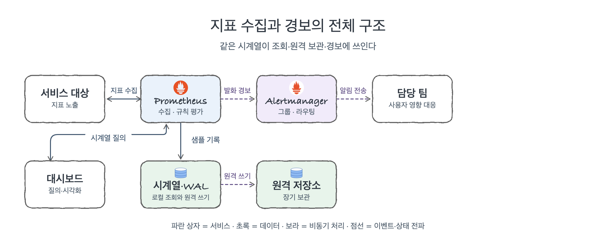

# Designing a Metrics and Alerting System

요청 성공률·지연·포화를 수집해 원인을 좁히고, 사용자에게 영향이 있는 상태를 운영자에게 알리는 시스템을 설계한다. 수집, 보관, 규칙 평가, 알림 전송은 각각 뒤처질 수 있으므로 구간별 시각을 기록한다. [Google SRE · Monitoring Distributed Systems](https://sre.google/sre-book/monitoring-distributed-systems/) · [Prometheus · Alertmanager](https://prometheus.io/docs/alerting/latest/alertmanager/)

그림의 근거 · [Prometheus · Remote Write Tuning](https://prometheus.io/docs/practices/remote_write/) · [Prometheus · Alerting Rules](https://prometheus.io/docs/prometheus/latest/configuration/alerting_rules/) · [Prometheus · Alertmanager](https://prometheus.io/docs/alerting/latest/alertmanager/) · [Google SRE · Monitoring Distributed Systems](https://sre.google/sre-book/monitoring-distributed-systems/)

## 1. 수집 경로의 데이터양을 계산한다

예를 들어 300개 대상이 활성 시계열 200개씩을 15초 간격으로 노출하면 60,000개 시계열에서 평균 약 4,000 samples/s를 수집한다. `service`와 `route_template`처럼 집합이 제한된 값은 라벨 후보로 두고, `user_id`나 개별 URL은 로그나 트레이스에서 찾는다. 라벨 조합이 늘면 이 가정을 다시 계산한다. [Prometheus · Metric and Label Naming](https://prometheus.io/docs/practices/naming/)

Prometheus 원격 쓰기는 WAL을 읽어 샤드 큐를 거쳐 대상에 보낸다. 응답이 느려졌을 때 샘플 적체와 최신 샘플 도착 지연을 관측하고, 장기 저장소 조회의 지연과 수집 자체의 실패를 구분한다. [Prometheus · Remote Write Tuning](https://prometheus.io/docs/practices/remote_write/)

## 2. 사고를 만들고 경보가 도착하는지 확인한다

예제의 경보 규칙은 오류율이 일정 시간 지속될 때 활성화한다. Prometheus 규칙의 `for`로 지속 시간을 정하고, Alertmanager에서 같은 서비스의 경보를 묶어 담당 팀으로 전달한다. 대상 수집 중단과 정상적인 무트래픽을 다른 상태로 보고, 알림까지 걸린 시간을 별도로 측정한다. [Prometheus · Alerting Rules](https://prometheus.io/docs/prometheus/latest/configuration/alerting_rules/) · [Prometheus · Alertmanager](https://prometheus.io/docs/alerting/latest/alertmanager/)
