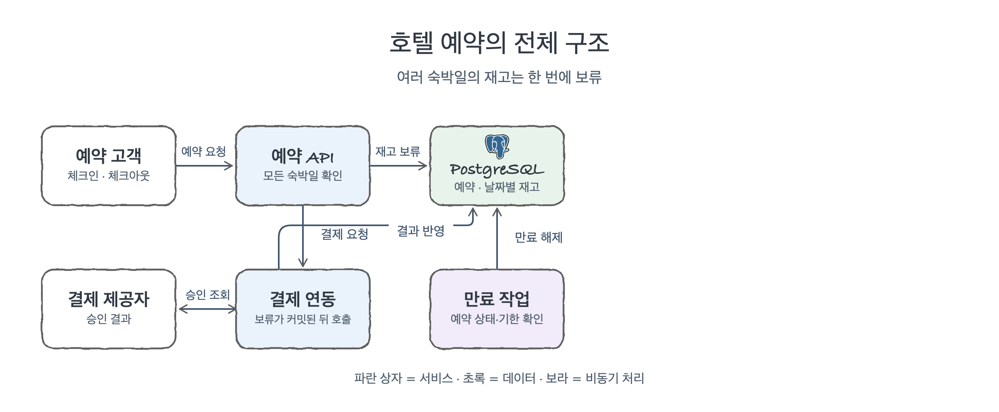

# Designing a Hotel Reservation Service

호텔 예약은 객실 유형별로 여러 숙박일의 재고를 한 번에 확보한다. 7월 1일 체크인과 7월 3일 체크아웃이라면 1일과 2일 재고를 사용한다. 객실 유형, 숙박일, 예약 수량을 입력 계약으로 두고 호텔 현지 날짜로 해석한다. [ByteByteGo · Hotel Reservation](https://bytebytego.com/courses/system-design-interview/hotel-reservation-system)

그림의 근거 · [PostgreSQL 18 · Explicit Locking](https://www.postgresql.org/docs/18/explicit-locking.html) · [AWS · Saga Orchestration](https://docs.aws.amazon.com/prescriptive-guidance/latest/cloud-design-patterns/saga-orchestration.html) · [ByteByteGo · Hotel Reservation](https://bytebytego.com/courses/system-design-interview/hotel-reservation-system) · [AWS · Making Retries Safe with Idempotent APIs](https://aws.amazon.com/builders-library/making-retries-safe-with-idempotent-APIs/)

## 1. 날짜별 재고를 한 트랜잭션으로 확보한다

예제의 재고 키는 `(hotel_id, room_type_id, stay_date)`다. PostgreSQL 18에서 예약할 날짜를 키 순으로 하나씩 잠그고 각 행의 `capacity - held - booked`가 요청 객실 수 이상인지 확인한다. 어느 하루라도 부족하거나 행이 없으면 전체 예약을 되돌린다. 예를 들어 두 날짜의 잔여가 각각 2실과 0실이면 1실 요청도 거절한다. [PostgreSQL 18 · Explicit Locking](https://www.postgresql.org/docs/18/explicit-locking.html)

## 2. 결제 응답과 보류 만료의 경합을 처리한다

재고 보류와 예약 ID를 먼저 커밋하고 외부 결제를 호출한다. 확정과 만료 처리는 같은 예약 행을 먼저 잠그고 보류 상태와 저장된 만료 시각을 함께 확인한다. 기한이 지난 뒤 결제 성공을 확인하면 결제 취소 등 보상 정책을 실행한다. [PostgreSQL 18 · Explicit Locking](https://www.postgresql.org/docs/18/explicit-locking.html) · [AWS · Saga Orchestration](https://docs.aws.amazon.com/prescriptive-guidance/latest/cloud-design-patterns/saga-orchestration.html)

두 예약이 일부 날짜만 겹치는 경우, 결제가 승인됐지만 응답이 유실된 경우, 만료 작업이 두 번 실행된 경우를 시험한다. 같은 예약 키로 재요청했을 때 객실과 금액이 두 번 반영되지 않는지 확인한다. [AWS · Making Retries Safe with Idempotent APIs](https://aws.amazon.com/builders-library/making-retries-safe-with-idempotent-APIs/) · [PostgreSQL 18 · Explicit Locking](https://www.postgresql.org/docs/18/explicit-locking.html)
