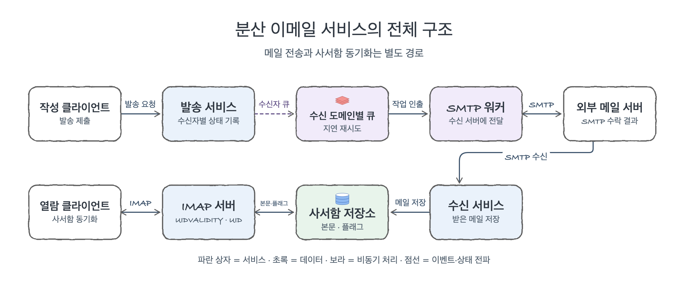

# Designing a Distributed Email Service

메일 발송 경로와 사서함 동기화 경로를 분리한다. SMTP는 서버에 메일을 전달하고, IMAP은 저장된 사서함과 메시지 상태를 클라이언트에 보여 준다. 서비스는 발송 대기, 상대 서버 수락, 재시도, 최종 실패를 구분해 기록한다. [RFC 5321 · SMTP](https://www.rfc-editor.org/rfc/rfc5321.html) · [RFC 9051 · IMAP4rev2](https://www.rfc-editor.org/rfc/rfc9051.html)

그림의 근거 · [RFC 5321 · SMTP](https://www.rfc-editor.org/rfc/rfc5321.html) · [RFC 9051 · IMAP4rev2 2.3.1.1](https://www.rfc-editor.org/rfc/rfc9051.html#section-2.3.1.1) · [RFC 5321 · SMTP 4.5.4.1](https://www.rfc-editor.org/rfc/rfc5321.html#section-4.5.4.1) · [RFC 9051 · IMAP4rev2](https://www.rfc-editor.org/rfc/rfc9051.html)

## 1. 발송 큐에서 수신자별 상태를 관리한다

발송 요청이 커밋되면 워커가 수신 도메인별로 SMTP 전달을 시도한다. `RCPT TO` 단계에서 일부 수신자만 수락될 수 있으므로 수신자별로 재시도 여부를 기록한다. 일시 실패인 4xx와 같은 요청을 그대로 반복해도 해결되지 않는 영구 실패인 5xx를 구분한다. `DATA` 뒤 성공 응답 전에 연결이 끊기면 실제 수락 여부가 불명확해 재시도에서 중복 전달이 생길 수 있다. [RFC 5321 · SMTP](https://www.rfc-editor.org/rfc/rfc5321.html)

## 2. 사서함에서 식별자와 읽음 상태를 동기화한다

IMAP 클라이언트는 계정 안에서 사서함 이름, `UIDVALIDITY`, `UID`를 묶어 메시지를 기억할 수 있다. 사서함의 `UIDVALIDITY`가 바뀌면 예전 UID를 현재 메시지에 그대로 연결하지 않고 사서함을 다시 조회한다. 읽음 표시처럼 바뀔 수 있는 플래그는 메시지 본문과 별도로 동기화한다. [RFC 9051 · IMAP4rev2 2.3.1.1](https://www.rfc-editor.org/rfc/rfc9051.html#section-2.3.1.1)

특정 도메인이 장시간 4xx를 반환하거나 수락 응답이 유실되는 상황을 재현한다. 해당 도메인의 재시도가 다른 도메인의 발송을 막지 않는지 확인하고, 큐에 가장 오래 머문 메일의 나이와 중복 전달을 살핀다. [RFC 5321 · SMTP 4.5.4.1](https://www.rfc-editor.org/rfc/rfc5321.html#section-4.5.4.1) · [Google SRE · Monitoring Distributed Systems](https://sre.google/sre-book/monitoring-distributed-systems/)
