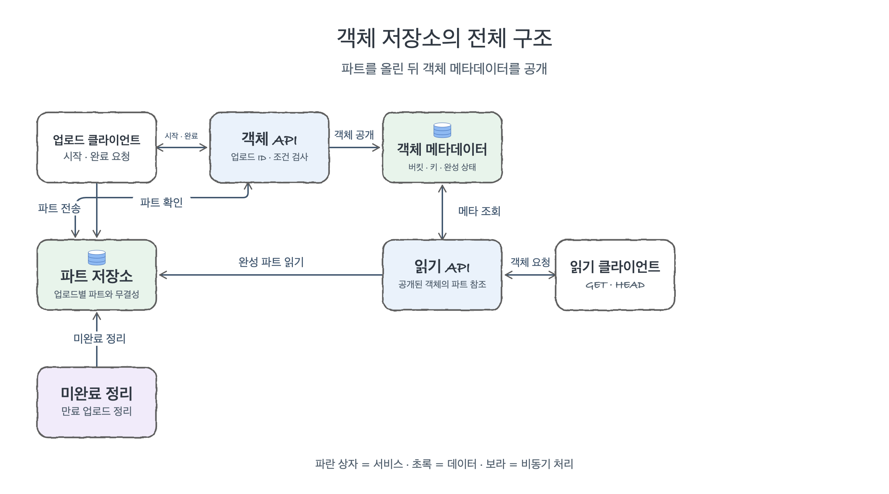

# Designing an Object Storage Service

버킷과 객체 키로 바이트 데이터를 읽고 쓰는 저장소를 설계한다. API 계층은 업로드 권한과 세션을 관리하고, 예제의 데이터 경로는 파트를 별도로 받아 저장한다. 객체 읽기는 완성된 객체의 메타데이터에서 시작한다. [Amazon S3 · Multipart Upload](https://docs.aws.amazon.com/AmazonS3/latest/userguide/mpuoverview.html)

그림의 근거 · [Amazon S3 · Multipart Upload](https://docs.aws.amazon.com/AmazonS3/latest/userguide/mpuoverview.html) · [Amazon S3 · Data Consistency Model](https://docs.aws.amazon.com/AmazonS3/latest/userguide/Welcome.html#ConsistencyModel) · [Amazon S3 · Conditional Writes](https://docs.aws.amazon.com/AmazonS3/latest/userguide/conditional-writes.html)

## 1. 파트 저장과 객체 공개를 나눈다

Amazon S3의 multipart upload는 시작, 파트 업로드, 완료로 나뉜다. 설계 예제는 업로드 ID로 각 파트를 묶고 완료 요청에서 파트 목록과 무결성 정보를 확인한 뒤 객체를 공개한다. 완료되지 않은 업로드는 객체로 읽을 수 없으므로 업로드 만료와 정리 정책을 둔다. [Amazon S3 · Multipart Upload](https://docs.aws.amazon.com/AmazonS3/latest/userguide/mpuoverview.html)

## 2. 같은 키의 경합과 실패를 검증한다

Amazon S3에서는 성공한 객체 PUT·DELETE 후의 읽기와 목록 조회에 강한 일관성을 제공한다. 현재 같은 키에 객체가 없을 때만 생성하려면 `If-None-Match: *`를, 기존 객체가 기대한 ETag일 때만 쓰려면 `If-Match`를 사용한다. 새 저장소를 설계할 때 이 보장을 객체 API 계약에 명시한다. [Amazon S3 · Data Consistency Model](https://docs.aws.amazon.com/AmazonS3/latest/userguide/Welcome.html#ConsistencyModel) · [Amazon S3 · Conditional Writes](https://docs.aws.amazon.com/AmazonS3/latest/userguide/conditional-writes.html)

같은 키로 두 업로더가 동시에 완료하는 경우와 완료 응답이 유실되는 경우를 시험한다. 재시도 전에 객체 메타데이터를 읽어 해당 업로드 세션이 완성한 객체인지 대조하고, 완료하지 못한 파트가 오래 남지 않는지 확인한다. [Amazon S3 · Conditional Writes](https://docs.aws.amazon.com/AmazonS3/latest/userguide/conditional-writes.html) · [Amazon S3 · Multipart Upload](https://docs.aws.amazon.com/AmazonS3/latest/userguide/mpuoverview.html)
