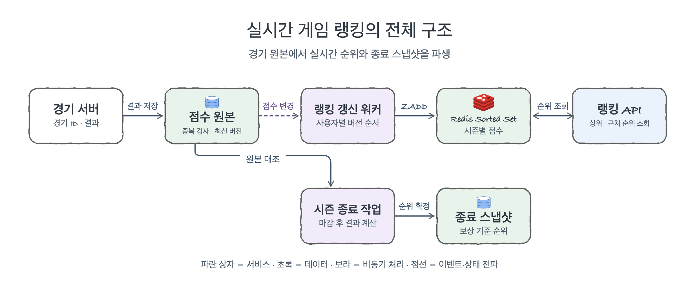

# Designing a Real-Time Game Leaderboard

시즌별 상위 순위와 내 주변 순위를 조회하는 랭킹을 설계한다. 경기 결과를 점수 원본에 보관하고 정렬된 조회용 목록을 갱신한다. 재전달된 경기 결과는 원본에서 경기 ID로 구분한다. [Redis · Sorted Sets](https://redis.io/docs/latest/develop/data-types/sorted-sets/) · [AWS · Making Retries Safe with Idempotent APIs](https://aws.amazon.com/builders-library/making-retries-safe-with-idempotent-APIs/)

그림의 근거 · [Redis · Sorted Sets](https://redis.io/docs/latest/develop/data-types/sorted-sets/) · [Redis · ZADD](https://redis.io/docs/latest/commands/zadd/) · [Flink 2.2 · Window Lifecycle and Allowed Lateness](https://nightlies.apache.org/flink/flink-docs-release-2.2/docs/dev/datastream/operators/windows/) · [Redis · ZRANGE](https://redis.io/docs/latest/commands/zrange/)

## 1. 동점을 어떻게 표시할지 결정한다

Redis 예제는 시즌별 Sorted Set에 사용자 ID와 점수를 저장한다. `ZRANGE ... REV`는 높은 점수부터 반환하고, 동점이면 멤버 문자열을 역 사전순으로 정렬한다. `ZREVRANK`는 0부터 시작하는 위치를 반환하므로 공동 1위 다음을 3위로 표시하는 정책에는 자신보다 점수가 높은 인원 수를 따로 계산한다. [Redis · ZRANGE](https://redis.io/docs/latest/commands/zrange/) · [Redis · ZREVRANK](https://redis.io/docs/latest/commands/zrevrank/)

## 2. 급증하는 갱신과 시즌 종료를 처리한다

점수 변경 이벤트에 사용자별 버전을 붙이고, 조회 목록에는 중복을 제거한 절대 점수를 버전 순서대로 반영한다. `ZADD`는 같은 멤버의 점수를 갱신하므로 사용자별로 버전 확인과 점수 반영을 직렬화해 최신 점수가 오래된 점수로 되돌아가는 경합을 막는다. [Redis · ZADD](https://redis.io/docs/latest/commands/zadd/) · [AWS · Making Retries Safe with Idempotent APIs](https://aws.amazon.com/builders-library/making-retries-safe-with-idempotent-APIs/)

시즌 중 실시간 조회와 보상 지급에 쓰는 종료 스냅샷을 따로 정의한다. 지연 도착을 얼마 동안 받아 줄지 정하고, 동점이 순위 경계에 몰릴 때와 시즌 종료 직전에 중복 이벤트가 들어올 때 최종 결과를 확인한다. 정확한 상위 K를 여러 샤드에서 계산하는 조건은 [스트림 Top-K 설계](26_finding_top_k_on_an_event_stream.md)에서 다룬다. [Flink 2.2 · Window Lifecycle and Allowed Lateness](https://nightlies.apache.org/flink/flink-docs-release-2.2/docs/dev/datastream/operators/windows/)
