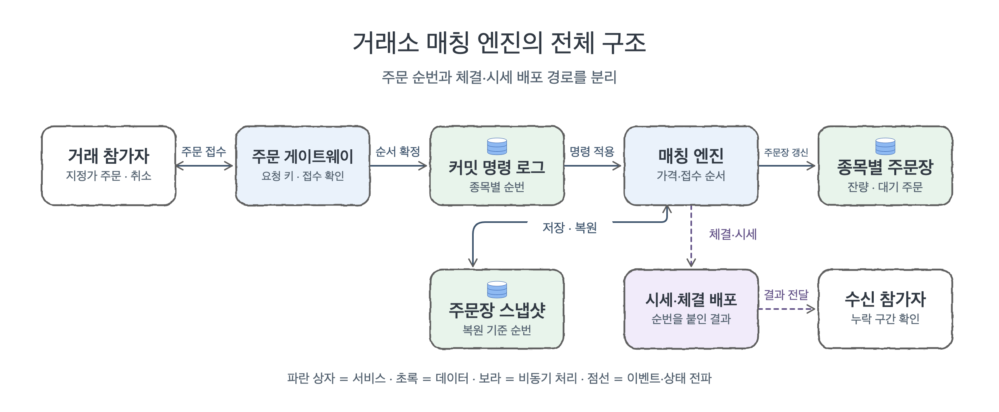

# Designing an Exchange Matching Engine

지정가 주문의 접수·취소·부분 체결과 시세 배포를 다루는 교육용 거래소를 설계한다. 예제는 더 나은 가격을 우선하고 같은 가격에서는 접수 순서를 따른다. 실제 Nasdaq의 우선순위에는 표시 여부와 주문 유형에 따른 규칙도 들어간다. [Nasdaq Equity 4 · Rules 4756–4757](https://listingcenter.nasdaq.com/rulebook/nasdaq/rules/nasdaq-equity-4)

그림의 근거 · [Nasdaq Equity 4 · Rules 4756–4757](https://listingcenter.nasdaq.com/rulebook/nasdaq/rules/nasdaq-equity-4) · [Ongaro·Ousterhout · Raft](https://raft.github.io/raft.pdf) · [Nasdaq · TotalView-ITCH 5.0](https://www.nasdaqtrader.com/content/technicalsupport/specifications/dataproducts/NQTVITCHSpecification_5.0.pdf) · [Nasdaq · MoldUDP64](https://www.nasdaqtrader.com/content/technicalsupport/specifications/dataproducts/moldudp64.pdf)

## 1. 종목별 주문 순서와 체결 결과를 확정한다

게이트웨이는 요청 키를 확인해 중복 접수를 구분하고, 종목별 주문장에는 순서가 확정된 명령을 한 번씩 적용한다. 예를 들어 같은 가격에 매도 주문 A 5주와 B 4주가 차례로 대기할 때 7주 매수 주문은 A 5주와 B 2주를 체결하고 B 2주를 남긴다. 접수 확인과 체결 통지는 별도 메시지로 기록한다. [Nasdaq Equity 4 · Rules 4756–4757](https://listingcenter.nasdaq.com/rulebook/nasdaq/rules/nasdaq-equity-4) · [Ongaro·Ousterhout · Raft](https://raft.github.io/raft.pdf)

## 2. 주문장과 시세 수신기의 복구를 시험한다

매칭 엔진은 커밋된 명령 로그와 순번이 붙은 스냅샷으로 주문장을 복원한다. 다른 노드가 같은 로그를 적용했을 때 남은 수량과 체결 ID가 같은지, 새 리더가 이전 리더와 동시에 주문을 확정할 수 없는지 시험한다. [Ongaro·Ousterhout · Raft](https://raft.github.io/raft.pdf)

시세 수신기는 연속 순번을 추적한다. 누락이 나면 재전송으로 구간을 채우고, 채울 수 없을 때는 이 예제의 스냅샷에서 다시 시작한다. 시세가 늦어져도 매칭 경로가 같이 막히지 않는지, 수신기가 중복 패킷을 주문장에 두 번 반영하지 않는지 확인한다. [Nasdaq · TotalView-ITCH 5.0](https://www.nasdaqtrader.com/content/technicalsupport/specifications/dataproducts/NQTVITCHSpecification_5.0.pdf) · [Nasdaq · MoldUDP64](https://www.nasdaqtrader.com/content/technicalsupport/specifications/dataproducts/moldudp64.pdf)
