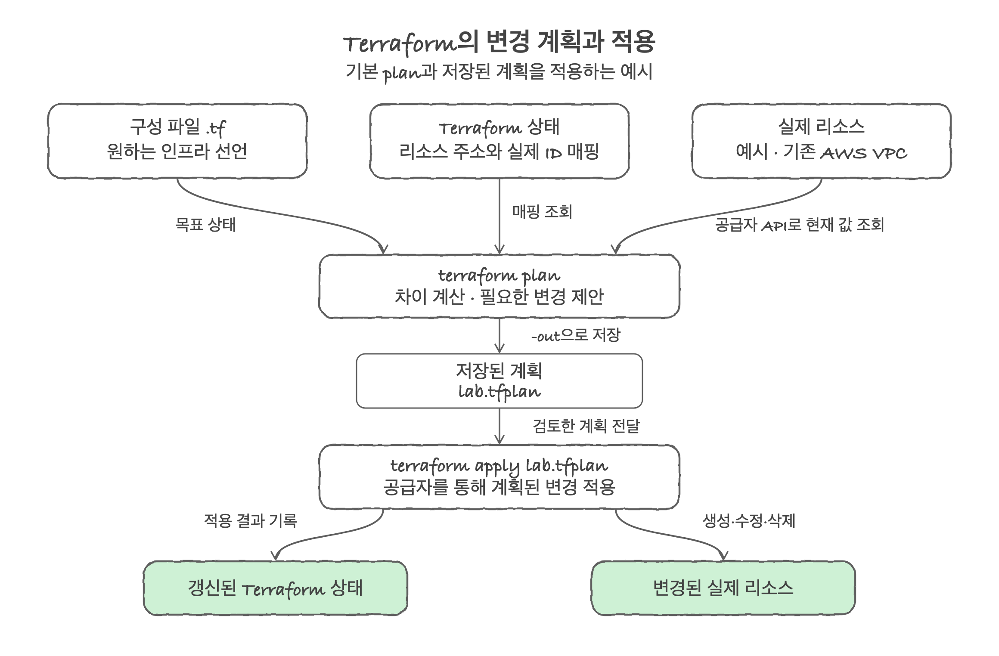

# Terraform Workflow and AWS CLI Setup

Terraform은 인프라의 목표 상태를 코드로 선언하고, 구성과 상태, 공급자가 읽은 실제 리소스를 비교해 변경 계획을 만든다. 작업에 필요한 자격 증명과 기존 리소스를 관리하는 상태의 위치를 먼저 확인한다. [Terraform Core Workflow](https://developer.hashicorp.com/terraform/intro/core-workflow)

## 1. 도구와 AWS 접근

Terraform CLI와 AWS CLI v2를 설치한 뒤 `terraform version`과 `aws --version`으로 확인한다. 아래 실습은 Terraform 1.10 이상을 기준으로 한다. Zsh를 써도 동일한 CLI 명령을 실행할 수 있다. Oh My Zsh는 자동 완성과 프롬프트를 위한 선택 사항이다. [Terraform 설치](https://developer.hashicorp.com/terraform/install) · [AWS CLI 설치](https://docs.aws.amazon.com/cli/latest/userguide/getting-started-install.html) · [Oh My Zsh](https://ohmyz.sh/)

IAM Identity Center가 구성된 계정에서는 다음 흐름으로 이름 있는 프로파일과 임시 자격 증명을 사용한다. `aws configure`는 프로파일의 기본 설정을 다루며, 자격 증명 방식은 조직의 정책에 따라 선택한다. 시작 전에 실제 계정과 역할을 확인한다. [AWS CLI IAM Identity Center](https://docs.aws.amazon.com/cli/latest/userguide/cli-configure-sso.html)

```bash
aws configure sso --profile sandbox
aws sso login --profile sandbox
export AWS_PROFILE=sandbox
export AWS_REGION=ap-northeast-2
aws sts get-caller-identity
```

EC2에 SSH로 연결하는 환경이라면 올바른 AMI 사용자, 사설 키와 파일 권한, 인스턴스까지 도달하는 경로를 확인한다. 퍼블릭 IPv4를 통한 직접 SSH는 키 페어와 제한된 출발지의 보안 그룹 인바운드가 필요하다. 사설 서브넷에서는 Session Manager를 검토할 수 있다. 이 방식은 SSM Agent, 인스턴스 역할, Systems Manager 서비스에 대한 네트워크 경로가 필요하다. [EC2 SSH](https://docs.aws.amazon.com/AWSEC2/latest/UserGuide/connect-linux-inst-ssh.html) · [Session Manager 사전 요건](https://docs.aws.amazon.com/systems-manager/latest/userguide/session-manager-prerequisites.html)

## 2. AWS 계정 없이 CLI 흐름 익히기

빈 디렉터리의 `main.tf`에 다음을 넣는다. `terraform_data`는 Terraform에 내장된 리소스라 이 예제에 클라우드 공급자나 AWS 계정이 필요하지 않다. [Terraform Data Resource](https://developer.hashicorp.com/terraform/language/resources/terraform-data)

```hcl
terraform {
  required_version = ">= 1.10.0, < 2.0.0"
}

resource "terraform_data" "example" {
  input = "terraform-lab"
}

output "message" {
  value = terraform_data.example.output
}
```

```bash
terraform init
terraform fmt -check
terraform validate
terraform plan -out=lab.tfplan
terraform apply lab.tfplan
terraform output -raw message
terraform state list
terraform plan -destroy -out=cleanup.tfplan
terraform apply cleanup.tfplan
```

`init`은 백엔드와 공급자 등을 초기화한다. `validate`는 구성의 형식과 내부 일관성을 검사하고, `plan`은 예상 변경을 표시한다. `apply`는 실제 변경과 상태 갱신을 수행한다. 위 삭제 계획은 로컬 예제만 정리한다. AWS 작업에서는 계획에 나온 대상과 계정, 교체·삭제 여부를 적용 전에 각각 확인한다. [Terraform CLI](https://developer.hashicorp.com/terraform/cli)


