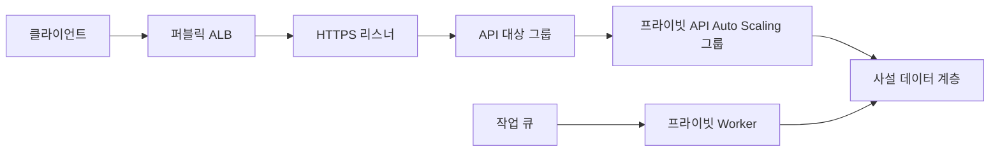

# Three-Tier AWS Infrastructure and Terraform Import

3계층 구성에서는 외부 트래픽을 받는 계층, 애플리케이션을 실행하는 계층, 상태를 보관하는 계층을 구분한다. VPC는 네트워크 경계를, Terraform 상태는 인프라 변경의 책임과 수명 주기를 표현한다.

## 1. 요청 경로와 환경 분리



| 계층 | 구성과 허용할 흐름 |
| --- | --- |
| 진입 | 두 가용 영역 이상의 퍼블릭 서브넷에 ALB를 둔다. 허용한 출발지의 HTTPS를 받고 API 포트로 전달한다. |
| 애플리케이션 | API는 사설 서브넷에서 실행하고, ALB 보안 그룹에서 온 앱·헬스 체크 포트를 허용한다. Worker는 업무상 필요한 큐와 저장소 연결을 부여한다. |
| 데이터 | DB는 사설 데이터 계층에 둔다. 앱·Worker 중 필요한 보안 그룹과 포트만 허용한다. |

dev와 stage는 같은 모듈을 사용할 수 있다. 입력값·IAM과 상태 키는 환경별로 분리하고, VPC를 공유한다면 서브넷과 트래픽 정책의 경계가 어떤 장애를 격리하는지 확인한다. [ALB Security Groups](https://docs.aws.amazon.com/elasticloadbalancing/latest/application/load-balancer-update-security-groups.html) · [Auto Scaling과 로드 밸런서](https://docs.aws.amazon.com/autoscaling/ec2/userguide/getting-started-elastic-load-balancing.html)

## 2. HTTPS ALB와 API용 Auto Scaling 그룹

아래는 기존 VPC에 붙이는 별도 Terraform 구성이다. 퍼블릭 서브넷은 서로 다른 가용 영역에 두고, 프라이빗 서브넷도 해당 가용 영역에 맞춘다. AMI에는 부팅 시 8080 포트로 서비스를 시작하고 `/health`에서 준비 상태를 반환하는 앱이 있어야 한다. 이 구성은 ALB–API 연결에 필요한 규칙을 다룬다. API의 DB·SSM·외부 서비스 접근은 필요한 네트워크 규칙과 인스턴스 역할을 운영 구성에서 연결한다.

```hcl
terraform {
  required_version = ">= 1.10.0, < 2.0.0"
  required_providers {
    aws = {
      source  = "hashicorp/aws"
      version = "~> 6.0"
    }
  }
}

provider "aws" {
  region = "ap-northeast-2"
}

variable "vpc_id" { type = string }
variable "public_subnet_ids" { type = list(string) }
variable "private_subnet_ids" { type = list(string) }
variable "certificate_arn" { type = string }
variable "ami_id" { type = string }
variable "client_cidr" { type = string }

resource "aws_security_group" "alb" {
  name_prefix = "tf-alb-"
  vpc_id      = var.vpc_id
}

resource "aws_security_group" "api" {
  name_prefix = "tf-api-"
  vpc_id      = var.vpc_id
}

resource "aws_vpc_security_group_ingress_rule" "https" {
  security_group_id = aws_security_group.alb.id
  cidr_ipv4         = var.client_cidr
  ip_protocol       = "tcp"
  from_port         = 443
  to_port           = 443
}

resource "aws_vpc_security_group_egress_rule" "alb_to_api" {
  security_group_id            = aws_security_group.alb.id
  referenced_security_group_id = aws_security_group.api.id
  ip_protocol                  = "tcp"
  from_port                    = 8080
  to_port                      = 8080
}

resource "aws_vpc_security_group_ingress_rule" "api_from_alb" {
  security_group_id            = aws_security_group.api.id
  referenced_security_group_id = aws_security_group.alb.id
  ip_protocol                  = "tcp"
  from_port                    = 8080
  to_port                      = 8080
}

resource "aws_lb" "api" {
  name               = "tf-lab-api"
  load_balancer_type = "application"
  internal           = false
  security_groups    = [aws_security_group.alb.id]
  subnets            = var.public_subnet_ids
}

resource "aws_lb_target_group" "api" {
  name        = "tf-lab-api"
  target_type = "instance"
  vpc_id      = var.vpc_id
  protocol    = "HTTP"
  port        = 8080

  health_check {
    path    = "/health"
    matcher = "200"
  }
}

resource "aws_lb_listener" "https" {
  load_balancer_arn = aws_lb.api.arn
  port              = 443
  protocol          = "HTTPS"
  certificate_arn   = var.certificate_arn
  ssl_policy        = "ELBSecurityPolicy-TLS13-1-2-2021-06"

  default_action {
    type             = "forward"
    target_group_arn = aws_lb_target_group.api.arn
  }
}

resource "aws_launch_template" "api" {
  name_prefix            = "tf-lab-api-"
  image_id               = var.ami_id
  instance_type          = "t3.micro"
  vpc_security_group_ids = [aws_security_group.api.id]
}

resource "aws_autoscaling_group" "api" {
  name                      = "tf-lab-api"
  min_size                  = 2
  max_size                  = 4
  desired_capacity          = 2
  vpc_zone_identifier       = var.private_subnet_ids
  target_group_arns         = [aws_lb_target_group.api.arn]
  health_check_type         = "ELB"
  health_check_grace_period = 120

  launch_template {
    id      = aws_launch_template.api.id
    version = tostring(aws_launch_template.api.latest_version)
  }

  depends_on = [aws_lb_listener.https]
}
```

ASG에서 API 인스턴스를 대상 그룹의 `instance` 대상으로 등록한다. 시작 템플릿을 바꾸면 새로 시작하는 인스턴스가 새 버전을 쓰며, 기존 인스턴스를 교체할 시점과 속도는 Instance Refresh 등으로 관리한다. Worker는 별도 시작 템플릿과 그룹을 두고, 큐 지연이나 작업 수 같은 지표가 확장 정책에 맞는지 검토한다. [EC2 Instance Refresh](https://docs.aws.amazon.com/autoscaling/ec2/userguide/instance-refresh-overview.html)

## 3. Internal NLB, 트러블슈팅, import

Internal NLB는 사설 경로에서 TCP·TLS·UDP 등 전송 계층 트래픽을 전달하는 구성에 쓸 수 있다. HTTP 경로·호스트 규칙이 필요한지, 사설 TCP 연결이나 PrivateLink 서비스의 진입점이 필요한지 기준으로 ALB와 NLB를 선택한다.

외부에서 API 접근이 안 되면 DNS와 리스너, 대상 그룹 등록·헬스 체크, 보안 그룹과 앱 포트 순서로 확인한다. ASG에서 인스턴스가 반복 교체되면 활동 기록, 헬스 체크의 실패 이유, 부팅 시간과 유예 기간을 함께 본다. [ALB Troubleshooting](https://docs.aws.amazon.com/elasticloadbalancing/latest/application/load-balancer-troubleshooting.html) · [NLB Troubleshooting](https://docs.aws.amazon.com/elasticloadbalancing/latest/network/load-balancer-troubleshooting.html)

기존 ALB를 이 구성으로 관리하려면 실제 ARN을 확인하고 설정을 현재 상태에 맞춘 뒤 아래 블록을 추가한다. `plan`에서 import와 동시에 예정된 수정·교체·삭제를 확인하고 적용한다. ALB 가져오기는 리스너, 대상 그룹, 역할이나 ASG를 함께 가져오는 동작과 구분한다. [Terraform Import](https://developer.hashicorp.com/terraform/language/import) · [AWS Provider · aws_lb Import](https://registry.terraform.io/providers/hashicorp/aws/latest/docs/resources/lb#import)

```hcl
variable "existing_alb_arn" { type = string }

import {
  to = aws_lb.api
  id = var.existing_alb_arn
}
```
