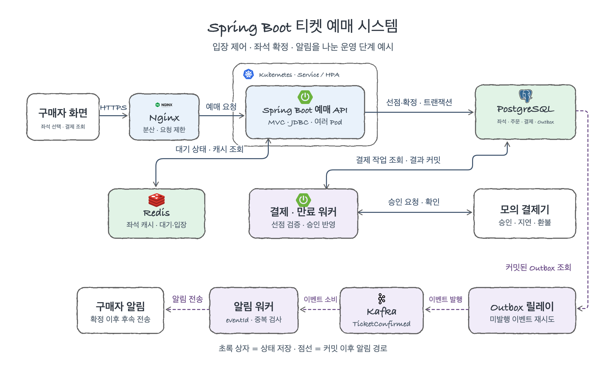

# Defining Ticketing Invariants

이 실습은 공연의 지정석 한 자리를 한 번에 한 주문에만 판매한다. Java 21과 Spring Boot 3.5의 Spring MVC·JDBC로 시작해 PostgreSQL 18을 좌석과 주문의 쓰기 원본으로 사용한다. 첫 배포는 API 한 대와 DB로 시작하고, 운영 단계에서 Nginx·Redis·Kafka·Kubernetes를 붙인다. [Spring Boot 3.5 · SQL Databases](https://docs.spring.io/spring-boot/3.5/reference/data/sql.html) · [PostgreSQL 18 · Constraints](https://www.postgresql.org/docs/18/ddl-constraints.html) · [Google SRE · Handling Overload](https://sre.google/sre-book/handling-overload/)

그림의 근거 · [Spring Boot 3.5 · SQL Databases](https://docs.spring.io/spring-boot/3.5/reference/data/sql.html) · [Kubernetes · Horizontal Pod Autoscaling](https://kubernetes.io/docs/concepts/workloads/autoscaling/horizontal-pod-autoscale/) · [Nginx · Load Balancing](https://nginx.org/en/docs/http/load_balancing.html) · [PostgreSQL 18 · Row-Level Locks](https://www.postgresql.org/docs/18/explicit-locking.html) · [AWS · Transactional Outbox](https://docs.aws.amazon.com/prescriptive-guidance/latest/cloud-design-patterns/transactional-outbox.html) · [Microsoft · Queue-Based Load Leveling](https://learn.microsoft.com/en-us/azure/architecture/patterns/queue-based-load-leveling)

## 1. 좌석의 상태와 판매 조건을 정한다

이벤트와 좌석의 조합을 원본 행의 키로 둔다. 선점하면 `AVAILABLE → HELD`, 기한 안의 결제를 반영하면 `HELD → SOLD`가 된다. 만료된 선점은 해제할 수 있다. 판매 후 다시 판매하지 않는 실습 범위에서는 주문 테이블에도 `UNIQUE(event_id, seat_id)`를 둔다. [PostgreSQL 18 · Constraints](https://www.postgresql.org/docs/18/ddl-constraints.html) · [PostgreSQL 18 · Row-Level Locks](https://www.postgresql.org/docs/18/explicit-locking.html)

## 2. 읽기와 확정의 경계를 분리한다

좌석 조회는 배치도를 빠르게 표시한다. 최종 선점·확정은 PostgreSQL의 현재 `hold_id`와 기한으로 판정한다. 알림은 확정 이후 별도로 전송하고, 워커가 중단됐을 때 재처리할 수 있도록 예매 변경과 Outbox를 같은 트랜잭션에 남긴다. [PostgreSQL 18 · Row-Level Locks](https://www.postgresql.org/docs/18/explicit-locking.html) · [Microsoft · Cache-Aside](https://learn.microsoft.com/en-us/azure/architecture/patterns/cache-aside) · [AWS · Transactional Outbox](https://docs.aws.amazon.com/prescriptive-guidance/latest/cloud-design-patterns/transactional-outbox.html)

## 3. 첫 번째 완료 조건을 정한다

같은 좌석에 여러 건이 몰렸을 때 유효 선점이 하나이고 확정 주문도 하나인지 먼저 검증한다. 다른 좌석은 서로 진행할 수 있어야 한다. DB 경쟁과 결제 응답 유실을 체크한 뒤 분산 배치에서 같은 계약을 재검증한다. 관련 기본 설명은 [티켓 예매 설계](../system-design/22_designing_a_ticket_reservation_service.md)에서 이어 읽는다. [PostgreSQL 18 · Transaction Isolation](https://www.postgresql.org/docs/18/transaction-iso.html) · [AWS · Making Retries Safe](https://aws.amazon.com/builders-library/making-retries-safe-with-idempotent-APIs/)
