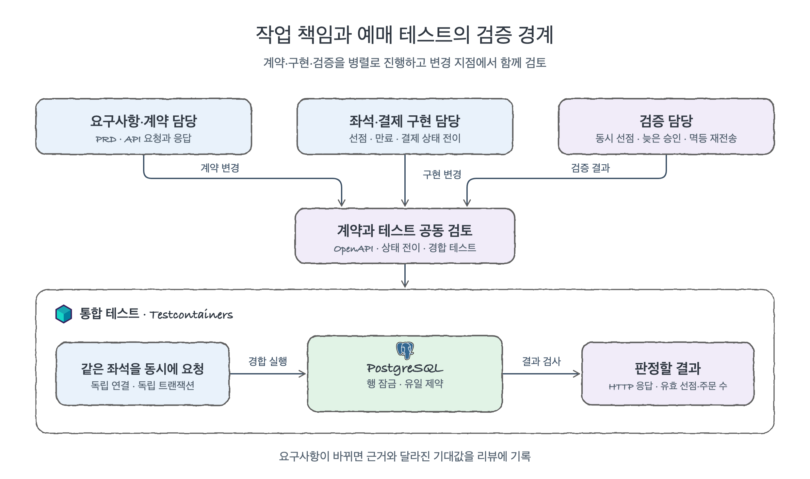

# Organizing Agent Work and Protecting Tests

실습 작업을 요구사항·API 계약, 좌석·결제 구현, 검증으로 나눈다. 작업자가 여럿이면 같은 파일을 동시에 수정하지 않도록 변경 담당과 통합 순서를 적고, 계약 변경은 검증 담당이 같이 확인한다. 이 저장소의 [위키 작업 규칙](../AGENTS.md)과 [테스트 실패를 다루는 방법](../test-driven-development/04_test_failures_and_safe_design_changes.md)을 작업 요청에 연결한다. [Lounge · 계약이 바뀔 때의 테스트](../test-driven-development/04_test_failures_and_safe_design_changes.md#3-요구사항-변경에-따라-테스트-고치기)

그림의 근거 · [Spring Boot 3.5 · Testcontainers](https://docs.spring.io/spring-boot/3.5/reference/testing/testcontainers.html) · [PostgreSQL 18 · Row-Level Locks](https://www.postgresql.org/docs/18/explicit-locking.html#LOCKING-ROWS) · [OpenAPI 3.1.1](https://spec.openapis.org/oas/v3.1.1.html)

## 1. 깨지면 안 되는 테스트를 먼저 합의한다

같은 좌석 동시 선점, 만료 후 늦은 승인, 같은 멱등 키 재전송을 필수 사례로 둔다. 각 테스트에는 입력과 기대 HTTP 응답뿐 아니라 DB의 유효 선점·확정 주문 수를 적는다. 실패한 테스트를 바꿀 때는 요구가 바뀐 근거와 달라진 기대값을 리뷰에 남긴다. [JUnit 5.13 · User Guide](https://docs.junit.org/5.13.4/user-guide/) · [PostgreSQL 18 · Row-Level Locks](https://www.postgresql.org/docs/18/explicit-locking.html) · [AWS · Making Retries Safe](https://aws.amazon.com/builders-library/making-retries-safe-with-idempotent-APIs/)

## 2. 실제 PostgreSQL로 동시성 테스트를 작성한다

평상시 테스트는 서비스 조건을 빠르게 검증하고, 잠금과 유일 제약은 Spring Boot 통합 테스트에서 Testcontainers의 PostgreSQL로 확인한다. 여러 요청은 독립 연결과 트랜잭션을 사용하며, 경쟁을 시작하기 전에 각 작업의 준비 상태를 확인한다. 같은 테스트 트랜잭션 안에서 요청을 순서대로 호출하면 실제 경쟁을 검증하기 어렵다. [Spring Boot 3.5 · Testcontainers](https://docs.spring.io/spring-boot/3.5/reference/testing/testcontainers.html) · [PostgreSQL 18 · Transaction Isolation](https://www.postgresql.org/docs/18/transaction-iso.html) · [PostgreSQL 18 · Constraints](https://www.postgresql.org/docs/18/ddl-constraints.html)

## 3. 계약과 테스트를 함께 검토한다

PR에는 OpenAPI 변경, 상태 전이, 경합 테스트 결과를 함께 남긴다. 예매 불변식의 완화가 필요한 경우 실패 출력을 삭제하는 대신 요구사항과 모델·테스트를 함께 업데이트한다. [OpenAPI 3.1.1](https://spec.openapis.org/oas/v3.1.1.html) · [Lounge · 계약이 바뀔 때의 테스트](../test-driven-development/04_test_failures_and_safe_design_changes.md#3-요구사항-변경에-따라-테스트-고치기)
