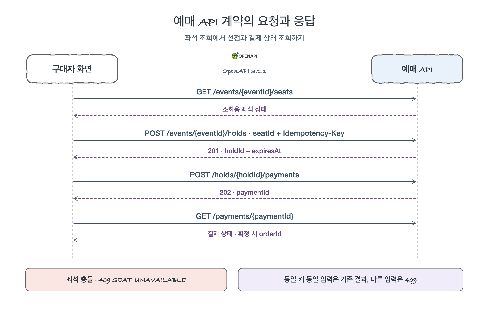

# Writing the PRD and API Contract

첫 출시 범위는 공연별 좌석 조회, 로그인한 구매자의 단일 좌석 선점, 모의 결제 시작, 결과 조회다. PRD에는 선점 기한, 좌석 확정 조건, 대기열 도입 단계, 정상·혼잡 상태별 목표 응답을 적는다. OpenAPI 3.1.1 문서에 같은 계약을 기록한다. [OpenAPI 3.1.1](https://spec.openapis.org/oas/v3.1.1.html) · [Google SRE · Implementing SLOs](https://sre.google/workbook/implementing-slos/)

그림의 근거 · [OpenAPI 3.1.1](https://spec.openapis.org/oas/v3.1.1.html) · [RFC 9110 · HTTP Semantics](https://www.rfc-editor.org/rfc/rfc9110.html) · [AWS · Making Retries Safe](https://aws.amazon.com/builders-library/making-retries-safe-with-idempotent-APIs/)

## 1. 조회와 선점의 계약을 정한다

`GET /events/{eventId}/seats`는 조회용 좌석 상태를 반환한다. `POST /events/{eventId}/holds`는 `seatId`와 `Idempotency-Key`를 받아 성공하면 `201`, `holdId`, 서버가 지정한 `expiresAt`을 반환한다. 다른 구매자가 먼저 잡았거나 이미 판매된 좌석이면 `409`와 `SEAT_UNAVAILABLE`을 응답한다. 대기열 단계에서는 이 요청에 입장 토큰도 검증한다. [OpenAPI 3.1.1](https://spec.openapis.org/oas/v3.1.1.html) · [AWS · Making Retries Safe](https://aws.amazon.com/builders-library/making-retries-safe-with-idempotent-APIs/) · [PostgreSQL 18 · Row-Level Locks](https://www.postgresql.org/docs/18/explicit-locking.html) · [RFC 9457 · Problem Details](https://www.rfc-editor.org/rfc/rfc9457.html)

## 2. 결제는 별도 상태로 조회한다

`POST /holds/{holdId}/payments`는 결제 요청을 접수하면 `202`와 `paymentId`를 반환한다. `GET /payments/{paymentId}`는 본인의 결제 처리 상태와, 예매가 확정된 경우 `orderId`를 반환한다. 같은 사용자·작업·요청 키에 같은 입력이면 기존 결과를 돌려주고, 같은 키의 다른 입력은 `409`로 구분한다. [OpenAPI 3.1.1](https://spec.openapis.org/oas/v3.1.1.html) · [RFC 9110 · HTTP Semantics](https://www.rfc-editor.org/rfc/rfc9110.html) · [AWS · Making Retries Safe](https://aws.amazon.com/builders-library/making-retries-safe-with-idempotent-APIs/)

## 3. 오류 응답과 인수 조건을 명시한다

Spring MVC에서 `ProblemDetail`로 HTTP 상태, 안정적인 업무 코드, 사용자에게 보여 줄 설명을 전달한다. 예를 들어 `HOLD_EXPIRED`는 선점을 다시 시작하게 하고, `SEAT_UNAVAILABLE`은 좌석을 새로 읽게 한다. 인수 테스트는 정상 흐름, 동시 선점의 `409`, 결제 접수 후 조회를 포함한다. [Spring Framework 6.2 · Error Responses](https://docs.spring.io/spring-framework/reference/6.2/web/webmvc/mvc-ann-rest-exceptions.html) · [RFC 9457 · Problem Details](https://www.rfc-editor.org/rfc/rfc9457.html) · [OpenAPI 3.1.1](https://spec.openapis.org/oas/v3.1.1.html)
