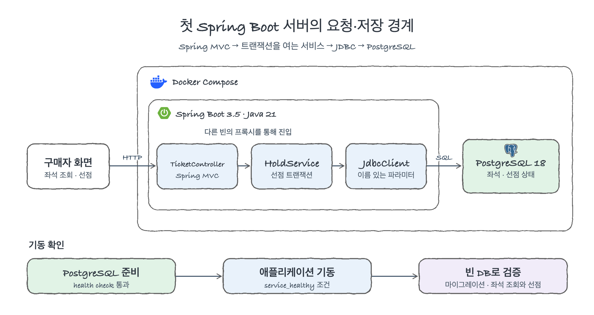

# Building the First Server with Spring Boot

첫 서버는 Spring Boot 3.5, Java 21, Spring MVC, JDBC와 PostgreSQL 18로 구성한다. `spring-boot-starter-web`과 `spring-boot-starter-jdbc`, PostgreSQL JDBC 드라이버를 사용하고, Docker Compose에는 애플리케이션과 DB를 둔다. [Spring Boot 3.5 · Starters](https://docs.spring.io/spring-boot/3.5/reference/using/build-systems.html) · [Spring Boot 3.5 · SQL Databases](https://docs.spring.io/spring-boot/3.5/reference/data/sql.html) · [Docker Compose · Startup Order](https://docs.docker.com/compose/how-tos/startup-order/)

그림의 근거 · [Spring Framework 6.2 · Transactional](https://docs.spring.io/spring-framework/reference/6.2/data-access/transaction/declarative/annotations.html) · [Spring Framework 6.2 · JdbcClient](https://docs.spring.io/spring-framework/reference/6.2/data-access/jdbc/core.html) · [Docker Compose · Startup Order](https://docs.docker.com/compose/how-tos/startup-order/)

## 1. 요청부터 DB까지 경계를 잡는다

`TicketController`는 입력과 HTTP 응답을 처리하고, `HoldService`가 선점 트랜잭션을 연다. 저장 계층은 `JdbcClient`의 이름 있는 파라미터로 SQL을 전달한다. 기본 프록시 방식에서 트랜잭션 메서드는 다른 빈에서 호출하게 두고, 같은 객체의 내부 호출에 트랜잭션 시작을 맡기지 않는다. [Spring Boot 3.5 · SQL Databases](https://docs.spring.io/spring-boot/3.5/reference/data/sql.html) · [Spring Framework 6.2 · JdbcClient](https://docs.spring.io/spring-framework/reference/6.2/data-access/jdbc/core.html) · [Spring Framework 6.2 · Transactional](https://docs.spring.io/spring-framework/reference/6.2/data-access/transaction/declarative/annotations.html)

## 2. Compose 준비 확인과 스키마 변경을 관리한다

PostgreSQL에 health check를 두고 앱 서비스의 `depends_on`에 `condition: service_healthy`를 설정한다. 앱은 스키마 마이그레이션을 버전별로 관리하고, 컨테이너가 실행된 뒤에는 빈 DB에서 좌석 목록과 선점 API가 실제로 동작하는지 확인한다. [Docker Compose · Startup Order](https://docs.docker.com/compose/how-tos/startup-order/) · [PostgreSQL 18 · Constraints](https://www.postgresql.org/docs/18/ddl-constraints.html) · [Spring Boot 3.5 · SQL Databases](https://docs.spring.io/spring-boot/3.5/reference/data/sql.html)

## 3. 기능을 붙이는 순서를 작게 유지한다

좌석 1개를 시드 데이터로 넣고 좌석 조회와 선점부터 실행한다. 같은 좌석을 다시 요청했을 때 응답을 확인한 뒤, 새 컨테이너에서 DB 제약과 동시 선점 테스트를 반복한다. 이 단계의 성공 조건은 기능과 상태 전이이며, 처리량은 다음 실습에서 측정한다. [Spring Boot 3.5 · Testcontainers](https://docs.spring.io/spring-boot/3.5/reference/testing/testcontainers.html) · [PostgreSQL 18 · Transaction Isolation](https://www.postgresql.org/docs/18/transaction-iso.html) · [Google SRE · Implementing SLOs](https://sre.google/workbook/implementing-slos/)
