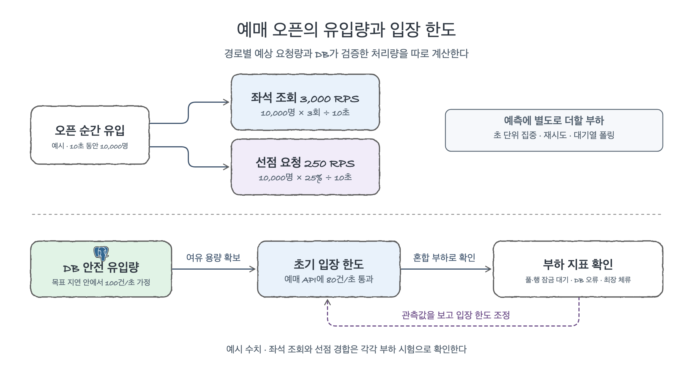

# Estimating Traffic and Server Capacity for Ticketing

가입자 수와 예매 오픈 순간의 유입량을 구분한다. 브라우저의 좌석 조회와 대기열 폴링은 비교적 자주 발생하고, 선점·확정은 원본 DB에 쓰기 잠금을 유발한다. 각 경로의 유입과 처리 한도를 따로 추정한다. [Google SRE · Handling Overload](https://sre.google/sre-book/handling-overload/) · [Google SRE · Implementing SLOs](https://sre.google/workbook/implementing-slos/)

그림의 근거 · [Microsoft · Queue-Based Load Leveling](https://learn.microsoft.com/en-us/azure/architecture/patterns/queue-based-load-leveling) · [Google SRE · Handling Overload](https://sre.google/sre-book/handling-overload/)

## 1. 동시 유입을 경로별 처리량으로 바꾼다

예를 들어 10초에 10,000명이 들어오고 각자 좌석 화면을 세 번 읽으면 그 구간 평균은 조회 3,000 RPS다. 같은 구간에 25%가 한 번씩 선점하면 평균 쓰기 요청은 250 RPS다. 이 값은 해당 구간의 평균이므로 초 단위 집중도, 재시도, 대기열 폴링은 별도로 더한다. [Google SRE · Handling Overload](https://sre.google/sre-book/handling-overload/) · [Google SRE · Implementing SLOs](https://sre.google/workbook/implementing-slos/)

## 2. DB가 견디는 처리량에서 입장 속도를 정한다

목표 지연 안에서 선점·결제 반영을 섞어 검증한 안전 유입량이 초당 100건이라고 가정하면, 첫 실험에서는 초당 80건을 예매 API에 통과시키고 남는 용량으로 짧은 변동을 흡수한다. 연결 풀 대기, 행 잠금 대기, DB 오류, 대기열의 최장 체류 시간을 함께 보고 입장량을 조정한다. [Microsoft · Queue-Based Load Leveling](https://learn.microsoft.com/en-us/azure/architecture/patterns/queue-based-load-leveling) · [Google SRE · Handling Overload](https://sre.google/sre-book/handling-overload/) · [Google SRE · Monitoring Distributed Systems](https://sre.google/sre-book/monitoring-distributed-systems/)

## 3. 평균보다 병목을 재현한다

분산 좌석 조회와 한 좌석에 집중되는 500건을 별도 시나리오로 실행한다. 매진·선점 충돌을 정상 업무 거절로 분류하고, 네트워크 오류·5xx·응답 지연을 따로 집계한다. 부하 발생량을 유지해야 하는 시나리오는 k6의 arrival-rate 방식으로 측정한다. [Grafana k6 · Open and Closed Models](https://grafana.com/docs/k6/latest/using-k6/scenarios/concepts/open-vs-closed/) · [Google SRE · Monitoring Distributed Systems](https://sre.google/sre-book/monitoring-distributed-systems/) · [PostgreSQL 18 · Row-Level Locks](https://www.postgresql.org/docs/18/explicit-locking.html)
