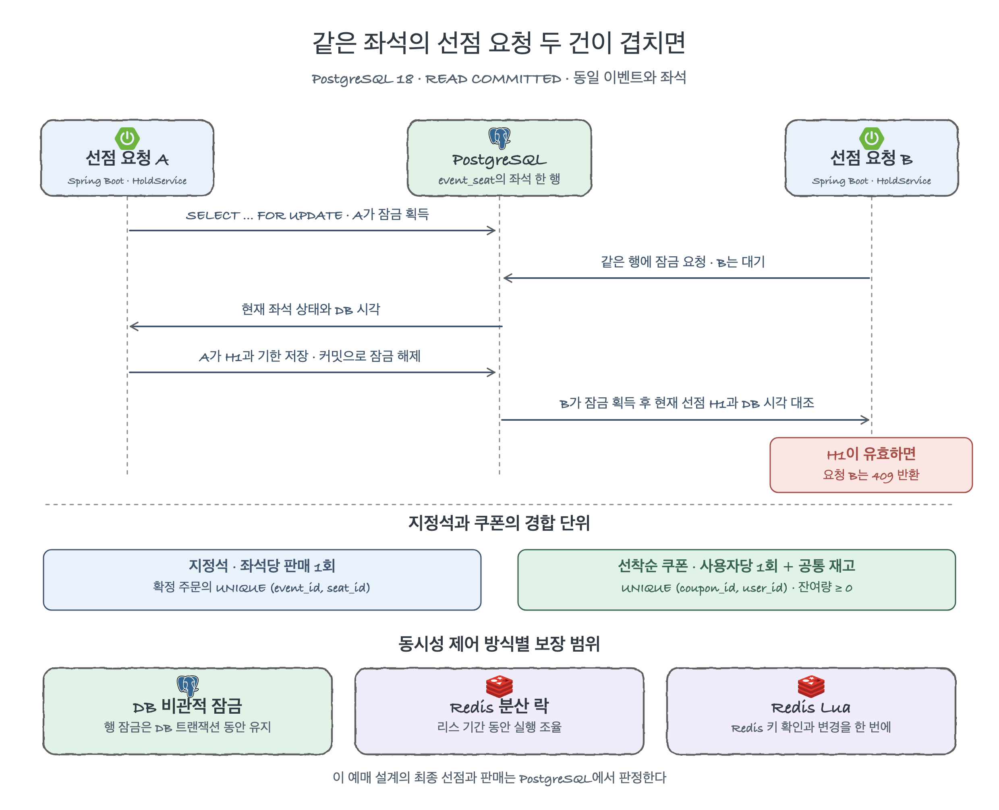

# Preventing Double Booking Under Concurrency

같은 이벤트의 한 좌석에 500개 요청이 동시에 도착하는 조건을 재현한다. 좌석을 읽고 나중에 무조건 갱신하면 경쟁에서 이전 상태를 기준으로 결정할 수 있다. PostgreSQL 18의 기본 `READ COMMITTED`를 기준으로 원본 좌석을 잠근 뒤 현재 값을 판정한다. [PostgreSQL 18 · Transaction Isolation](https://www.postgresql.org/docs/18/transaction-iso.html) · [PostgreSQL 18 · Row-Level Locks](https://www.postgresql.org/docs/18/explicit-locking.html)

그림의 근거 · [PostgreSQL 18 · Row-Level Locks](https://www.postgresql.org/docs/18/explicit-locking.html#LOCKING-ROWS) · [PostgreSQL 18 · Constraints](https://www.postgresql.org/docs/18/ddl-constraints.html) · [Redis · Distributed Locks](https://redis.io/docs/latest/develop/clients/patterns/distributed-locks/) · [Redis · Scripting with Lua](https://redis.io/docs/latest/develop/programmability/eval-intro/)

## 1. 좌석 한 행에서 판정을 직렬화한다

`HoldService`의 짧은 트랜잭션에서 `SELECT ... FOR UPDATE`로 이벤트·좌석의 행을 잠근다. 잠금을 얻고 DB 현재 시간을 읽은 뒤 사용 가능 상태나 만료된 선점에 새 `holdId`와 기한을 저장한다. 대기 중 다른 요청이 유효한 선점을 만들었다면 `409`를 반환한다. [PostgreSQL 18 · Row-Level Locks](https://www.postgresql.org/docs/18/explicit-locking.html) · [PostgreSQL 18 · Current Date and Time](https://www.postgresql.org/docs/18/functions-datetime.html) · [Spring Framework 6.2 · Transactional](https://docs.spring.io/spring-framework/reference/6.2/data-access/transaction/declarative/annotations.html)

## 2. 마지막 저장 경계에도 제약을 둔다

`event_seat`의 기본 키는 `(event_id, seat_id)`다. 이 실습의 단일 판매 규칙에서는 확정 주문에도 같은 열 조합의 유일 제약을 둔다. 외부 HTTP와 알림 전송은 좌석 행 잠금을 잡은 트랜잭션 밖에서 처리한다. [PostgreSQL 18 · Constraints](https://www.postgresql.org/docs/18/ddl-constraints.html) · [PostgreSQL 18 · Row-Level Locks](https://www.postgresql.org/docs/18/explicit-locking.html) · [AWS · Transactional Outbox](https://docs.aws.amazon.com/prescriptive-guidance/latest/cloud-design-patterns/transactional-outbox.html)

## 3. 업무 충돌과 시스템 포화를 나눠 확인한다

500개 요청이 모두 서비스를 통과한 경쟁 실험에서는 유효 선점 1건과 나머지 업무 충돌을 확인한다. 별도의 부하 실험에서는 연결 풀·타임아웃·대기열로 일부 요청이 먼저 거절될 수 있다. 두 실험 모두 확정 주문이 같은 좌석에 두 건 존재하지 않는지 DB로 검증한다. [Spring Boot 3.5 · Testcontainers](https://docs.spring.io/spring-boot/3.5/reference/testing/testcontainers.html) · [PostgreSQL 18 · Constraints](https://www.postgresql.org/docs/18/ddl-constraints.html) · [Google SRE · Handling Overload](https://sre.google/sre-book/handling-overload/)

## 4. 지정석과 선착순 쿠폰의 제약을 비교한다

지정석에서 경쟁하는 단위는 이벤트의 특정 좌석이며, 확정 주문의 `UNIQUE (event_id, seat_id)`가 좌석당 한 번만 판매되도록 제한한다. 선착순 쿠폰은 캠페인 재고를 공유한다. 발급 기록에 `NOT NULL`인 키를 사용해 `UNIQUE (coupon_id, user_id)`로 사용자당 한 번만 발급하고, 재고 행의 `remaining`에 `NOT NULL`과 `CHECK (remaining >= 0)`을 둔다. 두 제약은 각각 중복 발급과 음수 재고를 막는다. [PostgreSQL 18 · Constraints](https://www.postgresql.org/docs/18/ddl-constraints.html)

쿠폰의 상한을 지키는 예로 `UPDATE coupon SET remaining = remaining - 1 WHERE id = ? AND remaining > 0`가 한 행을 변경한 경우에만 발급 기록을 삽입한다. PostgreSQL `READ COMMITTED`에서는 경합 후 갱신된 행에 조건을 다시 검사한다. 차감과 발급을 같은 트랜잭션에서 커밋하고, 중복 발급 제약에 걸리면 롤백해 차감도 취소한다. 재고가 1개인 서로 다른 두 사용자와 재고가 충분한 같은 사용자의 동시 요청을 각각 검증한다. [PostgreSQL 18 · Read Committed](https://www.postgresql.org/docs/18/transaction-iso.html#XACT-READ-COMMITTED) · [PostgreSQL 18 · Transactions](https://www.postgresql.org/docs/18/tutorial-transactions.html) · [PostgreSQL 18 · Constraints](https://www.postgresql.org/docs/18/ddl-constraints.html)

## 5. 동시성 제어 방식의 적용 범위를 비교한다

- **PostgreSQL 비관적 잠금**은 읽을 때 `FOR UPDATE`로 원본 행을 잠그고 같은 트랜잭션에서 현재 상태를 확인해 갱신한다. 이 예매 설계는 그 방식으로 선점과 판매를 판정한다. 같은 좌석에 쓰기가 몰리면 잠금 대기 시간과 커밋된 선점 수를 함께 본다. [PostgreSQL 18 · Row-Level Locks](https://www.postgresql.org/docs/18/explicit-locking.html#LOCKING-ROWS)
- **Redis 분산 락**은 공유 자원의 실행을 리스 기간 동안 조율한다. 리스가 만료된 뒤 이전 작업자가 재개될 수 있으므로, Redis 락을 쓰더라도 PostgreSQL의 현재 상태 검사와 유일 제약을 유지한다. [Redis · Distributed Locks](https://redis.io/docs/latest/develop/clients/patterns/distributed-locks/) · [PostgreSQL 18 · Constraints](https://www.postgresql.org/docs/18/ddl-constraints.html)
- **Redis Lua**는 Redis 키의 조건 확인과 갱신을 다른 Redis 요청이 끼어들지 않게 묶는다. 예매의 Redis 입장 예산에 이 방식을 적용할 수 있다. Lua의 원자성은 Redis 내부에 적용되며, PostgreSQL의 선점·판매 확정은 자체 트랜잭션으로 처리한다. [Redis · Scripting with Lua](https://redis.io/docs/latest/develop/programmability/eval-intro/) · [PostgreSQL 18 · Transactions](https://www.postgresql.org/docs/18/tutorial-transactions.html)
