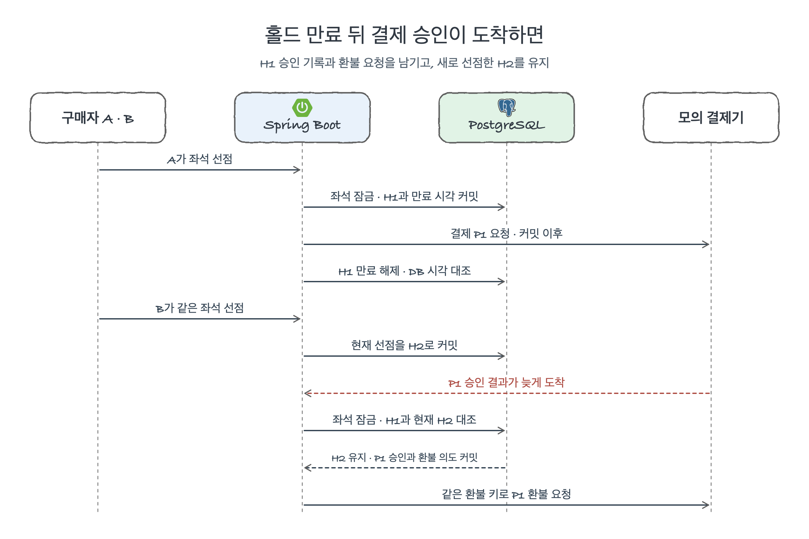

# Handling Hold Expiration and Mock Payments

좌석 선점과 결제 승인 사실은 서로 다른 상태다. 이 실습의 결제기는 승인·거절·타임아웃·지연 응답을 제어할 수 있는 모의 시스템이다. 승인 결과가 도착하면 좌석 원본을 다시 확인하고, 기한이 지난 승인에는 환불 요청을 남긴다. [PostgreSQL 18 · Row-Level Locks](https://www.postgresql.org/docs/18/explicit-locking.html) · [PostgreSQL 18 · Current Date and Time](https://www.postgresql.org/docs/18/functions-datetime.html) · [AWS · Saga Patterns](https://docs.aws.amazon.com/prescriptive-guidance/latest/cloud-design-patterns/saga.html)

그림의 근거 · [PostgreSQL 18 · Row-Level Locks](https://www.postgresql.org/docs/18/explicit-locking.html) · [PostgreSQL 18 · Current Date and Time](https://www.postgresql.org/docs/18/functions-datetime.html) · [AWS · Saga Patterns](https://docs.aws.amazon.com/prescriptive-guidance/latest/cloud-design-patterns/saga.html) · [AWS · Making Retries Safe](https://aws.amazon.com/builders-library/making-retries-safe-with-idempotent-APIs/)

## 1. 결제 요청부터 외부 호출까지 분리한다

`POST /holds/{holdId}/payments`는 본인의 선점인지 확인하고, 선점당 하나의 결제 항목을 저장한다. 저장을 커밋한 뒤 워커가 모의 결제를 호출한다. 호출 결과를 잃으면 같은 결제 요청 키로 조회하거나 재시도하며, 승인 여부를 모르는 동안에는 처리 중으로 유지한다. [PostgreSQL 18 · Constraints](https://www.postgresql.org/docs/18/ddl-constraints.html) · [AWS · Making Retries Safe](https://aws.amazon.com/builders-library/making-retries-safe-with-idempotent-APIs/) · [AWS · Saga Patterns](https://docs.aws.amazon.com/prescriptive-guidance/latest/cloud-design-patterns/saga.html)

## 2. 승인과 만료를 같은 좌석 행으로 조정한다

결제 승인 반영과 만료 작업은 같은 좌석 행을 잠그고, 잠금 이후에 `clock_timestamp()`로 DB 현재 시간을 읽는다. 승인 시 요청의 `holdId`가 현재 선점과 일치하고 기한이 남아 있어야 `SOLD`가 된다. 만료 작업은 자신이 대상으로 삼은 선점이 여전히 현재 선점이며 기한이 지난 경우에만 해제한다. [PostgreSQL 18 · Row-Level Locks](https://www.postgresql.org/docs/18/explicit-locking.html) · [PostgreSQL 18 · Current Date and Time](https://www.postgresql.org/docs/18/functions-datetime.html) · [PostgreSQL 18 · Transaction Isolation](https://www.postgresql.org/docs/18/transaction-iso.html)

## 3. 늦은 승인과 중복 승인을 복구한다

H1 만료 뒤 H2가 같은 좌석을 선점했다면 H1의 지연 승인은 H2의 상태를 바꾸지 않는다. H1의 승인 사실과 보상 의도를 보관하고, 결제 ID로 중복을 판단해 환불 요청을 한 번만 등록한다. 처리 결과가 유실될 수 있으므로 환불도 자체 멱등 키로 조회·재시도한다. [PostgreSQL 18 · Row-Level Locks](https://www.postgresql.org/docs/18/explicit-locking.html) · [AWS · Making Retries Safe](https://aws.amazon.com/builders-library/making-retries-safe-with-idempotent-APIs/) · [AWS · Saga Patterns](https://docs.aws.amazon.com/prescriptive-guidance/latest/cloud-design-patterns/saga.html) · [AWS · Transactional Outbox](https://docs.aws.amazon.com/prescriptive-guidance/latest/cloud-design-patterns/transactional-outbox.html)
