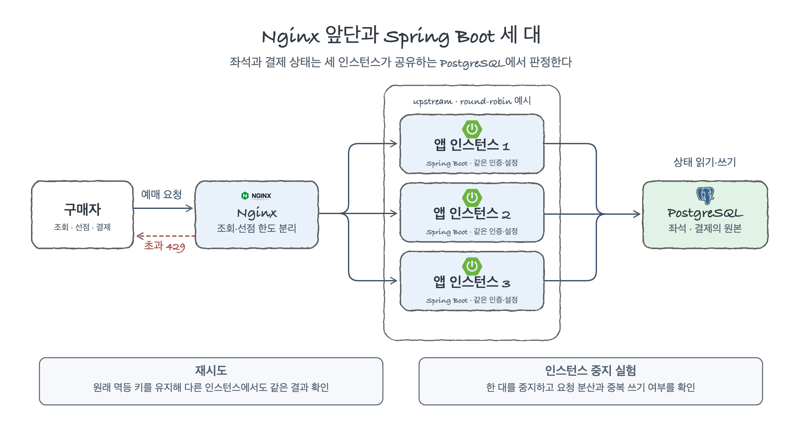

# Balancing Three Spring Boot Instances with Nginx

Nginx의 upstream에 Spring Boot 인스턴스 세 대를 둔다. 앱 인스턴스는 같은 예매 DB를 사용하고, 선점과 결제 판정은 각 인스턴스의 메모리가 아니라 PostgreSQL의 원본에서 수행한다. [Nginx · Load Balancing](https://nginx.org/en/docs/http/load_balancing.html) · [PostgreSQL 18 · Row-Level Locks](https://www.postgresql.org/docs/18/explicit-locking.html)

그림의 근거 · [Nginx · Load Balancing](https://nginx.org/en/docs/http/load_balancing.html) · [Nginx · limit_req](https://nginx.org/en/docs/http/ngx_http_limit_req_module.html) · [PostgreSQL 18 · Row-Level Locks](https://www.postgresql.org/docs/18/explicit-locking.html#LOCKING-ROWS)

## 1. 인스턴스를 늘려도 요청 상태를 이어간다

라우팅 기본 예로 round-robin을 쓰고, 인스턴스마다 같은 사용자 인증과 설정을 적용한다. 한 인스턴스가 선점을 처리한 뒤 다른 인스턴스가 멱등 키 재시도나 결제 조회를 받아도 같은 결과를 찾아야 한다. [Nginx · Load Balancing](https://nginx.org/en/docs/http/load_balancing.html) · [AWS · Making Retries Safe](https://aws.amazon.com/builders-library/making-retries-safe-with-idempotent-APIs/)

## 2. 엣지 제한과 업무별 재시도를 정한다

Nginx의 `limit_req`로 오픈 직전 급증하는 요청을 제어한다. 예제에서 초과 응답을 `429`로 정할 때는 `limit_req_status 429`를 명시한다. 좌석 조회와 선점의 한도를 분리하고, 쓰기 요청을 재전송할 때는 클라이언트가 원래 요청의 멱등 키를 유지한다. [Nginx · limit_req](https://nginx.org/en/docs/http/ngx_http_limit_req_module.html) · [AWS · Making Retries Safe](https://aws.amazon.com/builders-library/making-retries-safe-with-idempotent-APIs/)

## 3. 두 대가 남은 상태에서도 측정한다

트래픽을 보내며 한 대를 중지해 요청이 남은 인스턴스로 흘러가는지와, 실패한 쓰기가 중복 생성되지 않는지 확인한다. 정상 처리량과 DB 잠금 대기를 함께 기록해 앱 인스턴스 수를 늘리면 개선되는지 판단한다. [Nginx · Load Balancing](https://nginx.org/en/docs/http/load_balancing.html) · [AWS · Making Retries Safe](https://aws.amazon.com/builders-library/making-retries-safe-with-idempotent-APIs/) · [Google SRE · Monitoring Distributed Systems](https://sre.google/sre-book/monitoring-distributed-systems/)
