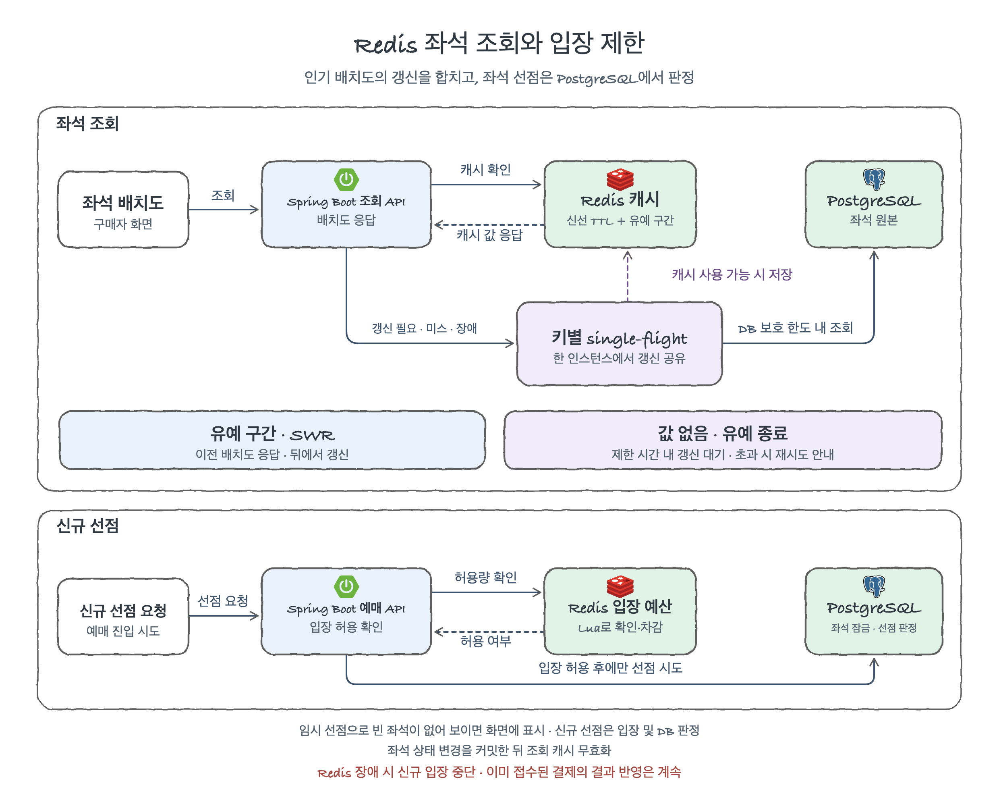

# Caching Seat Reads and Gating Requests with Redis

Redis를 조회 캐시와 예매 API 앞의 입장 제한에 사용한다. 좌석 조회는 일시적으로 이전 상태를 보여 줄 수 있으며, 어떤 요청을 통과시킬지는 입장 정책으로, 누가 좌석을 확보하는지는 PostgreSQL 트랜잭션으로 결정한다. [Microsoft · Cache-Aside](https://learn.microsoft.com/en-us/azure/architecture/patterns/cache-aside) · [Microsoft · Queue-Based Load Leveling](https://learn.microsoft.com/en-us/azure/architecture/patterns/queue-based-load-leveling) · [PostgreSQL 18 · Row-Level Locks](https://www.postgresql.org/docs/18/explicit-locking.html)

그림의 근거 · [Cloudflare · Request Collapsing](https://developers.cloudflare.com/cache/concepts/default-cache-behavior/#request-collapsing) · [RFC 5861 · Stale-While-Revalidate](https://www.rfc-editor.org/rfc/rfc5861.html#section-3) · [Google SRE · Handling Overload](https://sre.google/sre-book/handling-overload/) · [Redis · Lua Scripting](https://redis.io/docs/latest/develop/programmability/eval-intro/) · [PostgreSQL 18 · Row-Level Locks](https://www.postgresql.org/docs/18/explicit-locking.html#LOCKING-ROWS)

## 1. 좌석 목록에는 최신성 정책을 둔다

좌석 배치도는 이벤트별로 짧은 TTL을 두고 캐시한다. 원본을 갱신한 뒤 관련 조회 캐시를 무효화하고, 캐시 미스에서 DB로 몰리는 요청 수를 제한한다. 선점 응답은 DB에서 확정한 `holdId`와 기한을 사용한다. [Microsoft · Cache-Aside](https://learn.microsoft.com/en-us/azure/architecture/patterns/cache-aside) · [PostgreSQL 18 · Row-Level Locks](https://www.postgresql.org/docs/18/explicit-locking.html)

### 같은 공연의 배치도 갱신을 합친다

인기 공연의 배치도 캐시가 만료되면 동시 조회가 한꺼번에 PostgreSQL로 넘어가는 캐시 스탬피드가 발생할 수 있다. 인스턴스 안에서 이벤트별 single-flight를 적용해 같은 키의 요청이 진행 중인 갱신을 공유하게 한다. 다른 인스턴스에서는 같은 키를 별도로 갱신할 수 있으므로, 갱신 직전에 공유 Redis를 다시 조회하고도 DB 호출이 과도할 때 인스턴스 간 조율을 검토한다. [Cloudflare · Request Collapsing](https://developers.cloudflare.com/cache/concepts/default-cache-behavior/#request-collapsing) · [Redis · Distributed Locks](https://redis.io/docs/latest/develop/clients/patterns/distributed-locks/)

조회에 stale-while-revalidate(SWR)를 적용한다면 신선 TTL과 이전 값 제공 유예 기간을 나눈다. Redis 만료 시간은 두 기간을 합해 설정한다. 유예 안에서는 이전 배치도를 즉시 반환하고 뒤에서 키별 갱신을 시도하며, 갱신 실패만으로 유예를 연장하지 않는다. 캐시가 비었거나 유예가 끝났다면 DB 보호 한도 안에서만 원본을 조회하고, 요청은 정해진 시간까지 결과를 기다린다. 한도나 대기 시간을 넘으면 재시도를 안내한다. [RFC 5861 · Stale-While-Revalidate](https://www.rfc-editor.org/rfc/rfc5861.html#section-3) · [Redis · Cache-Aside](https://redis.io/docs/latest/develop/use-cases/cache-aside/) · [Google SRE · Handling Overload](https://sre.google/sre-book/handling-overload/)

임시 홀드로 빈 좌석이 없다면 그 시점의 상태를 배치도에 표시한다. 신규 선점은 계속 입장 제어와 PostgreSQL의 좌석 판정을 거친다. 로컬 L1 캐시로 선점을 조기에 차단하는 정책은 취소분 반환·재오픈이 없고 원본 DB에서 판매 종료가 확정된 행사에 한해 검토한다. [Microsoft · Cache-Aside](https://learn.microsoft.com/en-us/azure/architecture/patterns/cache-aside) · [선점 만료와 해제](07_handling_hold_expiration_and_mock_payments.md#2-승인과-만료를-같은-좌석-행으로-조정한다) · [PostgreSQL 18 · Row-Level Locks](https://www.postgresql.org/docs/18/explicit-locking.html#LOCKING-ROWS)

## 2. 입장 허용량은 짧은 원자 연산으로 갱신한다

이벤트별 입장 속도를 Redis에서 관리한다면 예산 확인과 차감을 짧은 Lua 스크립트로 묶을 수 있다. 이 실습에서 Redis가 중단되면 신규 선점용 입장은 멈추고, 조회는 DB 보호 한도 안에서만 제공한다. 이미 접수한 결제의 결과 반영은 기존 결제 상태를 사용해 계속 처리한다. [Redis · Lua Scripting](https://redis.io/docs/latest/develop/programmability/eval-intro/) · [Microsoft · Queue-Based Load Leveling](https://learn.microsoft.com/en-us/azure/architecture/patterns/queue-based-load-leveling) · [Google SRE · Handling Overload](https://sre.google/sre-book/handling-overload/)

## 3. 캐시 만료와 제한 저장소 장애를 따로 시험한다

캐시 동시 만료 때 원본 조회와 p95가 어떻게 변하는지 측정한다. 입장 제한기가 끊겨도 보호한 좌석 쓰기 경로가 갑자기 열리지 않는지 확인하고, Redis 장애 처리와 별개로 DB의 좌석 유일 제약을 검증한다. [Microsoft · Cache-Aside](https://learn.microsoft.com/en-us/azure/architecture/patterns/cache-aside) · [Google SRE · Monitoring Distributed Systems](https://sre.google/sre-book/monitoring-distributed-systems/) · [PostgreSQL 18 · Constraints](https://www.postgresql.org/docs/18/ddl-constraints.html)

같은 이벤트에 요청을 몰아 기본 캐시, single-flight, single-flight와 SWR을 같은 부하로 비교한다. 신선 TTL 만료 직후와 유예 종료 직후를 구분하고, DB 조회 수, 좌석 조회 p95, 응답에 사용한 배치도의 나이, 보호 한도 초과를 함께 기록한다. 홀드가 만료되어 좌석이 다시 열리는 동안에도 이전 배치도의 표시 때문에 신규 선점이 막히지 않는지 확인한다. [Google SRE · Monitoring Distributed Systems](https://sre.google/sre-book/monitoring-distributed-systems/) · [RFC 5861 · Stale-While-Revalidate](https://www.rfc-editor.org/rfc/rfc5861.html#section-3) · [선점 만료와 해제](07_handling_hold_expiration_and_mock_payments.md#2-승인과-만료를-같은-좌석-행으로-조정한다)
