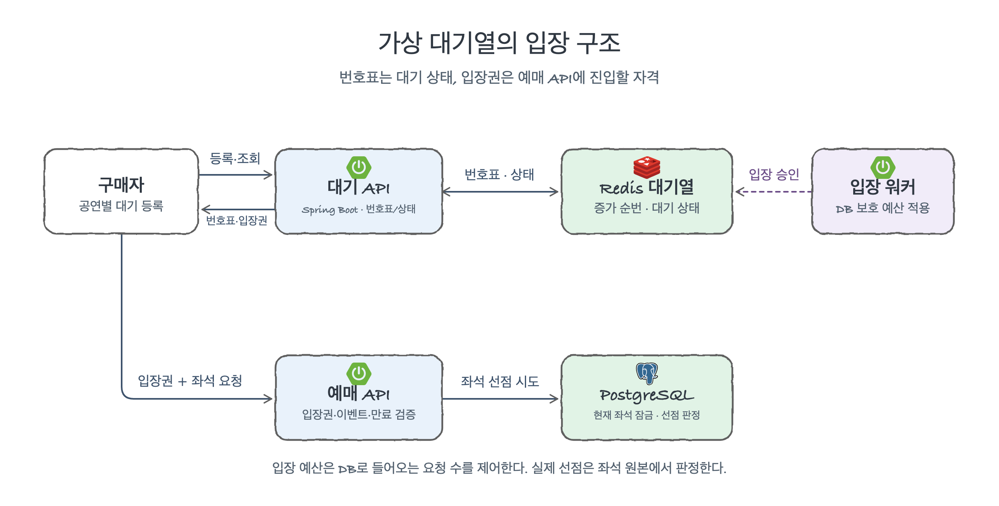

# Designing a Virtual Waiting Room

구매자는 이벤트별 대기 등록으로 번호표를 받고, 상태 조회로 대기 또는 입장을 확인한다. 입장권은 인기 좌석을 확보하는 권리가 아니라 예매 API에 진입하는 짧은 자격이다. 입장 속도는 원본 DB의 안전 처리량에 맞춘다. [Microsoft · Queue-Based Load Leveling](https://learn.microsoft.com/en-us/azure/architecture/patterns/queue-based-load-leveling) · [Google SRE · Handling Overload](https://sre.google/sre-book/handling-overload/)

그림의 근거 · [Redis · Sorted Sets](https://redis.io/docs/latest/develop/data-types/sorted-sets/) · [Redis · Lua Scripting](https://redis.io/docs/latest/develop/programmability/eval-intro/) · [Microsoft · Queue-Based Load Leveling](https://learn.microsoft.com/en-us/azure/architecture/patterns/queue-based-load-leveling) · [PostgreSQL 18 · Row-Level Locks](https://www.postgresql.org/docs/18/explicit-locking.html)

## 1. 번호표와 대기 순서를 저장한다

`POST /events/{eventId}/queue/entries`는 주체와 이벤트에 연결된 `entryId`를 만든다. 같은 주체의 활성 등록을 다시 요청하면 기존 번호표를 반환한다. Redis Sorted Set을 쓸 경우 서버에서 발급한 증가 순번을 점수로 사용하고, 순번 발급과 등록은 하나의 짧은 원자 연산으로 처리한다. [Redis · Sorted Sets](https://redis.io/docs/latest/develop/data-types/sorted-sets/) · [Redis · Lua Scripting](https://redis.io/docs/latest/develop/programmability/eval-intro/) · [AWS · Making Retries Safe](https://aws.amazon.com/builders-library/making-retries-safe-with-idempotent-APIs/)

## 2. 상태 조회와 입장권을 분리한다

`GET /events/{eventId}/queue/entries/{entryId}`는 번호표의 소유자를 확인하고 대기 상태나 입장권을 반환한다. 화면의 순번은 상태 조회 시점의 추정값으로 안내한다. 입장권에는 주체·이벤트·만료를 묶고 선점 API에서 검증한다. 이미 접수한 요청의 같은 멱등 키 재시도는 새 선점과 구별한다. [OpenAPI 3.1.1](https://spec.openapis.org/oas/v3.1.1.html) · [AWS · Making Retries Safe](https://aws.amazon.com/builders-library/making-retries-safe-with-idempotent-APIs/) · [Microsoft · Queue-Based Load Leveling](https://learn.microsoft.com/en-us/azure/architecture/patterns/queue-based-load-leveling)

## 3. 입장 속도와 만료 정책을 시험한다

입장 작업이 중복 실행돼도 같은 번호표가 여러 번 입장 예산을 소비하지 않게 발급과 상태 갱신을 함께 처리한다. 폴링 폭주, 입장권 만료, 대기열 저장소 장애를 재현해 DB에 도달하는 새 선점 요청 수가 보호 한도를 넘지 않는지 점검한다. [Redis · Lua Scripting](https://redis.io/docs/latest/develop/programmability/eval-intro/) · [Microsoft · Queue-Based Load Leveling](https://learn.microsoft.com/en-us/azure/architecture/patterns/queue-based-load-leveling) · [Google SRE · Handling Overload](https://sre.google/sre-book/handling-overload/)
