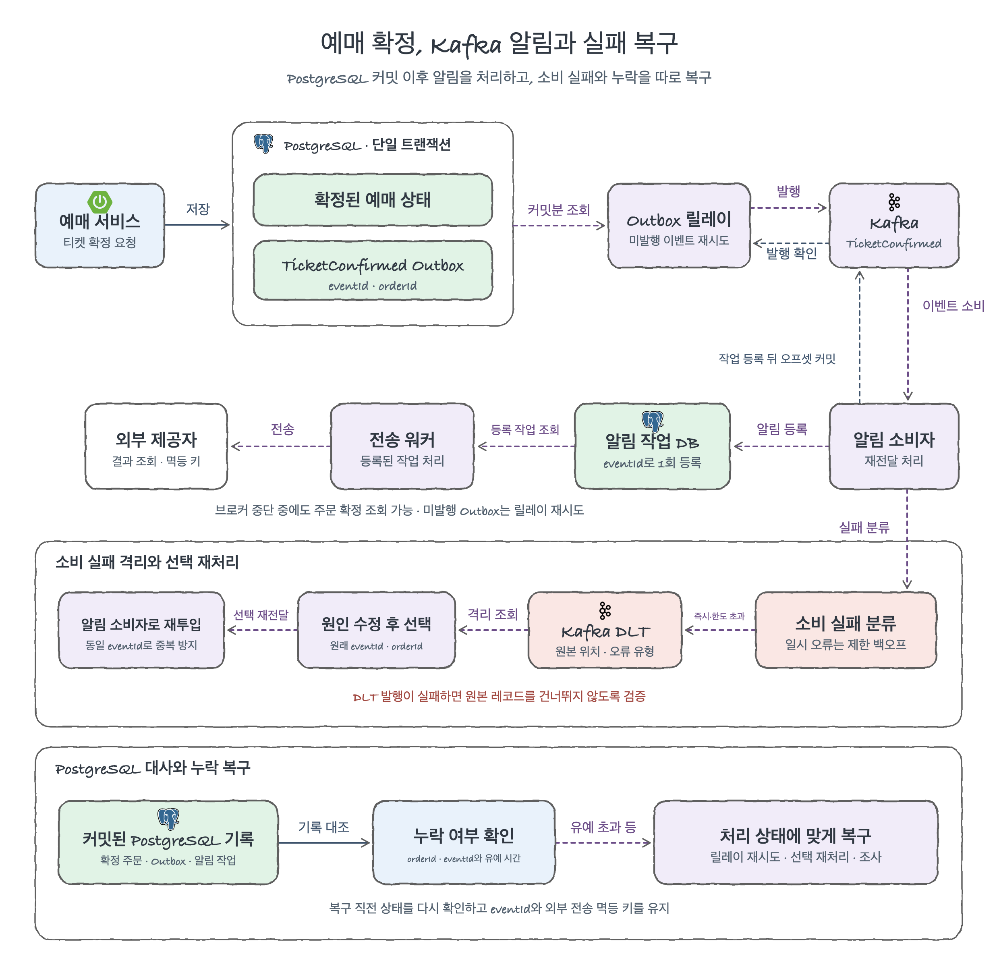

# Publishing Ticket Events with Kafka and Outbox

티켓 확정은 PostgreSQL 커밋으로 완료된다. 예매 상태와 `TicketConfirmed` Outbox 행은 같은 트랜잭션에서 커밋하고, Kafka 발행과 알림은 나중에 실행한다. 알림을 기다리는 동안 확정 주문은 조회할 수 있다. [AWS · Transactional Outbox](https://docs.aws.amazon.com/prescriptive-guidance/latest/cloud-design-patterns/transactional-outbox.html) · [Kafka 4.3 · Design](https://kafka.apache.org/43/design/design/)

그림의 근거 · [AWS · Transactional Outbox](https://docs.aws.amazon.com/prescriptive-guidance/latest/cloud-design-patterns/transactional-outbox.html) · [Kafka 4.3 · Design](https://kafka.apache.org/43/design/design/) · [Spring Kafka 3.3 · Handling Exceptions](https://docs.spring.io/spring-kafka/reference/3.3/kafka/annotation-error-handling.html) · [PostgreSQL 18 · Table Expressions](https://www.postgresql.org/docs/18/queries-table-expressions.html)

## 1. 릴레이는 미발행 이벤트를 재시도한다

Outbox에는 `eventId`, `orderId`, 종류, 생성 시각을 기록한다. 릴레이가 이벤트를 Kafka에 발행한 뒤 결과를 확인하는 사이에 중단되면 같은 이벤트가 다시 발행될 수 있다. 같은 주문의 이벤트 순서가 중요하면 주문 ID로 파티션을 정하고, 릴레이가 그 주문의 발행 순서도 보존하는지 확인한다. [AWS · Transactional Outbox](https://docs.aws.amazon.com/prescriptive-guidance/latest/cloud-design-patterns/transactional-outbox.html) · [Kafka 4.3 · Design](https://kafka.apache.org/43/design/design/)

## 2. 소비자는 재전달과 외부 전송 결과를 관리한다

알림 소비자는 `eventId`에 대응하는 알림 작업을 DB에 한 번만 등록하고 그 뒤 오프셋을 커밋한다. 외부 제공자 전송은 별도 작업으로 실행한다. 전송 응답이 유실될 경우에는 제공자가 지원하는 멱등 키나 결과 조회로 대조한다. [AWS · Transactional Outbox](https://docs.aws.amazon.com/prescriptive-guidance/latest/cloud-design-patterns/transactional-outbox.html) · [Kafka 4.3 · Design](https://kafka.apache.org/43/design/design/) · [AWS · Making Retries Safe](https://aws.amazon.com/builders-library/making-retries-safe-with-idempotent-APIs/)

## 3. 브로커가 멈춰도 예매 상태를 확인한다

Kafka를 잠시 중단한 상태에서 좌석 확정이 DB에서 완료되고 Outbox가 남는지 확인한다. 브로커를 복구한 뒤 발행 적체와 오래된 미발행 건의 체류 시간을 측정한다. 같은 이벤트를 재전달해 예약 상태가 바뀌거나 알림 작업이 중복 생성되지 않는지 검사한다. [AWS · Transactional Outbox](https://docs.aws.amazon.com/prescriptive-guidance/latest/cloud-design-patterns/transactional-outbox.html) · [Kafka 4.3 · Design](https://kafka.apache.org/43/design/design/) · [Google SRE · Monitoring Distributed Systems](https://sre.google/sre-book/monitoring-distributed-systems/)

## 4. 소비 실패를 DLT에 격리하고 필요한 건만 재처리한다

알림 소비자는 DB 연결 타임아웃처럼 일시적인 오류를 정해진 횟수만큼 백오프 후 재시도한다. 역직렬화 오류나 수정이 필요한 스키마 오류는 재시도 없이 DLT(Dead Letter Topic)에 격리하고, 한도를 소진한 오류도 같은 경로로 보낸다. 원본 토픽·파티션·오프셋과 오류 유형을 남긴다. 릴레이의 Kafka 발행 실패는 미발행 Outbox 행에서 처리한다. [Spring Kafka 3.3 · Handling Exceptions](https://docs.spring.io/spring-kafka/reference/3.3/kafka/annotation-error-handling.html) · [AWS · Transactional Outbox](https://docs.aws.amazon.com/prescriptive-guidance/latest/cloud-design-patterns/transactional-outbox.html)

Spring Kafka 3.3의 비트랜잭션 레코드 리스너에서는 `DefaultErrorHandler`와 `DeadLetterPublishingRecoverer`를 연결할 수 있다. `setFailIfSendResultIsError(true)`와 발행 확인 타임아웃을 설정해 DLT 발행 실패를 예외로 전파한다. 발행에 실패한 레코드를 건너뛰지 않도록 실제 오프셋 커밋과 재수신을 검증한다. Kafka 트랜잭션 리스너에서 DLT 발행과 대상 오프셋을 같은 복구 트랜잭션에 넣으려면 `DefaultAfterRollbackProcessor`의 `commitRecovered`와 `kafkaTemplate` 설정을 함께 확인한다. [Spring Kafka 3.3 · Handling Exceptions](https://docs.spring.io/spring-kafka/reference/3.3/kafka/annotation-error-handling.html)

원인을 수정한 뒤 현재 주문 상태와 알림 작업을 확인하고 필요한 이벤트만 다시 전달한다. 원래 `eventId`와 `orderId`를 유지하고 `eventId` 유일 제약으로 알림 작업의 중복 등록을 막는다. 역직렬화에 실패한 건의 이벤트 식별자가 불명확하면 원본 레코드와 Outbox를 대조해 식별한 뒤 처리한다. [Spring Kafka 3.3 · Handling Exceptions](https://docs.spring.io/spring-kafka/reference/3.3/kafka/annotation-error-handling.html) · [AWS · Transactional Outbox](https://docs.aws.amazon.com/prescriptive-guidance/latest/cloud-design-patterns/transactional-outbox.html) · [PostgreSQL 18 · Constraints](https://www.postgresql.org/docs/18/ddl-constraints.html)

## 5. 확정 주문과 알림 작업을 정기 대사한다

PostgreSQL의 확정 주문과 `TicketConfirmed` Outbox를 `orderId`로 연결하고, Outbox와 알림 작업은 `eventId`로 연결한다. 각 단계의 행이 빠진 건을 찾되, 알림 작업의 정상 비동기 지연은 유예 시간으로 구분한다. Redis 캐시 값은 조회 화면에 쓰고, 대사의 기준은 PostgreSQL에 커밋된 기록으로 둔다. [PostgreSQL 18 · Table Expressions](https://www.postgresql.org/docs/18/queries-table-expressions.html) · [AWS · Transactional Outbox](https://docs.aws.amazon.com/prescriptive-guidance/latest/cloud-design-patterns/transactional-outbox.html)

미발행 Outbox는 릴레이 재시도로 돌려보낸다. 발행은 확인됐지만 알림 작업이 유예 시간을 넘겨 누락된 건은 DLT와 소비 상태를 확인한 뒤, 원본 이벤트를 같은 `eventId`로 재처리한다. Outbox 자체가 없으면 주문 확정 경로와 기록 보존 여부부터 조사한다. 외부 전송 결과가 불명확하면 제공자 조회나 운영 기록으로 결과를 확인한다. 복구 직전 현재 상태를 다시 확인하고, `eventId`와 외부 제공자의 멱등 키를 유지한다. [AWS · Transactional Outbox](https://docs.aws.amazon.com/prescriptive-guidance/latest/cloud-design-patterns/transactional-outbox.html) · [AWS · Making Retries Safe](https://aws.amazon.com/builders-library/making-retries-safe-with-idempotent-APIs/)

검증에서는 역직렬화 오류, DLT 발행 장애, 발행 뒤 알림 작업 누락을 각각 주입한다. DLT 재처리와 대사가 같은 이벤트를 동시에 복구해도 확정 주문 상태가 유지되고 알림 작업이 `eventId`당 한 건인지 확인한다. [Spring Kafka 3.3 · Handling Exceptions](https://docs.spring.io/spring-kafka/reference/3.3/kafka/annotation-error-handling.html) · [AWS · Transactional Outbox](https://docs.aws.amazon.com/prescriptive-guidance/latest/cloud-design-patterns/transactional-outbox.html) · [PostgreSQL 18 · Constraints](https://www.postgresql.org/docs/18/ddl-constraints.html)
