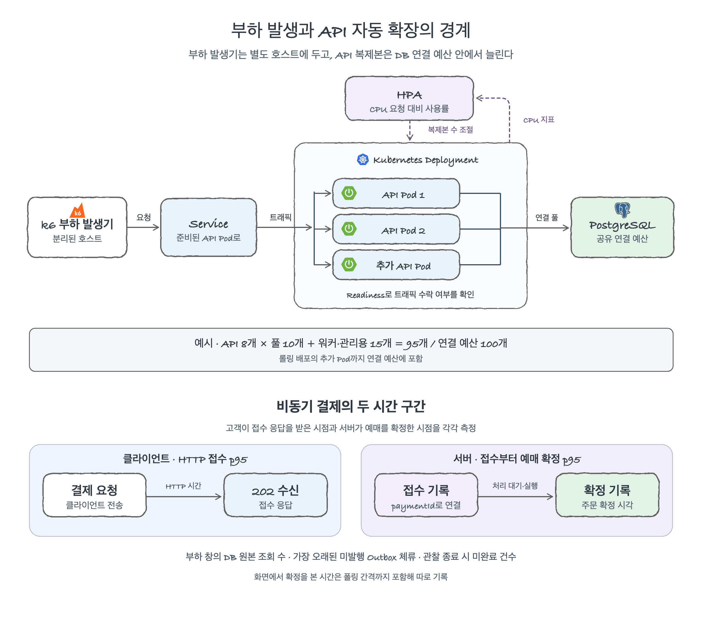

# Scaling Ticketing on Kubernetes and Load Testing

무상태 Spring Boot API를 Kubernetes Deployment와 Service로 배포하고, HPA는 API 복제본을 조절하게 한다. PostgreSQL·Redis·Kafka는 이 예제의 API 복제본과 독립적으로 운영한다. 행사 시작 전에는 급증을 버틸 최소 복제본과 입장 정책을 먼저 정한다. [Kubernetes · Horizontal Pod Autoscaling](https://kubernetes.io/docs/concepts/workloads/autoscaling/horizontal-pod-autoscale/) · [Google SRE · Handling Overload](https://sre.google/sre-book/handling-overload/)

그림의 근거 · [Kubernetes · Horizontal Pod Autoscaling](https://kubernetes.io/docs/concepts/workloads/autoscaling/horizontal-pod-autoscale/) · [Grafana k6 · Running Large Tests](https://grafana.com/docs/k6/latest/testing-guides/running-large-tests/) · [Spring Boot 3.5 · SQL Databases](https://docs.spring.io/spring-boot/3.5/reference/data/sql.html) · [RFC 9110 · 202 Accepted](https://www.rfc-editor.org/rfc/rfc9110.html#section-15.3.3) · [Grafana k6 · Trend](https://grafana.com/docs/k6/latest/javascript-api/k6-metrics/trend/)

## 1. 프로브와 CPU 요청을 설정한다

Spring Boot Actuator의 `/actuator/health/liveness`, `/actuator/health/readiness`로 프로세스 상태와 트래픽 수락 여부를 구분한다. 공유 PostgreSQL 장애를 liveness에 넣으면 앱 재시작이 겹칠 수 있으므로 이 예제에서는 분리한다. CPU 사용률 기반 HPA는 CPU 요청 대비 사용률을 보므로 요청량과 지표 수집을 먼저 확인한다. [Spring Boot 3.5 · Kubernetes Probes](https://docs.spring.io/spring-boot/3.5/reference/actuator/endpoints.html) · [Kubernetes · Horizontal Pod Autoscaling](https://kubernetes.io/docs/concepts/workloads/autoscaling/horizontal-pod-autoscale/)

## 2. 확장 한도를 연결 예산과 함께 계산한다

DB에 쓸 수 있는 연결이 100개이고 워커·관리용으로 15개를 남긴다고 가정한다. Pod당 풀 최대 10개를 쓰면 API 8개에서 연결 최대치 80개이고 합계는 95개다. 이 계산에는 롤링 배포 때의 추가 Pod도 포함해 다시 검토한다. 풀 대기와 좌석 잠금이 포화라면 입장량부터 조절한다. [Spring Boot 3.5 · SQL Databases](https://docs.spring.io/spring-boot/3.5/reference/data/sql.html) · [Kubernetes · Horizontal Pod Autoscaling](https://kubernetes.io/docs/concepts/workloads/autoscaling/horizontal-pod-autoscale/) · [Google SRE · Handling Overload](https://sre.google/sre-book/handling-overload/)

## 3. 부하 발생기와 대상 서비스 환경을 분리한다

별도 호스트나 노드 풀에서 부하를 발생시킨다. 좌석 조회·대기 폴링·선점·결과 조회를 비율대로 섞고, 한 좌석 쏠림과 브로커 중단을 따로 시험한다. 유입량 유지가 필요한 실험은 k6 arrival-rate를 사용하고, p95·업무 거절·5xx·DB 대기·대기열 체류·복제본 변화를 함께 본다. [Grafana k6 · Open and Closed Models](https://grafana.com/docs/k6/latest/using-k6/scenarios/concepts/open-vs-closed/) · [Google SRE · Monitoring Distributed Systems](https://sre.google/sre-book/monitoring-distributed-systems/) · [Grafana k6 · Running Large Tests](https://grafana.com/docs/k6/latest/testing-guides/running-large-tests/)

## 4. 접수 응답과 예매 확정 시간을 따로 잰다

비동기 결제 요청은 접수와 확정을 두 지표로 측정한다. HTTP 접수 p95는 `POST /holds/{holdId}/payments`의 `202` 응답만 모아 k6의 `http_req_duration`으로 구한다. 예매 확정 p95는 같은 `paymentId`의 접수 기록 시각부터 주문 확정 기록 시각까지의 시간을 서버 기록에서 계산한다. 결과 조회로 사용자가 확정을 처음 확인한 시간은 폴링 간격의 영향을 받으므로 별도 지표로 둔다. [RFC 9110 · 202 Accepted](https://www.rfc-editor.org/rfc/rfc9110.html#section-15.3.3) · [Grafana k6 · HTTP Metrics](https://grafana.com/docs/k6/latest/using-k6/metrics/reference/#http-specific-built-in-metrics) · [Grafana k6 · Trend](https://grafana.com/docs/k6/latest/javascript-api/k6-metrics/trend/)

동기·비동기 방식을 비교할 때는 요청 비율, 목표 유입률, 초기 좌석 상태, 부하 시간과 종료 후 관찰 시간을 맞춘다. 동일하게 비교할 완료 지표는 요청 전송부터 클라이언트가 확정 상태를 확인할 때까지의 시간이다. 그 p95와 함께 접수 건수, 확정 건수, 거절·만료 건수, 관찰 종료 시 아직 미완료인 건수를 기록하고, k6 전송 누락도 별도로 집계한다. [Grafana k6 · Open and Closed Models](https://grafana.com/docs/k6/latest/using-k6/scenarios/concepts/open-vs-closed/) · [Grafana k6 · Dropped Iterations](https://grafana.com/docs/k6/latest/using-k6/scenarios/concepts/dropped-iterations/)

캐시 적용 전후에는 같은 부하 구간의 캐시 적중률과 PostgreSQL 원본 조회 건수를 비교한다. Kafka 알림 경로를 켠 시험에서는 가장 오래된 미발행 Outbox의 체류 시간과 확정 주문부터 알림 작업 등록까지 걸린 시간을 각각 기록한다. 이렇게 하면 API 응답 시간과 별도로 읽기 부하와 후속 알림 적체를 추적할 수 있다. [Microsoft · Cache-Aside](https://learn.microsoft.com/en-us/azure/architecture/patterns/cache-aside) · [AWS · Transactional Outbox](https://docs.aws.amazon.com/prescriptive-guidance/latest/cloud-design-patterns/transactional-outbox.html)

같은 환경에서 로컬 시험을 반복할 때는 [13번의 로컬 혼합 부하 결과](13_building_the_ticketing_ui_from_openapi.md#4-로컬-실습-결과)를 조회·선점의 기준값으로 참고한다. 당시 시나리오는 Redis 캐시·대기열과 Kafka를 끈 상태였다. [13번 측정 로그 발췌](13_building_the_ticketing_ui_from_openapi.md#측정-로그-발췌)
