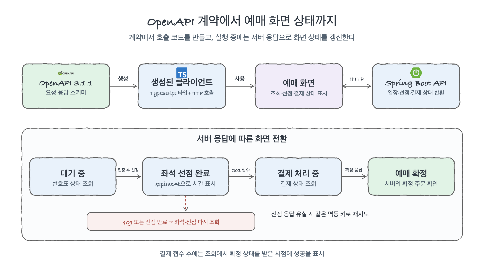

# Building the Ticketing UI from OpenAPI

OpenAPI 3.1.1 계약을 바탕으로 TypeScript 타입과 HTTP 호출 코드를 생성한다. 서버에서 쓰는 DTO와 화면에서 보여 주는 상태를 같은 계약으로 대조하고, 화면은 서버가 반환한 선점·입장·결제 상태를 표시한다. [OpenAPI 3.1.1](https://spec.openapis.org/oas/v3.1.1.html) · [OpenAPI Generator · TypeScript Fetch](https://openapi-generator.tech/docs/generators/typescript-fetch/)



그림의 근거 · [OpenAPI Generator · TypeScript Fetch](https://openapi-generator.tech/docs/generators/typescript-fetch/) · [RFC 9110 · HTTP Semantics](https://www.rfc-editor.org/rfc/rfc9110.html) · [AWS · Making Retries Safe](https://aws.amazon.com/builders-library/making-retries-safe-with-idempotent-APIs/)

## 1. 각 화면에서 서버 상태를 따라간다

대기 중에는 상태를 일정 간격으로 조회하고, 허용된 경우에만 선점 요청에 입장권을 사용한다. 선점 응답의 `expiresAt`으로 남은 시간을 표시한다. 타이머가 끝나거나 다른 탭과 상태가 어긋나면 서버를 다시 조회하며, 최종 판매 상태는 서버가 판정한다. [OpenAPI 3.1.1](https://spec.openapis.org/oas/v3.1.1.html) · [PostgreSQL 18 · Current Date and Time](https://www.postgresql.org/docs/18/functions-datetime.html) · [PostgreSQL 18 · Row-Level Locks](https://www.postgresql.org/docs/18/explicit-locking.html)

## 2. 재시도와 에러를 상태별로 처리한다

선점 버튼을 누르면 사용자 동작에 요청 키를 하나 부여하고, 동일 요청을 재시도할 때는 그 키를 다시 쓴다. `409`의 문제 코드에 따라 좌석 또는 선점 상태를 새로 읽는다. 결제 요청이 `202`로 접수되면 결제 조회에서 확정을 받을 때까지 결제 처리 중을 보여 준다. [AWS · Making Retries Safe](https://aws.amazon.com/builders-library/making-retries-safe-with-idempotent-APIs/) · [RFC 9110 · HTTP Semantics](https://www.rfc-editor.org/rfc/rfc9110.html) · [RFC 9457 · Problem Details](https://www.rfc-editor.org/rfc/rfc9457.html)

## 3. 화면에서도 경합을 재현한다

두 탭에서 마지막 좌석을 요청하거나 결제 응답을 지연시켜 화면이 어떻게 바뀌는지 확인한다. 새 OpenAPI로 타입을 생성한 뒤 UI와 계약 테스트를 함께 실행한다. 화면에서 성공을 표시하는 시점과 서버의 확정 주문이 일치하는지 기록한다. [OpenAPI 3.1.1](https://spec.openapis.org/oas/v3.1.1.html) · [OpenAPI Generator · TypeScript Fetch](https://openapi-generator.tech/docs/generators/typescript-fetch/) · [PostgreSQL 18 · Constraints](https://www.postgresql.org/docs/18/ddl-constraints.html)

## 4. 로컬 실습 결과

### 측정 조건

Apple Silicon 장비 한 대의 Docker Desktop에서 측정했다. 부하 발생기인 k6는 같은 호스트의 별도 컨테이너에서 CPU 2개와 메모리 1 GiB로 실행했다. [측정 로그 발췌](#측정-로그-발췌)

혼합 부하는 동일한 Nginx 경로에서 좌석 조회 90%, 선점 10%로 구성했다. Redis 캐시·대기열과 Kafka를 끄고 설정별 1회씩 측정했다. 300 RPS는 20초, 900 RPS는 15초 동안 실행했고, 900 RPS 결과에는 이미 선점된 좌석에 대한 정상 충돌이 포함된다. [측정 로그 발췌](#측정-로그-발췌)

#### 운영 환경과 차이가 나는 이유

- **공유 자원과 네트워크 경로.** k6, Nginx, Spring Boot, PostgreSQL은 Docker Desktop의 같은 가상 머신에 할당된 CPU와 메모리를 나눠 썼다. 부하 발생기와 서버가 동시에 바쁘면 자원 경합이 지연에 영향을 줄 수 있다. 이번 혼합 시험은 Docker 내부의 Nginx로 직접 요청했다. 운영에서 외부 로드 밸런서나 노드 간 통신을 거치면 사용자 왕복 시간도 달라질 수 있다. [측정 로그 발췌](#측정-로그-발췌) · [Docker Desktop 리소스](https://docs.docker.com/desktop/settings-and-maintenance/settings/#vm-resources) · [Grafana k6 하드웨어 고려 사항](https://grafana.com/docs/k6/latest/testing-guides/running-large-tests/#hardware-considerations)
- **기능 구성과 시험 시간.** 혼합 부하의 p95는 캐시·대기열·Kafka를 끈 상태에서 좌석 조회와 선점의 HTTP 응답을 대상으로 한다. 운영에서 캐시 적중률은 DB 조회량을 바꾸고, 사용자 체감 시간에는 입장 대기가 더해질 수 있다. 알림은 예매 확정 뒤 별도 경로에서 처리한다. 15~20초씩 한 번씩 실행한 이 값은 해당 로컬 설정을 비교하는 데 사용한다. [측정 로그 발췌](#측정-로그-발췌) · [Redis 캐시](09_caching_seat_reads_and_gating_requests_with_redis.md#1-좌석-목록에는-최신성-정책을-둔다) · [가상 대기실](10_designing_a_virtual_waiting_room.md#2-상태-조회와-입장권을-분리한다) · [AWS · Transactional Outbox](https://docs.aws.amazon.com/prescriptive-guidance/latest/cloud-design-patterns/transactional-outbox.html)

### 혼합 부하와 동일 좌석 경합

| 목표 RPS | Spring Boot | 실측 RPS | p95 | p99 | 5xx / 전송 누락 |
| ---: | ---: | ---: | ---: | ---: | ---: |
| 300 | 1대 | 299.99 | 2.09 ms | 3.12 ms | 0 / 0 |
| 300 | 3대 | 300.00 | 2.55 ms | 3.47 ms | 0 / 0 |
| 900 | 1대 | 899.96 | 1.20 ms | 1.90 ms | 0 / 0 |
| 900 | 3대 | 899.84 | 1.48 ms | 2.20 ms | 0 / 0 |

동일 좌석에 동시 요청 500건을 보냈을 때 선점 성공 1건, 정상 충돌 499건, 5xx와 전송 누락 각각 0건을 기록했다. p95는 1.48초였다. [측정 로그 발췌](#측정-로그-발췌)

측정한 두 목표 RPS에서 Spring Boot 세 대 구성의 p95가 한 대 구성보다 높았다. 300 RPS에서는 좌석 충돌이 없었고, 900 RPS에서는 구성별로 578건과 577건이 발생했다. 두 부하의 전체 p95에는 이 응답 구성 차이도 반영될 수 있다. [측정 로그 발췌](#측정-로그-발췌)

### Kubernetes 자동 확장

별도의 로컬 k3d 읽기 전용 시험에서 준비된 Pod가 1개에서 6개까지 늘었다. 목표 1,800 RPS에서 실측 1,798.72 RPS, p95 2.76 ms, 5xx 0건을 기록했다. k6의 가상 사용자 250개 한도에서 75건이 전송되지 않아 무누락 기준은 실패했다. [측정 로그 발췌](#측정-로그-발췌)

### 브라우저·정합성·장애 검증

- Chrome에서 좌석 48개를 불러오고 Redis 대기열 입장, 좌석 선점, 모의 결제 확정까지 검증했다. [측정 로그 발췌](#측정-로그-발췌)
- 입장권 없는 선점을 거절했다. 동시 요청 48건에서 주문 한 건만 확정됐고, 동일 멱등 키 재전송과 선점 만료 후 늦은 결제 승인에 대한 모의 환불도 확인했다. [측정 로그 발췌](#측정-로그-발췌)
- Kafka가 중단된 동안에도 주문을 확정하고 Outbox 이벤트를 저장했다. Kafka 재시작과 이벤트 재전송 후에도 DB 알림 기록은 한 건이었다. [측정 로그 발췌](#측정-로그-발췌)
- 한도를 낮춘 별도 Nginx에서 초과 선점 요청에 429가 반환되고 좌석 조회는 200을 반환했다. Redis 중단 시에도 PostgreSQL에서 좌석 48개를 조회했고, 입장권이 필요한 선점은 503으로 차단됐다. 캐시 미스 동시 요청은 DB 조회 4건, DB 진입 전 거절 6건이었다. [측정 로그 발췌](#측정-로그-발췌)

### 측정 로그 발췌

```text
Host: Apple Silicon, Docker Desktop with 12 CPUs and about 7.65 GiB
k6: grafana/k6:1.8.1, container limited to 2 CPUs and 1 GiB, same Docker host
Mixed workload: Nginx at http://nginx:8080 with rate limits, PostgreSQL, seat GET 90%, hold POST 10%, Redis cache/admission and Kafka disabled, one run for each configuration, 900 RPS included conflicts against held seats
Mixed: replicas=1, target=300 RPS for 20s, actual=299.99 RPS, p95=2.09 ms, p99=3.12 ms, HTTP 5xx=0, dropped=0, seat conflicts=0
Mixed: replicas=3, target=300 RPS for 20s, actual=300.00 RPS, p95=2.55 ms, p99=3.47 ms, HTTP 5xx=0, dropped=0, seat conflicts=0
Mixed: replicas=1, target=900 RPS for 15s, actual=899.96 RPS, p95=1.20 ms, p99=1.90 ms, HTTP 5xx=0, dropped=0, seat conflicts=578
Mixed: replicas=3, target=900 RPS for 15s, actual=899.84 RPS, p95=1.48 ms, p99=2.20 ms, HTTP 5xx=0, dropped=0, seat conflicts=577
Same-seat contention: requests=500, created=1, seat conflicts=499, p95=1482.49 ms, HTTP 5xx=0, dropped=0
HPA read-only: target=1800 RPS for 65s, actual=1798.72 RPS, p95=2.76 ms, HTTP 5xx=0, VUs=250, dropped=75
Failed threshold: dropped_iterations count==0
HPA ready pods: 1 at 16:28:57 KST → 4 at 16:29:33 KST → 6 at 16:29:48 KST
PASS Chrome live flow: 48 seats, Redis admission, hold, confirmed simulated payment, OpenAPI 3.1.1, seat A01
PASS hold without admission is rejected
PASS 48 competing requests: one hold, one confirmed order, 47 conflicts
PASS exact replay returns the same hold and changed input conflicts
PASS late approval refunded; new hold confirms the only sale
PASS purchase committed while Kafka was down; event persisted in outbox
PASS broker restart drained the outbox and created one notification
PASS duplicate delivery did not create a second notification
Nginx reduced-limit test: POST [403, 403, 429], GET 200
Redis offline: seats=48, hold HTTP 503, DB reads=4, rejected before DB=6
```
