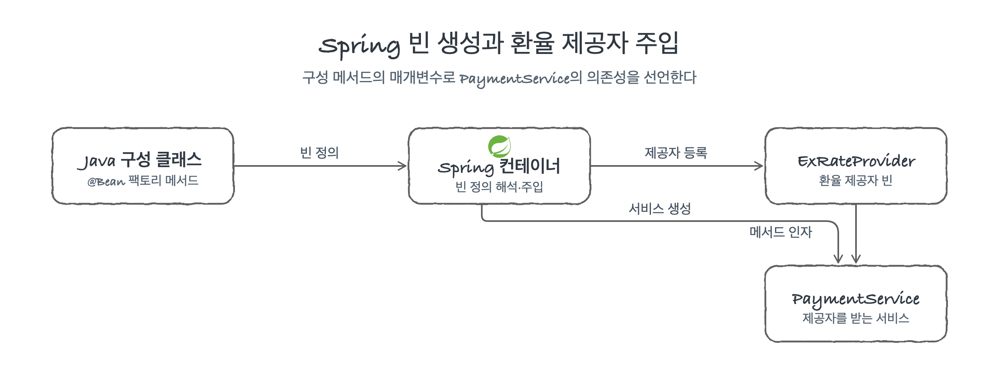

# Injecting Dependencies with the Spring Container

Spring 컨테이너는 빈 정의를 읽고 생성자나 팩토리 메서드로 의존관계를 연결한다. 예제로 Java 구성 클래스에서 환율 제공자와 PaymentService를 등록한다. [Spring 6.2 IoC](https://docs.spring.io/spring-framework/reference/6.2/core/beans/introduction.html) · [Spring 6.2 DI](https://docs.spring.io/spring-framework/reference/6.2/core/beans/dependencies/factory-collaborators.html) · [Spring 6.2 Java 구성](https://docs.spring.io/spring-framework/reference/6.2/core/beans/java/basic-concepts.html)

## 1. 구성 메서드에서 의존성을 선언한다

ExRateProvider를 먼저 빈으로 정의하고 paymentService(ExRateProvider rates)의 매개변수로 주입한다. 컨테이너를 닫아 자원을 해제하고, 서비스가 getBean을 직접 호출할 필요가 없도록 구성한다. [Spring 6.2 @Bean](https://docs.spring.io/spring-framework/reference/6.2/core/beans/java/bean-annotation.html) · [Spring 6.2 AnnotationConfigApplicationContext](https://docs.spring.io/spring-framework/reference/6.2/core/beans/java/instantiating-container.html) · [Spring 6.2 DI](https://docs.spring.io/spring-framework/reference/6.2/core/beans/dependencies/factory-collaborators.html)

그림의 근거 · [Spring 6.2 @Bean](https://docs.spring.io/spring-framework/reference/6.2/core/beans/java/bean-annotation.html) · [Spring 6.2 AnnotationConfigApplicationContext](https://docs.spring.io/spring-framework/reference/6.2/core/beans/java/instantiating-container.html) · [Spring 6.2 DI](https://docs.spring.io/spring-framework/reference/6.2/core/beans/dependencies/factory-collaborators.html)

## 2. 후보가 늘어날 때 선택 규칙을 드러낸다

같은 타입의 환율 제공자가 여러 개라면 의도한 제공자를 명시하는 구성을 추가한다. 컨테이너를 띄운 검사에서 주입 결과와 선택된 정책이 기대한 조합인지 확인한다. [Spring 6.2 DI](https://docs.spring.io/spring-framework/reference/6.2/core/beans/dependencies/factory-collaborators.html) · [Spring 6.2 AnnotationConfigApplicationContext](https://docs.spring.io/spring-framework/reference/6.2/core/beans/java/instantiating-container.html)
