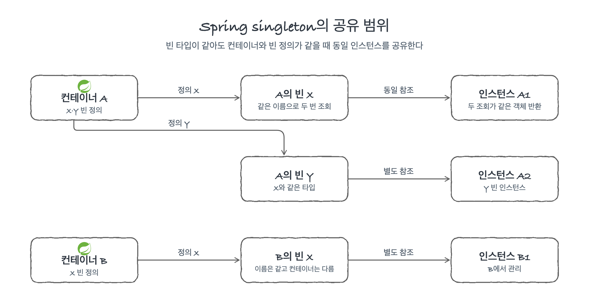

# Understanding the Spring Singleton Registry

Spring의 기본 singleton은 컨테이너와 빈 정의별 인스턴스 범위다. 동일한 타입도 빈 정의가 두 개라면 각각 별도 인스턴스를 가질 수 있다. [Spring 6.2 Bean Scopes](https://docs.spring.io/spring-framework/reference/6.2/core/beans/factory-scopes.html)

## 1. 빈 조회와 직접 생성을 구분한다

같은 컨텍스트에서 같은 이름의 singleton 빈을 두 번 조회해 동일 인스턴스를 확인한다. 일반 Java 객체를 직접 만드는 호출과 다른 컨텍스트에서 조회하는 호출에는 다른 수명 규칙이 적용될 수 있다. [Spring 6.2 Bean Scopes](https://docs.spring.io/spring-framework/reference/6.2/core/beans/factory-scopes.html) · [Spring 6.2 Java 구성](https://docs.spring.io/spring-framework/reference/6.2/core/beans/java/basic-concepts.html)

그림의 근거 · [Spring 6.2 Bean Scopes](https://docs.spring.io/spring-framework/reference/6.2/core/beans/factory-scopes.html)

## 2. 공유 객체에 요청 상태를 두지 않는다

싱글톤 서비스의 메서드를 여러 요청이 함께 실행할 수 있다. 현재 사용자나 계산 금액은 요청의 지역 변수나 매개변수로 두고 공유 필드의 변경을 줄인다. 싱글톤 범위와 스레드 안전성은 각각 검증한다. [Spring 6.2 Bean Scopes](https://docs.spring.io/spring-framework/reference/6.2/core/beans/factory-scopes.html) · [Spring 6.2 IoC](https://docs.spring.io/spring-framework/reference/6.2/core/beans/introduction.html)
