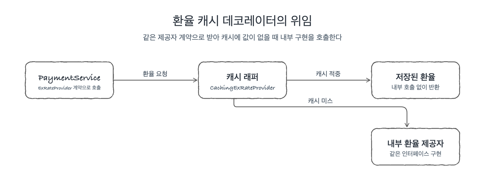

# Using Dependency Injection with Decorators

캐시나 관측을 추가하는 예로 Decorator를 적용한다. 같은 환율 제공자 계약을 구현한 객체가 내부 제공자를 감싸고, 필요한 때 위임한다. [Martin Fowler · Dependency Injection](https://martinfowler.com/articles/injection.html) · [Robert C. Martin · Open–Closed Principle](https://blog.cleancoder.com/uncle-bob/2014/05/12/TheOpenClosedPrinciple.html)

## 1. 구성 코드에서 래퍼를 조합한다

CachingExRateProvider가 내부 ExRateProvider를 받아 같은 계약을 제공하고, 값이 없으면 내부 제공자를 호출한다. 구성 코드에서 캐시·관측 래퍼의 순서를 명시한다. 순서에 따라 실제 외부 호출과 측정 구간이 바뀐다. [Martin Fowler · Dependency Injection](https://martinfowler.com/articles/injection.html) · [Robert C. Martin · Open–Closed Principle](https://blog.cleancoder.com/uncle-bob/2014/05/12/TheOpenClosedPrinciple.html)

그림의 근거 · [Martin Fowler · Dependency Injection](https://martinfowler.com/articles/injection.html) · [Robert C. Martin · Open–Closed Principle](https://blog.cleancoder.com/uncle-bob/2014/05/12/TheOpenClosedPrinciple.html)

## 2. 래퍼가 바꾸는 관찰 결과를 검사한다

캐시 적중·미스와 내부 구현이 예외를 던지는 경우를 검사한다. 호출자에게 반환하는 값과 오류 규약을 유지하고, 만료와 예외 캐싱 정책은 명시한다. [Liskov·Wing · Behavioral Subtyping](https://www.cs.cmu.edu/~wing/publications/LiskovWing94.pdf) · [Martin Fowler · Mocks Aren’t Stubs](https://martinfowler.com/articles/mocksArentStubs.html)
