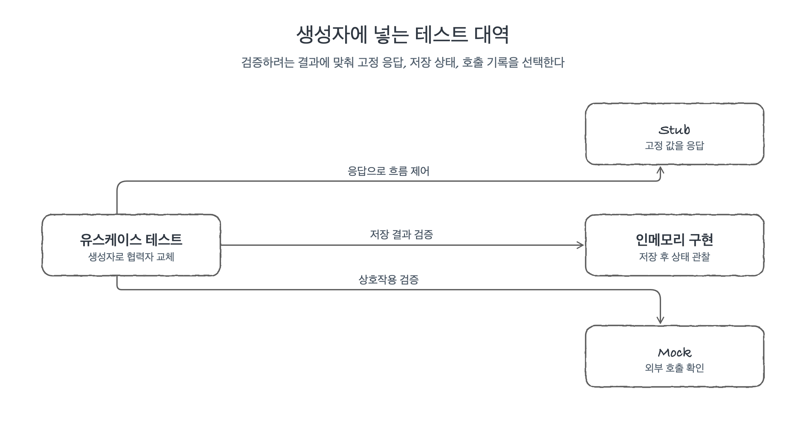

# Injecting Test Doubles without a Container

테스트가 생성자에 협력자를 직접 넣으면 실제 설정 없이 애플리케이션 규칙을 확인할 수 있다. 필요한 테스트 대역은 결과 검증에 따라 고른다. [Martin Fowler · Dependency Injection](https://martinfowler.com/articles/injection.html) · [Martin Fowler · Mocks Aren’t Stubs](https://martinfowler.com/articles/mocksArentStubs.html)

## 1. 대역을 역할에 맞게 사용한다

고정 응답으로 흐름을 통과시키는 대역은 stub으로 사용할 수 있다. 저장 상태가 필요한 경우에는 간단한 인메모리 구현을 쓰고, 외부로 어떤 호출을 내보냈는지가 계약이면 mock의 상호작용을 검증한다. [Martin Fowler · Mocks Aren’t Stubs](https://martinfowler.com/articles/mocksArentStubs.html)

그림의 근거 · [Martin Fowler · Mocks Aren’t Stubs](https://martinfowler.com/articles/mocksArentStubs.html)

## 2. 대역이 검증할 수 있는 범위를 정한다

인메모리 저장소로는 DB 잠금·유일 제약·커밋 시점 보장을 검증할 수 없다. 같은 유스케이스의 결과와 실제 인프라가 지키는 계약을 다른 테스트에서 다룬다. [Martin Fowler · Mocks Aren’t Stubs](https://martinfowler.com/articles/mocksArentStubs.html) · [Spring 6.2 Transactional Tests](https://docs.spring.io/spring-framework/reference/6.2/testing/testcontext-framework/tx.html)
